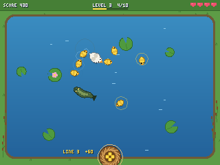
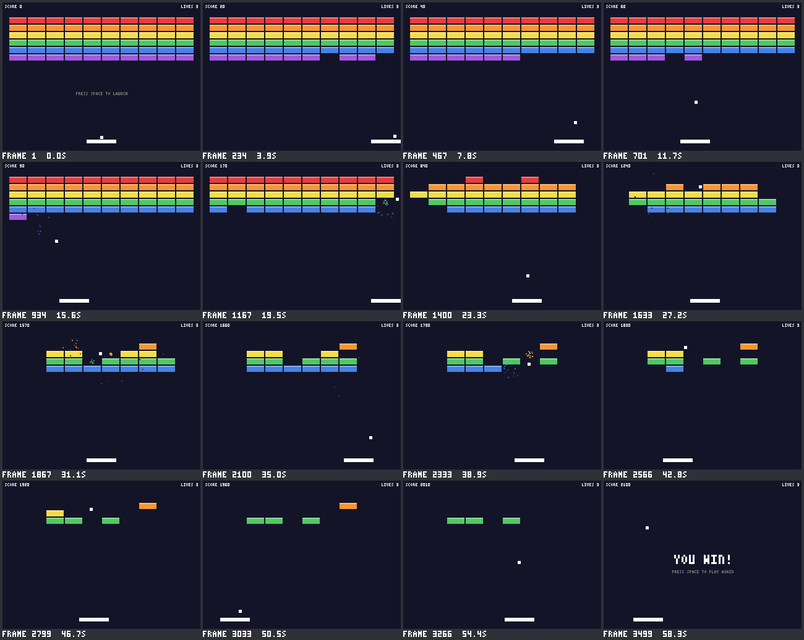

# duckforge: a game engine for learning Rust

A small game engine written in Rust, covering **2D graphics, 3D graphics
(on the graphics card, or on the CPU), sprites, a camera, sound and
physics**, plus a dozen example programs. It was written to be read:
about 13,000 lines of commented engine code, and over 250 tests.
[minifb](https://crates.io/crates/minifb) opens the window,
[wgpu](https://wgpu.rs) talks to the graphics card,
[png](https://crates.io/crates/png) reads and saves pictures and
[tinyaudio](https://crates.io/crates/tinyaudio) plays sound on Windows and
macOS; everything else is written from scratch: drawing, text, both 3D
renderers, the sound synthesizer, the physics solver, input, and random
numbers.

Games also run **without a screen**: on a cloud server, in a test, or for
an AI that writes games and needs to see what they draw.

**Quickest start: [docs/QUICKSTART.md](docs/QUICKSTART.md)**, one page:
build, a complete 40-line game, the loop of running and checking it
headless, and the five most common mistakes.

**Starting a new game? Copy [examples/template.rs](examples/template.rs)**:
a small, commented platformer with a sprite drawn in code, a camera that
follows the player, jump and coin sounds, a see-through pause screen and
play tests. Run it with `cargo run --example template`. For other kinds of
game, start from [examples/starter_topdown.rs](examples/starter_topdown.rs)
(walk a walled map, collect coins, escape chasing enemies; 4 or 8
directions) or [examples/starter_shooter.rs](examples/starter_shooter.rs)
(fast bullets, waves of enemies that dive and shoot, particle
explosions). Each has a tune file, a playthrough, rules and play tests,
and passes `tools/verify.sh`.

**New to Rust? Start with [TUTORIAL.md](TUTORIAL.md)**. It teaches the
language through this engine's code and explains how every part works.

**An AI assistant building games? Start with [docs/AI_GUIDE.md](docs/AI_GUIDE.md)**.
It covers building on a server with no screen, the loop of running a game
headless, looking at pictures of it, reading what it reports and testing
it, common mistakes, and how to judge whether a game feels good.
Agents that use skills can load
[skills/duckforge/SKILL.md](skills/duckforge/SKILL.md): the same workflow
in under 150 lines (build headless, copy a starter, the `verify` loop,
tuning, labels, checks and fuzzing, mistakes).

<p>




</p>

## Quick start

Install Rust from <https://rustup.rs> (1.87 or newer), then:

```sh
cargo run --example world3d    # 3D world with physics: fly around, throw balls
cargo run --release --example stress3d   # thousands of spinning 3D shapes
cargo run --example physics    # 2D physics sandbox: click to drop balls and boxes
cargo run --example breakout   # the classic game
cargo run --example dodge      # dodge the falling rocks: sprites, shake and sound
cargo run --release --example duckling_parade   # lead ducklings home past hungry pike
cargo run --release --example door_short        # a one-minute "choose your door" video
cargo run --release --example door_show_3d      # the same video on a 3D game-show stage
cargo run --example hello      # the smallest possible game
cargo run --example shapes     # every 2D drawing function, animated
cargo run --example template   # the starter game to copy
cargo test                     # run the tests (on Windows: double-click test.bat)
cargo doc --open               # browse the engine's documentation
```

On a machine with no screen (a cloud server, say), build without the window
and run any game with `--headless`. It runs as fast as it can and saves the
last frame as a PNG:

```sh
cargo run --no-default-features --example breakout -- --headless --frames 600 --out shots
```

| Example    | Controls |
|------------|----------|
| `world3d`  | W/A/S/D move · Q/E down/up · Shift faster · arrows or right-drag to look · Space or click throws a ball · B drops a crate · R resets |
| `physics`  | Left click drops a ball · right click drops a box · Space drops a shower · C clears |
| `breakout` | Left/Right or A/D move · Space launches · P pauses · R restarts |
| `dodge`    | Left/Right or A/D move · Space starts and restarts |
| `duckling_parade` | Arrows or WASD swim · Enter starts · P pauses · R restarts |
| `hello`    | Arrow keys or WASD move · click to teleport |
| `stress3d` | 1–6 pick 500 to 20,000 objects · O toggles orbit/fly |
| `template` | Arrows or A/D run · Up, W or Space jumps · P pauses |
| every game | **F1** debug overlay · **F3** shows the FPS · **F10** starts and stops recording · **F12** saves a screenshot (PNG) · Escape quits |

## Features

- **2D drawing:** rectangles, circles, lines, triangles, text in a built-in
  pixel font (every ASCII character, lowercase too, multi-line), see-through colors (`Color::rgba`, `with_alpha`), and `.png`
  or `.bmp` screenshots.
- **Sprites:** load a `.png`, or draw one with letters in your code
  (`Sprite::from_ascii`); cut frames from a sprite sheet, animate them, and
  draw them flipped, scaled (pixels stay sharp), tinted or see-through.
- **A 2D camera:** worlds bigger than the screen, zoom, smooth following,
  screen shake that replays exactly, and mouse-to-world conversion. Draw
  the world between `push_camera` and `pop_camera`, the score after.
- **Sound, with no files needed:** `ctx.beep(440.0, 100.0)`, ready-made
  `Sound::coin()`, `jump()`, `hit()` and `explosion()`, your own synth
  sounds (square, sine, triangle or noise, with a pitch slide), and `.wav`
  files. Headless runs mix every sound into `audio.wav` at its exact frame
  and list it in `log.json`, so tests can check sounds too.
- **3D rendering:** a camera with ready-made fly controls, meshes (cube,
  pyramid, sphere, checkerboard, or build your own), transforms, sunlight
  shading, a depth buffer, and near-plane clipping.
  - **On the graphics card** with wgpu (the default): meshes are cached on
    the GPU and every copy of a mesh is drawn with one draw call
    (instancing). Works with DirectX 12, Metal, Vulkan and OpenGL.
  - **On the CPU**, as an automatic fallback when there's no usable GPU,
    and as a version of the pipeline you can read line by line.
- **Collision helpers:** `circle_vs_rect`, `circle_vs_circle`, `Rect`'s
  `intersection`, `inset` and `expand`, and `swept_aabb` for fast bullets
  that would otherwise pass through thin walls. Plus `approach` and
  `remap`, and optional `init` and `resize` hooks on `Game`.
- **Physics in 2D *and* 3D, from the same code:** balls and boxes with
  gravity, bouncing, friction, mass and stacking, plus fixed walls and
  contact reports. (Boxes don't rotate.)
- **Input:** the whole keyboard, and the mouse (position in game pixels,
  buttons, movement and scroll wheel).
- **Repeatable:** a fixed timestep (60 updates per second, however fast
  the computer) and an optional random seed mean the same inputs always
  play out exactly the same way. A `Simulation` runs a game step by step
  without a window, for tests.
- **Headless:** every game understands `--headless`, `--frames`, `--out`
  and `--seed` on the command line.
- **Recording and replaying:** F10 records everything you do to a JSON
  input script, and `--inputs FILE` replays one exactly, in a window or
  without one.
- **Seeing a run:** numbered snapshots, a contact sheet of the whole run,
  an animated GIF, enlarged close-ups, and `ctx.report("score", 12)` so a
  game can describe itself in `log.json`.
- **Play tests:** `PlayTest` plays a game inside a normal `cargo test`,
  usually by replaying an input script, and checks what it reported (and
  which sounds played, and when). The engine builds without any window,
  graphics or sound libraries (`--no-default-features`), for servers.

## Writing a game

A game is any type that implements the `Game` trait:

```rust
use duckforge::prelude::*;

struct MyGame {
    x: f32,
}

impl Game for MyGame {
    fn update(&mut self, ctx: &mut Context) {
        self.x += 50.0 * ctx.dt(); // 50 pixels per second
        if ctx.input.was_pressed(Key::Escape) {
            ctx.quit();
        }
    }

    fn draw(&self, canvas: &mut Canvas) {
        canvas.clear(Color::BLACK);
        canvas.fill_rect(Rect::new(self.x, 100.0, 16.0, 16.0), Color::YELLOW);
        canvas.draw_text("HELLO!", vec2(8.0, 8.0), 2, Color::WHITE);
    }
}

fn main() -> Result<(), Box<dyn std::error::Error>> {
    duckforge::run(Config::default(), MyGame { x: 0.0 })
}
```

Save it as `examples/mygame.rs` and run `cargo run --example mygame`.

### In 3D

A spinning cube you can fly around (WASD and the arrow keys):

```rust
use duckforge::prelude::*;

struct Scene {
    camera: Camera3D,
    cube: Mesh,
    time: f32,
}

impl Game for Scene {
    fn update(&mut self, ctx: &mut Context) {
        self.camera.fly(ctx, 3.0);
        self.time += ctx.dt();
    }

    fn draw(&self, canvas: &mut Canvas) {
        canvas.clear(Color::BLACK);
        let spin = Transform::at(vec3(0.0, 0.0, 3.0)).rotated(vec3(self.time, self.time, 0.0));
        canvas.draw_mesh(&self.cube, &spin, &self.camera);
    }
}

fn main() -> Result<(), Box<dyn std::error::Error>> {
    let scene = Scene {
        camera: Camera3D::new(Vec3::ZERO),
        cube: Mesh::cube(Color::ORANGE),
        time: 0.0,
    };
    duckforge::run(Config::default(), scene)
}
```

### With physics

```rust
use duckforge::physics::{Body, PhysicsWorld};

// 2D, in pixels (y points down). For 3D, pass a Vec3 like vec3(0.0, -9.8, 0.0).
let mut world = PhysicsWorld::new(vec2(0.0, 500.0));
world.add(Body::block(vec2(160.0, 230.0), vec2(320.0, 20.0)).fixed()); // floor
let ball = world.add(Body::ball(vec2(160.0, 20.0), 8.0).with_bounce(0.6));

// In `update`:
world.step(ctx.dt());
// In `draw`: draw the ball at `world.get(ball).unwrap().position`.
```

**Units: 2D is in pixels, 3D is in metres.** In 2D, one unit is one
canvas pixel and y points down: a 16-pixel player, a speed of 200 px/s,
and gravity of about `vec2(0.0, 500.0)` to `vec2(0.0, 1000.0)` px/s²
feel right on a 320 x 240 canvas (real gravity at 32 pixels per metre
would be 9.8 x 32 = 314, which feels floaty in games). In 3D, one unit is
one metre and y points up: a person is about 1.8 tall, a crate 1.0, and
gravity is `vec3(0.0, -9.8, 0.0)`. The physics code itself doesn't care;
these are just the scales the examples, cameras and defaults are tuned for.

### Testing a game without a window

A `Simulation` runs a game with no window and no clock: you press the keys
and step it, one update (1/60 of a second) at a time. With the same seed
and the same inputs, it plays out exactly the same way every time.

```rust
#[test]
fn the_square_moves_and_escape_quits() {
    let mut sim = Simulation::new(Config::default(), MyGame { x: 0.0 });
    sim.run(60); // one second of game time
    assert!((sim.game().x - 50.0).abs() < 0.01);

    sim.press(Key::Escape);
    sim.step();
    assert!(sim.quit_requested());
    // The picture the game would show now: black, except the square.
    assert_eq!(sim.picture().get_pixel(0, 0), Some(Color::BLACK));
}
```

Two `Config` settings control repeatability: `timestep`
(`Timestep::Fixed { updates_per_second: 60 }` by default, or
`Timestep::RealTime` to use the clock) and `seed` (`None` by default,
which picks a new seed from the clock in a window). Run
`cargo test --example breakout` to see a test that plays Breakout twice
and checks both games end on the same picture, pixel for pixel. The
reasons behind these choices are in [docs/decisions.md](docs/decisions.md).

## Running without a screen

Every game understands these options, with no code of its own (everything
after `--` goes to the game, not to Cargo):

| Option | What it does |
|--------|--------------|
| `--headless` | Run with no window, as fast as possible, drawing with the CPU, and save the last frame as `last.png` |
| `--frames N` | Stop after N updates (default: a script's `"frames"`, or two seconds after its last event; else 600, which is 10 seconds of game time) |
| `--out DIR` | Where `--headless` saves its files (default `duckforge-out`) |
| `--seed N` | The random seed. Headless runs use seed 1 unless told otherwise, so they're repeatable |
| `--inputs FILE` | Replay an input script, in a window or with `--headless` |
| `--snapshot-every N` | Save frames N, 2N, 3N... as `frame-000060.png` and so on |
| `--sheet` | Save `sheet.png`: 16 frames (or the snapshots) in a grid, labelled with frame numbers |
| `--gif` | Save `run.gif`: the run, shrunk, at about 20 pictures per second |
| `--crop X,Y,W,H` | Save `closeup.png`: that area of the last frame (and of each snapshot), enlarged |
| `--zoom N` | How much close-ups are enlarged (default 4) |
| `--accept` | With `--headless --inputs FILE`: write this run's final reported values into FILE's `"expect"` block, the ending the playthrough should show |
| `--record FILE` | In a window, record everything you do to FILE (F10 records too) |
| `--debug` | Show the debug overlay (F1 in a window); with `--headless` it's in every saved picture |
| `--debug-corner C` | Where the overlay's box goes: `top-left`, `top-right`, `bottom-left` or `bottom-right` (the default) |
| `--grid N` | Draw a faint grid every N pixels, numbered along the edges, on `last.png`, snapshots and close-ups |
| `--grid-world N` | Like `--grid`, but every N world units through the game's camera, numbered in world coordinates |
| `--diff OLD NEW` | Compare two headless runs' folders: pictures (pixels changed, with highlighted copies in `NEW/diff/`), labels that moved, final reports. The game isn't run |
| `--fuzz N` | Play N headless runs (seeds 1 to N) with random but realistic key presses, and report crashes, failed `ctx.check` rules and freezes, with each failing run's inputs saved (and one per problem shrunk) as a replayable script |
| `--fuzz-keys K` | The keys `--fuzz` presses, like `Left,Right,Up,Space` (default: arrows, Space, Z, X) |
| `--freeze-seconds S` | How long nothing may change while keys are pressed before `--fuzz` calls it a freeze (default 10) |
| `--quiet` | After a headless run, print only problems (failed checks, warnings), or nothing; `summary.txt` still has everything |
| `--json` | After a headless run, print the summary as one line of JSON, for programs |
| `--describe` | After a headless run, describe the last frame in words: every `canvas.label`, and the text drawn |
| `--tune FILE` | Read `ctx.tune` values from FILE (default: `examples/<game>.tune.json`, if it exists) |
| `--set NAME=N` | Set one `ctx.tune` value, over the file (repeat it for more) |
| `--write-tune` | After the run, write every `ctx.tune` name the game used, with its value, to the tune file |
| `--help` | List the options |

```sh
cargo run --example world3d -- --headless --frames 120 --out shots
```

`cargo build --no-default-features` builds the engine without the window
(and without the GPU renderer and sound playback), so it needs no X11,
Wayland, graphics or sound libraries at all; then games can only run with
`--headless`. Sounds still work headless: they're saved in `audio.wav`. From code,
`duckforge::run_headless(config, game, &options)` does the same and hands
back the finished `Simulation`. A game with command-line options of its own
should read them from `duckforge::game_args()`, which leaves out the
engine's.

### Recording and replaying

Press **F10** in any game to start recording, and F10 again to save
`recording-1.json`. Then replay it, exactly, in a window or without one:

```sh
cargo run --example breakout -- --inputs recording-1.json
cargo run --example breakout -- --headless --inputs recording-1.json --out replay
```

The file is a short list of events like `{"frame": 127, "press": "Space"}`,
plus the seed the game ran with, so people and programs can also write
scripts by hand. [docs/input-format.md](docs/input-format.md) describes the
format. In code, `InputScript::load`, `Simulation::follow` and
`HeadlessOptions::inputs` do the same.

### Seeing what happened

A headless run always saves `last.png`, `log.json` and `summary.txt`,
and prints that summary: at most about 15 lines with the final reported
values, the lowest and highest of each number, when text values changed,
how many times each sound played, failed checks and warnings. `--quiet`
prints only the problems; `--json` prints the summary as JSON. Add
`--sheet` for the whole run on one page, and `--gif` to watch it:

```sh
cargo run --example breakout -- --headless --inputs playthroughs/breakout-win.json --sheet --gif --out win
```



Games can also describe themselves, which is much quicker to check than
pixels. Breakout reports its score, lives, bricks left and state:

```rust
ctx.report("score", self.score);   // numbers, true/false, or text
```

`log.json` then has the final values, and a line for every frame on which
one changed:

```json
"final": {"bricks_left": 0, "lives": 3, "score": 2100, "state": "Won"},
"changes": [
  {"frame": 1, "bricks_left": 60, "lives": 3, "score": 0, "state": "Serving"},
  {"frame": 30, "state": "Playing"},
  {"frame": 85, "bricks_left": 59, "score": 10},
  {"frame": 188, "bricks_left": 58, "score": 20},
  ...
```

`playthroughs/breakout-win.json` and `playthroughs/breakout-lose.json` are
example input scripts: a perfect game, and one that loses all three lives.
A small bot in Breakout's tests made them.

### Hearing what happened

If the game played sounds, a headless run also saves `audio.wav`, with
every sound mixed in at the exact frame it was played, and `log.json`
lists them:

```json
"sounds": [
  {"frame": 31, "sound": "coin", "wave": "square", "freq": 1050, "slide_to": 1600, "ms": 120, ...},
  {"frame": 95, "sound": "explosion", "wave": "noise", "freq": 1500, ...}
]
```

The same seed and inputs always give a byte-for-byte identical
`audio.wav`. With `--gif`, the engine prints an `ffmpeg` command that
joins `run.gif` and `audio.wav` into `run.mp4`, to watch with sound.

### Tuning without rebuilding

Numbers you'll want to adjust (speeds, gravity, timers) can be read by
name, with a default:

```rust
let jump_speed = ctx.tune("jump_speed", 330.0);
```

Then change them without recompiling: in `examples/<game>.tune.json`
(`{"jump_speed": 400}`), or for one run with `--set jump_speed=400`. In a
window the file is read again whenever you save it, so you can tweak a
running game. `--write-tune` creates the file with every name the game
asked for, and `log.json` records each value and where it came from.
`examples/template.rs` and `examples/template.tune.json` show it.

### Seeing without pictures: labels

In `draw`, name what you draw:

```rust
canvas.label("player", self.player);
for rock in &self.rocks {
    canvas.label("rock", *rock);
}
```

Labels draw nothing (the F1 overlay outlines them with their names).
Headless runs save a `last.scene.json` (and one per snapshot) with every
label's position in the world and on the screen, `--describe` prints the
last frame in words, and the summary warns about labels that are never on
screen, text that runs off the edge, and labels that overlap on the first
frame:

```text
frame 600, camera 160,120 zoom 1
rock x4 at 45,213 264,141 302,70 222,-1
duck at 154,216 12x12
text: "TIME 10.0" at 4,4; "LIVES 3" at 289,4
```

### Comparing two runs

After changing code, run the same command into a new folder and compare:

```sh
cargo run --no-default-features --example dodge -- --headless --inputs playthroughs/dodge.json --out out/before
# ... change the code ...
cargo run --no-default-features --example dodge -- --headless --inputs playthroughs/dodge.json --out out/after
cargo run --no-default-features --example dodge -- --diff out/before out/after
```

It lists how many pixels changed in each picture (and where), which
labelled things moved, and which reported values ended differently, and
saves copies of the changed pictures with the changed pixels in magenta.
"Did my fix change only what I meant to change?" in one command. Add
`--grid 32` to a run to put numbered gridlines on its pictures, so
positions can be read off them.

### Rules and fuzzing: finding bugs without watching

State the rules your game must never break, in `update`:

```rust
ctx.check("player inside the level", level.contains(player.center()));
```

A check that fails is recorded (the first frame, once per rule) without
stopping the game: the run summary and `log.json` list it, the debug
overlay shows it in red, and a `PlayTest` fails. Then let the engine play
the game a few hundred times with random keys:

```sh
cargo run --release --no-default-features --example template -- --fuzz 200
```

It reports every crash (with its message, line and frame), failed check
and freeze (nothing reported changes for 10 s while keys are pressed),
with the seed (call `ctx.idle_ok()` on title and pause screens, so
waiting there isn't called a freeze), and saves each failing run's inputs as a script, the
first of each kind shrunk to the fewest key presses that still cause it:
`--inputs fuzz/seed-14.json` replays it exactly. Runs go in parallel on
every core: 200 runs of 30 seconds of a small game take a few seconds.
It ends with coverage lines (each reported number's range across all
runs, the text values reached, the ones your playthroughs end on that
no random run reached, and how far runs got), so you can tell whether
"no problems found" means much.

### Checking everything in one command

```sh
tools/verify.sh dodge        # on Windows: tools\verify.bat dodge
```

builds the game headless, runs its play tests, replays every
`playthroughs/dodge.json` and `playthroughs/dodge-*.json` with a contact
sheet and the debug overlay, fuzzes 50 runs (`tools/verify.sh dodge 200`
for more), and prints one line per step, ending in `VERIFY OK` or
`VERIFY FAILED` (exit code 1). Each failed step shows its first lines of
detail; everything is saved in `out/verify/dodge/`.

### The debug overlay

Press **F1** in any game (or pass `--debug`, which also works headless)
to see outlines of anything the game marks in `update`, and a small
see-through box with two short lines: the frame number and FPS, and the
camera's position and zoom with the mouse's position in the world. The
box sits in the bottom-right corner, where games rarely put their score;
`Config { debug_corner: Corner::TopRight, .. }` or
`--debug-corner top-right` moves it.

```rust
ctx.debug_rect(self.player_hitbox());     // a magenta outline
ctx.debug_circle(self.enemy, ATTACK_RANGE); // a cyan circle
```

It's drawn in screen pixels on top of everything, and in world
coordinates through the game's camera, so the outlines sit right on the
things they mark.

### When something goes wrong

Loading a missing or broken file gives one sentence saying what's wrong
and where the engine looked, not a wall of debug output:

```text
Error: couldn't find the image file assets/duk.png (looked for /home/me/game/assets/duk.png);
paths are relative to the folder you run cargo from, so check the spelling and that the file is there
```

Mistakes in code, like a row of ASCII art that's too short, stop the game
with a message naming the row and pointing at your line.

### Play tests

`PlayTest` plays a game inside a normal `cargo test` and checks what it
reported:

```rust
#[test]
fn the_winning_playthrough_clears_every_brick() {
    let played = PlayTest::new(config(), Breakout::new())
        .inputs("playthroughs/breakout-win.json")
        .run();
    assert_eq!(played.text("state"), "Won");
    assert!(played.number("score") >= 10.0);
    assert_eq!(played.number("lives"), 3.0);
}
```

`.script(json)` takes a script written in the test instead of a file,
`.frames(n)` and `.seed(n)` change how it runs, and `.save_to(folder)`
also saves pictures to look at when a test fails. `played` is the
finished `Simulation`, so `played.game()`, `played.reported_at(frame,
name)` and `played.picture()` work too. If the game never reported a
name, the failure message lists what it did report. Breakout and the
physics sandbox have play tests at the bottom of their files: run them
with `cargo test --example breakout` and `cargo test --example physics`.

## Choosing a renderer, and benchmarking

By default 3D uses the graphics card when there's a usable one, and the CPU
otherwise. To choose, set `Config::renderer` to `Renderer::Auto`, `Gpu` or
`Cpu`. You can also override it for any game without changing code, with the
`DUCKFORGE_RENDERER` environment variable (`cpu`, `gpu` or `auto`):

```powershell
# Windows PowerShell
$env:DUCKFORGE_RENDERER = "cpu"; cargo run --release --example world3d
Remove-Item Env:DUCKFORGE_RENDERER   # back to the default
```

```sh
# macOS / Linux
DUCKFORGE_RENDERER=cpu cargo run --release --example world3d
```

To build without wgpu (faster to compile, CPU only), use
`cargo build --no-default-features --features window,audio`.

The three features, all on by default: `window` (play in a window, with
minifb), `gpu` (draw 3D on the graphics card, with wgpu) and `audio` (play
sounds out loud: tinyaudio on Windows and macOS; on Linux the engine loads
the system's ALSA library when the game starts, so no extra packages are
needed to build, and a computer with no sound card just plays silently).

### Benchmark: CPU vs GPU on your computer

`stress3d` has a benchmark mode. It runs for a fixed time with no
frame-rate cap, ignores the first two seconds, prints the average FPS and
which renderer it used, then quits. Keep its window visible while it runs.
These commands work the same way in PowerShell, cmd and any other shell:

```sh
cargo run --release --example stress3d -- --objects 5000 --seconds 10 --renderer cpu
cargo run --release --example stress3d -- --objects 5000 --seconds 10 --renderer gpu
```

Everything after the `--` goes to the program: `--objects N`,
`--seconds S`, and `--renderer gpu|cpu|auto`. To run the whole comparison
in PowerShell:

```powershell
foreach ($n in 500, 2000, 5000, 10000, 20000) {
    foreach ($r in "cpu", "gpu") {
        cargo run --release --quiet --example stress3d -- --objects $n --seconds 10 --renderer $r
    }
}
```

Each run prints a line like this (the GPU name is whatever your computer has):

```text
stress3d: 5000 objects, 222078 triangles, CPU: 39.8 FPS average (25.15 ms per frame, 319 frames in 8.0 s)
```

For reference, here are the numbers from the 4-core cloud machine this was
developed on. That machine has **no graphics card**: its "GPU" is llvmpipe,
a software imitation that runs on the same CPU cores, so the GPU column is
*not* what a real graphics card does. Expect your GPU numbers to be much
higher.

| Objects | Triangles | CPU renderer | wgpu on llvmpipe (no real GPU) |
|---:|---:|---:|---:|
| 500 | 21,846 | 177 FPS | 104 FPS |
| 2,000 | 89,412 | 79 FPS | 47 FPS |
| 5,000 | 222,078 | 40 FPS | 21 FPS |
| 10,000 | 445,164 | 22 FPS | 13 to 17 FPS |
| 20,000 | 910,914 | 12 FPS | 8 FPS |

## What's inside

| File              | What it does                                                        |
|-------------------|---------------------------------------------------------------------|
| `src/engine.rs`   | The `Game` trait, `Config`, `Context`, `Timestep`, and `run` (window or headless) |
| `src/simulation.rs` | `Simulation`: runs a game one update at a time, with no window or clock |
| `src/window.rs`   | The window and the real-time game loop (only built with the `window` feature) |
| `src/headless.rs` | `run_headless`: runs a game without a window and saves PNG pictures |
| `src/cli.rs`      | The command-line options every game understands                    |
| `src/script.rs`   | `InputScript`: recording and replaying inputs as JSON              |
| `src/report.rs`   | `ctx.report`: values a game shares about itself                    |
| `src/pictures.rs` | Contact sheets, GIFs and close-ups                                 |
| `src/playtest.rs` | `PlayTest`: play a game inside `cargo test` and check its reports  |
| `docs/`           | `AI_GUIDE.md` (for AI assistants), `decisions.md` (why things are the way they are), `input-format.md` |
| `playthroughs/`   | Example input scripts for Breakout (win, lose), Dodge and the physics sandbox |
| `src/canvas.rs`   | Software renderer: pixels, 2D shapes, text, sprites, the camera's view stack, triangles, depth buffer, screenshots |
| `src/sprite.rs`   | `Sprite` (from PNG, ASCII art or pixels), `Blit` options, `Animation` |
| `src/camera.rs`   | `Camera2D`: position, zoom, smooth follow, screen shake            |
| `src/sound.rs`    | The synthesizer (`Sound`, `Wave`), `.wav` files, mixing `audio.wav` |
| `src/speaker.rs`  | Playing sounds out loud in a window (only with the `audio` feature) |
| `src/debug.rs`    | The debug overlay (F1, `--debug`)                                   |
| `src/error.rs`    | `LoadError`: a missing or broken file, in one sentence              |
| `src/render3d.rs` | 3D: `Camera3D`, `Mesh`, `Transform`, `Renderer`, and the CPU renderer |
| `src/gpu.rs`      | The GPU renderer: wgpu setup, mesh cache, instancing, reading the picture back |
| `src/gpu.wgsl`    | The shaders: the small programs that run on the graphics card       |
| `src/physics.rs`  | `PhysicsWorld` and `Body`: collisions and an impulse solver, for `Vec2` or `Vec3` |
| `src/input.rs`    | Keyboard and mouse: held, just pressed, just released               |
| `src/math.rs`     | `Vec2`, `Rect`, `Vec3`, `Mat4`, the `Vector` trait that makes physics generic, and the collision helpers |
| `src/font.rs`     | A built-in 3-pixel-wide font: every printable ASCII character        |
| `src/color.rs`    | Colors with alpha, and see-through blending                         |
| `src/rng.rs`      | A tiny xorshift random number generator                             |
| `examples/`       | `hello`, `shapes`, `template`, `starter_topdown`, `starter_shooter`, `pollen_run`, `breakout`, `dodge`, `duckling_parade`, `door_short`, `door_show_3d`, `physics`, `world3d` and `stress3d` |
| `test.bat`        | Runs every test on Windows with a double-click                       |

Only `src/window.rs` knows minifb exists, so the window library could be
swapped out by rewriting one file.
