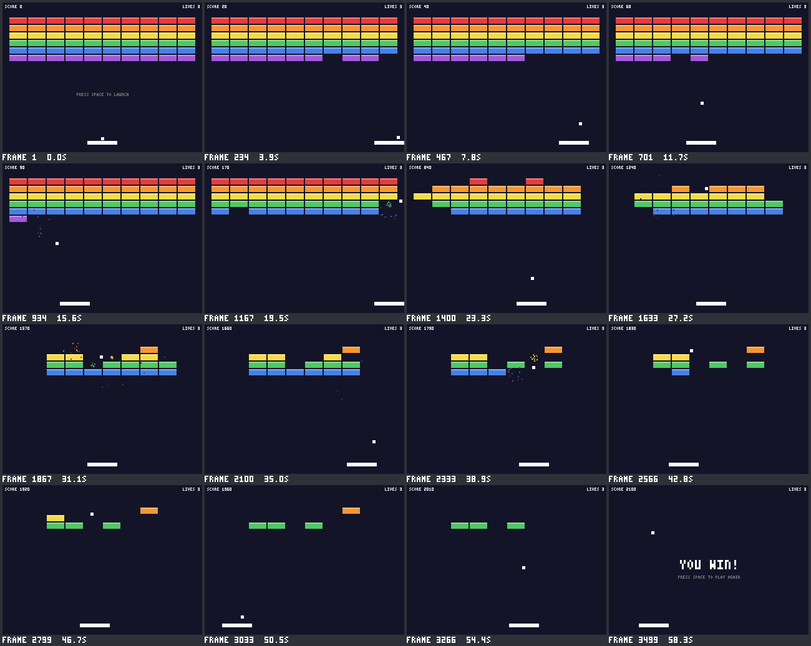

# Learn Rust by Building a Game Engine

This guide teaches you Rust using the code in this repository: a small
game engine called **duckforge**, which does 2D, 3D (on the CPU or the
graphics card), sprites, a camera, sound and physics, and a dozen example
programs built on it. Every Rust concept is shown in real code that you
can run, change and break.

- **Part 1** teaches the Rust language, one idea at a time.
- **Part 2** explains how the engine works and why it's built that way.
- **Part 3** shows how a game can run, replay and test itself without a
  screen.
- **Part 4** adds what most 2D games want: see-through colors, sprites,
  a camera, sound, text and collision helpers, each with a tiny game.
- **Part 5** has exercises, from "change a number" to "write a new game".

In a hurry to make something? [docs/QUICKSTART.md](docs/QUICKSTART.md)
is one page with a complete small game. Come back here to understand it.

Keep the source files open next to this guide. When you see a file like
`src/canvas.rs`, open it and look at the real code.

---

## Contents

- [0. Setup](#0-setup)
- **Part 1: Learning Rust**
  - [1. Cargo: Rust's build tool](#1-cargo-rusts-build-tool)
  - [2. Variables, mutability and types](#2-variables-mutability-and-types)
  - [3. Functions and expressions](#3-functions-and-expressions)
  - [4. Structs and methods](#4-structs-and-methods)
  - [5. Enums and pattern matching](#5-enums-and-pattern-matching)
  - [6. Ownership and borrowing](#6-ownership-and-borrowing)
  - [7. Collections, loops, closures and iterators](#7-collections-loops-closures-and-iterators)
  - [8. Traits](#8-traits)
  - [9. Modules and visibility](#9-modules-and-visibility)
  - [10. Error handling](#10-error-handling)
  - [11. Tests](#11-tests)
- **Part 2: How the engine works**
  - [12. The big picture](#12-the-big-picture)
  - [13. The game loop](#13-the-game-loop)
  - [14. Pixels and the framebuffer](#14-pixels-and-the-framebuffer)
  - [15. Drawing shapes and text](#15-drawing-shapes-and-text)
  - [16. Keyboard and mouse](#16-keyboard-and-mouse)
  - [17. Random numbers](#17-random-numbers)
  - [18. Breakout, piece by piece](#18-breakout-piece-by-piece)
  - [19. Physics](#19-physics)
  - [20. 3D graphics](#20-3d-graphics)
  - [21. Moving 3D to the GPU](#21-moving-3d-to-the-gpu)
- **Part 3: Games without a screen**
  - [22. Same inputs, same game](#22-same-inputs-same-game)
  - [23. Running without a screen](#23-running-without-a-screen)
  - [24. Recording and replaying](#24-recording-and-replaying)
  - [25. Seeing a whole game](#25-seeing-a-whole-game)
  - [26. Play tests](#26-play-tests)
  - [27. Building a game without ever seeing it](#27-building-a-game-without-ever-seeing-it)
- **Part 4: More to play with**
  - [28. See-through colors](#28-see-through-colors)
  - [29. Sprites](#29-sprites)
  - [30. A 2D camera](#30-a-2d-camera)
  - [31. Sound](#31-sound)
  - [32. Text](#32-text)
  - [33. Collisions and small helpers](#33-collisions-and-small-helpers)
  - [34. Starting your own game](#34-starting-your-own-game)
- **Part 5: Your turn**
  - [35. Exercises](#35-exercises)
  - [36. Common compiler errors](#36-common-compiler-errors)
  - [37. What a code review found](#37-what-a-code-review-found)
  - [38. Where to go next](#38-where-to-go-next)

---

## 0. Setup

**Install Rust** from <https://rustup.rs>. It installs three tools:

| Tool     | What it does                                         |
|----------|------------------------------------------------------|
| `rustc`  | The compiler. You'll rarely call it directly.        |
| `cargo`  | The build tool and package manager. You'll use this all the time. |
| `rustup` | Installs and updates Rust itself (`rustup update`).  |

On Windows the installer will ask you to install the Visual Studio C++ Build
Tools. Say yes: Rust needs their linker. This project needs Rust 1.87 or
newer; `rustc --version` tells you what you have.

**Run the games** from the project folder:

```sh
cargo run --example hello      # a square you move with the keys or the mouse
cargo run --example shapes     # every 2D drawing function, animated
cargo run --example template   # a small platformer to copy for your own game
cargo run --example breakout   # the full Breakout game
cargo run --example dodge      # dodge the falling rocks: sprites, sound, screen shake
cargo run --example physics    # a 2D physics sandbox: click to drop things
cargo run --example world3d    # a 3D world with physics: fly around, throw balls
cargo run --release --example stress3d   # thousands of 3D shapes: how fast is it?
```

The first build takes a few minutes because Cargo downloads and compiles
minifb, wgpu (the graphics card library), tinyaudio (sound, on Windows)
and the crates they depend on.
After that, builds are fast. Adding
`--release` gives fully optimized builds, but the project is set up so
normal builds run smoothly too.

Four keys work in every game: **F1** shows the debug overlay, **F3**
shows the frame rate (frames per second, or FPS), **F10** starts and
stops recording what you do, and **F12** saves a screenshot.

**Cargo commands you'll use:**

| Command            | What it does                                              |
|--------------------|-----------------------------------------------------------|
| `cargo check`      | Checks your code for errors without building. The fastest feedback. |
| `cargo build`      | Compiles everything.                                      |
| `cargo run --example NAME` | Builds and runs `examples/NAME.rs`.               |
| `cargo test`       | Runs all the tests. On Windows you can also double-click `test.bat`. |
| `cargo clippy`     | A linter with hundreds of helpful suggestions.            |
| `cargo fmt`        | Formats your code in the standard style.                  |
| `cargo doc --open` | Builds documentation for the engine and opens it in your browser. |

**The project layout:**

```text
Cargo.toml          project name, Rust edition, dependencies, build settings
src/
  lib.rs            the front door: lists the modules, defines the prelude
  engine.rs         the Game trait, Config, Context, and run()
  simulation.rs     runs a game one update at a time, with no window or clock
  window.rs         the window and the real-time game loop (the only file that uses minifb)
  headless.rs       running a game without a window, saving pictures
  cli.rs            the command-line options every game understands
  script.rs         input scripts: recording and replaying what a player does
  report.rs         values a game reports about itself (ctx.report)
  pictures.rs       contact sheets, GIFs, close-ups
  playtest.rs       PlayTest: play a game inside `cargo test` and check its reports
  canvas.rs         the pixel buffer: 2D drawing, triangles, the depth buffer
  sprite.rs         sprites (pictures made of pixels) and animations
  camera.rs         the 2D camera: following, zoom and screen shake
  sound.rs          the sound synthesizer, .wav files, and audio.wav for headless runs
  speaker.rs        playing sounds out loud in a window
  debug.rs          the debug overlay (F1)
  error.rs          LoadError: a missing or broken file, in one sentence
  font.rs           a tiny pixel font: every ASCII character, 3 pixels wide
  input.rs          keyboard and mouse
  math.rs           Vec2, Rect, Vec3 and the Vector trait
  color.rs          Color
  rng.rs            random numbers
  physics.rs        physics for 2D and 3D: gravity, bouncing, friction, stacking
  render3d.rs       3D: cameras, meshes, transforms, lighting, and the CPU renderer
  gpu.rs            the GPU renderer, using wgpu
  gpu.wgsl          the small programs (shaders) that run on the graphics card
examples/
  hello.rs          the smallest game
  shapes.rs         a tour of the 2D drawing functions
  template.rs       a small platformer to copy when you start a game
  breakout.rs       a complete 2D game
  dodge.rs          a small game built without a screen (see docs/AI_GUIDE.md)
  duckling_parade.rs  a bigger game, also built without a screen
  door_short.rs     a one-minute video drawn with the engine
  door_show_3d.rs   the same video on a 3D stage
  physics.rs        a 2D physics sandbox
  world3d.rs        a 3D playground with physics
  stress3d.rs       a 3D stress test and benchmark
```

---

# Part 1: Learning Rust

## 1. Cargo: Rust's build tool

Open `Cargo.toml`:

```toml
[package]
name = "duckforge"
version = "0.1.0"
edition = "2024"
rust-version = "1.87"
description = "A small game engine (2D, 3D and physics), written for learning Rust"

[features]
default = ["window", "gpu", "audio"]
window = ["dep:minifb"]
gpu = ["dep:wgpu", "dep:pollster", "dep:bytemuck"]
audio = ["dep:tinyaudio", "dep:libc"]

[dependencies]
minifb = { version = "0.28", optional = true }
gif = "0.14"
png = "0.18"
serde_json = "1"
wgpu = { version = "30", optional = true }
pollster = { version = "1", optional = true }
bytemuck = { version = "1", features = ["derive"], optional = true }

[target.'cfg(not(target_os = "linux"))'.dependencies]
tinyaudio = { version = "2", optional = true }

[target.'cfg(target_os = "linux")'.dependencies]
libc = { version = "0.2", optional = true }

[profile.dev]
opt-level = 1
```

- A Rust project is called a **crate**. This one is a *library crate*
  because it has a `src/lib.rs`. (A program with a `main` function has a
  `src/main.rs` and is a *binary crate*.)
- `edition = "2024"` picks the version of the language rules. Editions let
  Rust improve without breaking old code. `rust-version` is the oldest
  compiler that can build the project.
- `[dependencies]` lists other crates to download from
  [crates.io](https://crates.io). **minifb** opens a window, shows pixels
  and reports key presses. **png** reads and saves pictures as PNG files
  ([chapter 23](#23-running-without-a-screen)), **gif** saves animated
  GIFs and **serde_json** reads and writes JSON files (chapters 24 and 25).
  Three are only for the GPU renderer
  ([chapter 21](#21-moving-3d-to-the-gpu)): **wgpu** talks to the graphics
  card, **pollster** waits for its `async` setup, and **bytemuck** turns
  data into raw bytes for it. Everything else we write ourselves, because
  that's the point of the exercise.
- `[features]` are optional parts of a crate. `gpu` switches on the three
  `optional = true` dependencies (`dep:wgpu` means "the wgpu dependency"),
  `window` switches on minifb, and `audio` plays sounds out loud
  ([chapter 31](#31-sound)): with tinyaudio on Windows and macOS, and with
  libc on Linux, where the engine loads the system's sound library when a
  game starts. The `[target...]` sections list dependencies only for some
  operating systems. `default = ["window", "gpu", "audio"]` turns all
  three on unless you say otherwise. `cargo build --no-default-features`
  builds an engine with no window, GPU or sound-playback code, for
  machines without a screen ([chapter 23](#23-running-without-a-screen)).
- `[profile.dev]` changes how normal (debug) builds are compiled.
  `opt-level = 1` turns on light optimization, because code that touches
  every pixel is very slow without any.

Files in `examples/` are small programs that use the library. Each one
starts with:

```rust
use duckforge::prelude::*;
```

That line brings the engine's most-used names (`Game`, `Canvas`, `Color`,
`Vec2`, ...) into scope. We'll see how in [chapter 9](#9-modules-and-visibility).

## 2. Variables, mutability and types

### `let` and `mut`

Variables are created with `let`, and **they can't be changed unless you
say `mut`**:

```rust
let lives = 3;
lives = 2; // error!
```

The compiler refuses:

```text
error[E0384]: cannot assign twice to immutable variable `lives`
help: consider making this binding mutable
```

With `mut` it's fine:

```rust
let mut lives = 3;
lives = 2; // ok
```

This might feel strict, but it means that when you read `let x = ...` you
*know* `x` never changes, which makes code much easier to follow.

### Shadowing

You can declare a new variable with the same name as an old one. The new
one "shadows" the old. `update_ball` in `examples/breakout.rs` does this:

```rust
let step = self.ball_velocity.x * dt;
// ... use step for the x axis ...
let step = self.ball_velocity.y * dt; // a brand new `step`
// ... use step for the y axis ...
```

### Types

Every value has a type. Rust usually works it out for you (`let x = 3;` is
an `i32`), but you can write it out: `let x: f32 = 3.0;`.

The number types in the engine, and why each was chosen:

| Type    | What it holds                   | Where the engine uses it                          |
|---------|---------------------------------|---------------------------------------------------|
| `f32`   | 32-bit decimal number           | Positions, speeds, time: they need fractions      |
| `i32`   | 32-bit signed integer           | Pixel coordinates: can be negative (off-screen)   |
| `u32`   | 32-bit unsigned (never negative)| Score, lives, one packed pixel color              |
| `u8`    | 0 to 255                        | One color channel (red, green or blue)            |
| `usize` | Unsigned, the size of a memory address | Lengths and indexes: `vec[i]` needs a `usize` |
| `u64`   | 64-bit unsigned                 | The frame counter                                 |

Plus `bool` (`true`/`false`), `char` (one Unicode character) and `&str`
(text, see [chapter 6](#strings-string-vs-str)).

### Converting with `as`

Rust **never converts number types for you**. This doesn't compile:

```rust
let width: usize = 320;
let half: f32 = width / 2;
```

```text
error[E0308]: mismatched types
   |     let half: f32 = width / 2;
   |               ---   ^^^^^^^^^ expected `f32`, found `usize`
help: you can cast a `usize` to an `f32`
   |     let half: f32 = (width / 2) as f32;
```

You'll see `as` all over the engine, like in `Canvas::index`:

```rust
if x < 0 || y < 0 || x >= self.width as i32 || y >= self.height as i32 {
```

It's a little noisy, but it forces you to think about every conversion,
and conversions are where many bugs come from. (What does `-1` mean as a
`usize`? Rust makes you decide.)

### Constants

`const` values are fixed forever and must have a written type. By
convention they're in `SCREAMING_SNAKE_CASE`. The top of
`examples/breakout.rs` is full of them:

```rust
const PADDLE_WIDTH: f32 = 48.0;
const PADDLE_SPEED: f32 = 240.0;
const BALL_START_SPEED: f32 = 150.0;
```

Collecting the "tuning knobs" at the top of a file like this makes a game
easy to tweak. Try changing them!

## 3. Functions and expressions

A function lists its parameter types and, after `->`, its return type:

```rust
/// Shorthand for [`Vec2::new`]: `vec2(1.0, 2.0)`.
pub const fn vec2(x: f32, y: f32) -> Vec2 {
    Vec2 { x, y }
}
```

Two things to notice:

1. **There's no `return`.** In Rust, a block's value is its last
   *expression*, a line **without a semicolon**. `Vec2 { x, y }` is the
   last expression, so it's the return value. Adding a `;` would turn it
   into a statement that returns nothing, and the compiler would complain.
2. **`Vec2 { x, y }`** is shorthand for `Vec2 { x: x, y: y }`, used when
   the variables have the same names as the fields.

Comments starting with `///` are **doc comments**. They show up in
`cargo doc` and when you hover in your editor.

### `if` is an expression too

Since `if` produces a value, there's no need for a `? :` operator. From
`Canvas::draw_line`:

```rust
let step_x = if x < x_end { 1 } else { -1 };
```

And from `Vec2::normalized`:

```rust
pub fn normalized(self) -> Self {
    let len = self.length();
    if len == 0.0 {
        Self::ZERO
    } else {
        self * (1.0 / len)
    }
}
```

The whole `if`/`else` is the last expression, so its value is returned.

You can still leave a function early with `return`, as in `Canvas::index`:

```rust
fn index(&self, x: i32, y: i32) -> Option<usize> {
    if x < 0 || y < 0 || x >= self.width as i32 || y >= self.height as i32 {
        return None;
    }
    Some(y as usize * self.width + x as usize)
}
```

## 4. Structs and methods

A **struct** groups related data. Here's `Vec2` from `src/math.rs`:

```rust
#[derive(Debug, Clone, Copy, PartialEq, Default)]
pub struct Vec2 {
    pub x: f32,
    pub y: f32,
}
```

(The `#[derive(...)]` line is explained in [chapter 8](#derive-free-trait-implementations).)

A game's whole state is usually one struct. Here's Breakout's:

```rust
struct Breakout {
    state: State,
    paddle: Rect,
    ball: Rect,
    ball_velocity: Vec2,
    ball_speed: f32,
    bricks: Vec<Brick>,
    particles: Vec<Particle>,
    score: u32,
    lives: u32,
}
```

### Methods live in `impl` blocks

```rust
impl Vec2 {
    pub const ZERO: Vec2 = vec2(0.0, 0.0);

    pub const fn new(x: f32, y: f32) -> Self {
        Self { x, y }
    }

    pub fn length(self) -> f32 {
        (self.x * self.x + self.y * self.y).sqrt()
    }
}
```

- `Self` means "the type this `impl` is for", here `Vec2`.
- `new` has no `self` parameter, so it's an **associated function**, called
  with `::` like `Vec2::new(1.0, 2.0)`. Rust has no constructors; a function
  called `new` is just a convention.
- `length` takes `self`, so it's a **method**, called with a dot:
  `velocity.length()`.

### `self`, `&self` and `&mut self`

The first parameter of a method says how it uses the value. This is one of
the most important things to understand in Rust:

| Parameter   | Meaning                                          | Example                            |
|-------------|--------------------------------------------------|------------------------------------|
| `&self`     | Borrows the value to **read** it                 | `Rect::overlaps(&self, other: &Rect)` |
| `&mut self` | Borrows the value to **change** it               | `Canvas::clear(&mut self, color: Color)` |
| `self`      | Takes the value itself (ownership moves in)      | `Vec2::length(self)`               |

`Vec2::length` can take `self` cheaply because `Vec2` is `Copy` (it's just
two numbers), so calling it copies the vector. [Chapter 6](#6-ownership-and-borrowing)
explains what all of this really means.

### Private fields and getters

`Vec2`'s fields are `pub`, so anyone can read or write `v.x`. `Canvas`'s
fields are *not* `pub`:

```rust
pub struct Canvas {
    width: usize,
    height: usize,
    pixels: Vec<u32>,
}
```

(The real `Canvas` has a few more private fields, for 3D, the GPU and
the camera, but the idea is the same.) Outside `canvas.rs` you can only
read the size through `canvas.width()`.
Why? If a game could set `canvas.width = 1000` without resizing `pixels`,
every drawing function would index out of bounds. Keeping the fields
private makes that mistake impossible.

### Struct update syntax and destructuring

Every example creates its `Config` like this:

```rust
let config = Config {
    title: String::from("Hello, duckforge"),
    ..Config::default()
};
```

`..Config::default()` means "take every field I didn't list from
`Config::default()`".

You can also pull a struct apart into variables. From `Canvas::draw_rect`:

```rust
let Rect { x, y, w, h } = rect;
```

### Builder methods: chaining settings

The physics engine creates bodies like this:

```rust
let ball = Body::ball(vec2(160.0, 20.0), 8.0).with_bounce(0.6).with_friction(0.1);
let wall = Body::block(vec2(0.0, 100.0), vec2(10.0, 200.0)).fixed();
```

Each `with_...` method takes the body **by value** (`mut self`), changes
it, and hands it back:

```rust
pub fn with_bounce(mut self, bounce: f32) -> Self {
    self.bounce = bounce;
    self
}
```

That's what lets the calls chain one after another. This is called the
*builder pattern*: you mention only the settings you care about, and
everything else keeps a sensible default.

### Newtypes

`PhysicsWorld::add` gives you back a `BodyId`, which is just two numbers in
disguise:

```rust
pub struct BodyId {
    slot: usize,
    generation: u32,
}
```

Why not just return a `usize`? Because then you could accidentally pass a
score or an array index where a body id belongs. As its own type, that
mix-up won't compile. Wrapping a plain value in a type of its own like this
is called a **newtype**. And because the fields aren't `pub`, games can't
make up fake ids either.

The two numbers are the body's *slot* in the world's list of bodies, and a
*generation*. When a body is removed, its slot is reused for the next body
added, and the slot's generation goes up by one. So an old id still points
at the right slot, but its generation doesn't match any more, and looking
it up finds nothing instead of the wrong body. This trick is called a
*generational index*, and most game engines use it to name their objects.
(Chapter 37 tells the story of the bug that led to it.)

## 5. Enums and pattern matching

An **enum** is a type whose value is exactly *one* of several variants.
Breakout's game state:

```rust
enum State {
    Serving,
    Playing,
    Paused,
    GameOver,
    Won,
}
```

The game can never be "sort of paused and sort of game over". With separate
`bool` flags like `is_paused` and `is_game_over` that bug would be possible.
With an enum it can't happen.

### `match`

`match` runs the arm that fits the value. Breakout's `update` is built
around one:

```rust
match self.state {
    State::Serving => {
        self.move_paddle(ctx);
        self.put_ball_on_paddle();
        if ctx.input.was_pressed(Key::Space) {
            self.launch_ball(&mut ctx.rng);
        }
    }
    State::Playing => { /* ... */ }
    State::Paused => { /* ... */ }
    State::GameOver | State::Won => { /* ... */ } // `|` matches either
}
```

**`match` must cover every variant.** If you add a new state and forget to
handle it, the program won't compile:

```text
error[E0004]: non-exhaustive patterns: `State::Paused` not covered
```

This is great when a program grows: add a variant, then let the compiler
show you every place that needs updating.

To deliberately ignore the rest, use the `_` wildcard. `convert_key` in
`src/window.rs` translates the keys games can use and ignores the rest
(like Num Lock):

```rust
use minifb::Key as K;

let key = match key {
    K::A => Key::A,
    K::B => Key::B,
    // ...
    _ => return None,
};
```

(`use minifb::Key as K;` imports minifb's `Key` under a short nickname,
because our own type is *also* called `Key`. Without it, every one of the
~65 lines would start with `minifb::Key::`.)

`match` is also an expression that returns a value. From `draw_hud`:

```rust
let (title, hint) = match self.state {
    State::Playing => return, // nothing to show while playing
    State::Serving => ("", "PRESS SPACE TO LAUNCH"),
    State::Paused => ("PAUSED", "PRESS P TO CONTINUE"),
    State::GameOver => ("GAME OVER", "PRESS SPACE TO TRY AGAIN"),
    State::Won => ("YOU WIN!", "PRESS SPACE TO PLAY AGAIN"),
};
```

Each arm gives back a *tuple* of two strings, which `let (title, hint)`
unpacks.

### Enums can carry data: `Option`

Variants can hold values. The most important enum in Rust is in the
standard library:

```rust
enum Option<T> {
    Some(T), // there is a value, of type T
    None,    // there is no value
}
```

**Rust has no `null`.** When something might be missing, its type says so.
`Canvas::get_pixel` returns `Option<Color>` because the coordinates might be
off the canvas:

```rust
pub fn get_pixel(&self, x: i32, y: i32) -> Option<Color>
```

You *can't* use an `Option<Color>` as a `Color` by accident; you have to
deal with `None` first. The engine shows several ways to do that:

```rust
// if let: run code only when there is a value
if let Some(i) = self.index(x, y) {
    self.pixels[i] = color.to_u32();
}

// map: transform the value inside, if there is one
self.index(x, y).map(|i| Color::from_hex(self.pixels[i]))

// unwrap_or: use a fallback when there's no value
let longest = text.lines().map(|line| line.chars().count()).max().unwrap_or(0);

// let-else: take the value, or leave the function
let Some(index) = self.bricks.iter().position(|brick| brick.rect.overlaps(&self.ball)) else {
    return false;
};
```

There's also `.unwrap()`, which takes the value and **crashes the program
if it's `None`**. It's fine in tests and quick experiments. In real code,
prefer the forms above.

## 6. Ownership and borrowing

This is the chapter that makes Rust *Rust*. Take your time with it.

Most languages manage memory in one of two ways: you free it by hand (C,
C++), which is fast but causes crashes and security holes when you get it
wrong; or a *garbage collector* frees it for you (Java, Python, C#), which
is safe but costs performance and causes pauses. Rust does neither. Instead
the compiler follows a few rules that decide, at compile time, exactly when
each value is freed.

### The rules of ownership

1. Every value has exactly one **owner** (a variable, a struct field, ...).
2. When the owner goes away, the value is freed.
3. Ownership can be **moved** to a new owner. The old owner can't be used
   any more.

```rust
let name = String::from("Breakout");
let title = name;      // ownership moves from `name` to `title`
println!("{}", name);  // error!
```

```text
error[E0382]: borrow of moved value: `name`
   |     let name = String::from("Breakout");
   |         ---- move occurs because `name` has type `String`, which does not implement the `Copy` trait
   |     let title = name;
   |                 ---- value moved here
   |     println!("{}", name);
   |                    ^^^^ value borrowed here after move
help: consider cloning the value if the performance cost is acceptable
```

Why? If both variables owned the same text, it would be freed twice when
they both went away. Rust's answer: only one owner at a time.

You can see a move in every example's `main`:

```rust
duckforge::run(config, Breakout::new())
```

`run` takes the game *by value*, so the engine now owns your game for as long
as it runs. The game is freed when `run` finishes.

Another move is in Breakout, where a brick is destroyed:

```rust
let brick = self.bricks.remove(index);
self.score += brick.points;
```

`Vec::remove` moves the brick out of the vector and gives it to us. It's
freed at the end of the function, after we've used its points, color and
position.

### `Copy` types

Small, simple values like numbers are **copied** instead of moved, so the
old variable stays usable:

```rust
let a = 5;
let b = a; // copies
println!("{a}"); // fine
```

Our own types can opt in with `#[derive(Clone, Copy)]`. `Vec2`, `Rect` and
`Color` do, because they're just a few numbers and copying them costs
nothing. That's why you can write `let pos = self.position;` freely.

`Canvas` is **not** `Copy`: it owns a `Vec` of 76,800 pixels. Copying it
by accident on every function call would be slow, so Rust makes copying
explicit (you'd have to call `.clone()`, and `Canvas` doesn't even offer
that).

### Borrowing: `&` and `&mut`

Moving everything around would be exhausting, so usually you **borrow**
instead. A borrow is a *reference*: a pointer the compiler checks for
you.

- `&value` is a **shared borrow**: you can read, not change.
- `&mut value` is a **mutable borrow**: you can change it.

**The borrowing rule:** at any moment you can have *either* any number of
`&` borrows, *or* exactly one `&mut` borrow. Never both.

Look at where the engine calls your game, in `src/simulation.rs`:

```rust
self.game.update(&mut self.ctx);
self.game.draw(&mut self.canvas);
```

And the `Game` trait:

```rust
fn update(&mut self, ctx: &mut Context);
fn draw(&self, canvas: &mut Canvas);
```

- `update` gets `&mut self` (it can change the game) and `&mut Context`
  (it can use the random number generator or ask to quit).
- `draw` gets `&self` (it can only *look* at the game) and `&mut Canvas`
  (it can draw). If you try to change the score in `draw`, it won't
  compile. The type signature is a promise that the compiler enforces.

### Why the rule exists

Here's a bug that's easy to write in many languages: changing a list while
you're looping over it. Rust catches it at compile time. Try this:

```rust
impl Game {
    fn add_points(&mut self, n: u32) {
        self.score += n;
    }

    fn update(&mut self) {
        for brick in &self.bricks {   // shared borrow of self.bricks...
            if brick.alive {
                self.add_points(10);  // ...but this needs `&mut self`!
            }
        }
    }
}
```

```text
error[E0502]: cannot borrow `*self` as mutable because it is also borrowed as immutable
  |         for brick in &self.bricks {
  |                      ------------
  |                      |
  |                      immutable borrow occurs here
  |                      immutable borrow later used here
  |             if brick.alive {
  |                 self.add_points(10);
  |                 ^^^^^^^^^^^^^^^^^^^ mutable borrow occurs here
```

`add_points` takes `&mut self`, so it *could* change `self.bricks` while
the loop is walking over it. The compiler can't know it won't, so it says
no. Two ways to fix it:

1. **Touch the field directly.** `self.score += 10;` compiles fine inside
   the loop, because the compiler can see that `self.score` and
   `self.bricks` are *different fields*.
2. **Split the work into two steps**: first find what you need with a
   shared borrow, then change things once that borrow has ended.

Breakout uses the second approach in `break_brick_under_ball`:

```rust
// Step 1: a shared borrow, just to find the index. It ends on this line.
let Some(index) = self
    .bricks
    .iter()
    .position(|brick| brick.rect.overlaps(&self.ball))
else {
    return false;
};

// Step 2: now we're free to change things.
let brick = self.bricks.remove(index);
self.score += brick.points;
// ...
self.spawn_particles(brick.rect.center(), brick.color, rng);
```

When you fight the borrow checker, this "find first, change second"
pattern is usually the answer.

### Ask for only what you need

`break_brick_under_ball` needs random numbers for the particles. It could
take the whole `&mut Context`, but it takes just `rng: &mut Rng`:

```rust
fn break_brick_under_ball(&mut self, rng: &mut Rng) -> bool
```

and is called with `self.break_brick_under_ball(&mut ctx.rng)`. You can
borrow one field of a struct on its own. Asking for less makes a function
easier to understand and easier to call.

### A real borrow error, from building this engine

While writing the physics sandbox, I wrote this:

```rust
fn update(&mut self, ctx: &mut Context) {
    let input = &ctx.input;
    if input.was_pressed(Key::Escape) {
        ctx.quit();
    }
    if input.was_pressed(Key::C) {
        // ...
    }
}
```

and the compiler stopped me:

```text
error[E0502]: cannot borrow `*ctx` as mutable because it is also borrowed as immutable
   |
 7 |         let input = &ctx.input;
   |                     ---------- immutable borrow occurs here
 8 |         if input.was_pressed(Key::Escape) {
 9 |             ctx.quit();
   |             ^^^^^^^^^^ mutable borrow occurs here
10 |         }
11 |         if input.was_pressed(Key::C) {
   |            ----- immutable borrow later used here
```

`input` borrows part of `ctx`, and it's still in use on line 11, so from
line 7 to line 11 `ctx` is being read. But `ctx.quit()` needs `&mut` access
to *all* of `ctx`, which could change `ctx.input` while `input` is looking
at it. The fix was to drop the `input` variable and write
`ctx.input.was_pressed(...)` each time, so each borrow only lasts for its
own line.

Notice that the message points at *three* places: where the borrow starts,
where the conflict is, and where the borrow is used later. Reading all
three usually shows you the fix.

### Two mutable borrows into one list

The physics engine often needs to change two bodies at once (when they
collide), and both live in the same `Vec`. The obvious code doesn't
compile:

```rust
let a = &mut bodies[i];
let b = &mut bodies[j];
```

```text
error[E0499]: cannot borrow `bodies` as mutable more than once at a time
  |     let a = &mut bodies[i];
  |                  ------ first mutable borrow occurs here
  |     let b = &mut bodies[j];
  |                  ^^^^^^ second mutable borrow occurs here
  = help: use `.split_at_mut(position)` to obtain two mutable non-overlapping sub-slices
```

Even when `i` and `j` are different, the compiler only sees two `&mut`
borrows of `bodies`. And it tells you the fix: `split_at_mut` cuts a slice
into two halves that *can't* overlap. From `src/physics.rs`:

```rust
fn pair_mut<V>(bodies: &mut [Option<Body<V>>], i: usize, j: usize) -> (&mut Body<V>, &mut Body<V>) {
    assert!(i < j);
    let (left, right) = bodies.split_at_mut(j);
    let a = left[i].as_mut().expect("contact refers to a removed body");
    let b = right[0].as_mut().expect("contact refers to a removed body");
    (a, b)
}
```

`left` holds items `0..j` and `right` holds `j..`, so `bodies[j]` is
`right[0]`.

### `std::mem::take`

Sometimes you want to move a value *out* of something you only have a
`&mut` to. `ButtonState::begin_frame` in `src/input.rs` does this:

```rust
self.down_last_frame = std::mem::take(&mut self.down);
self.down.extend(held);
```

`mem::take` moves the set out of `self.down` and leaves an empty set
behind. Nothing is copied, and `self.down` is never left invalid.

### Strings: `String` vs `&str`

- `String` is **owned** text. It lives on the heap and can grow.
  `String::from("hi")` and `format!("SCORE {}", score)` create one.
- `&str` is a **borrowed** view of some text. String literals like
  `"GAME OVER"` are `&str`.

Functions that only read text should take `&str`, like `draw_text`:

```rust
pub fn draw_text(&mut self, text: &str, pos: Vec2, scale: u32, color: Color)
```

Then it accepts both kinds:

```rust
canvas.draw_text("HELLO, RUST!", vec2(8.0, 8.0), 2, Color::WHITE); // a &str literal
let lives = format!("LIVES {}", self.lives);                        // a String
canvas.draw_text(&lives, vec2(x, 4.0), 1, Color::WHITE);            // borrowed as &str
```

The same idea applies to arrays: `Vec<u32>` owns its items, while `&[u32]` (a
*slice*) borrows some of them. `Canvas::pixels` lends out the pixels
without giving away ownership:

```rust
pub fn pixels(&self) -> &[u32] {
    &self.pixels
}
```

### A word on lifetimes

The compiler tracks how long every borrow lives, and never lets a
reference outlive the value it points to. In `pixels()` above, it knows the
returned slice borrows from `self`, so the canvas can't be freed or
changed while someone is still holding that slice. Sometimes you have to
spell these relationships out with *lifetime annotations* like `<'a>`.
This engine never needed one, and small programs rarely do.

## 7. Collections, loops, closures and iterators

### `Vec<T>`: a growable list

```rust
let mut bricks = Vec::with_capacity(rows * BRICK_COLUMNS); // empty, with room reserved
bricks.push(Brick { /* ... */ });                          // add to the end
let brick = self.bricks.remove(index);                     // take one out
if self.bricks.is_empty() { /* ... */ }                    // check if empty
let pixels = vec![0; width * height];                      // `width * height` zeros
self.pixels[i] = color.to_u32();                           // index (panics if out of range)
```

`Input` keeps the held keys in a `HashSet`, a collection with no duplicates
and a fast `contains` check, which is exactly what "which keys are held?"
needs.

The examples use two more collections from `std::collections`:

- `HashMap<K, V>` looks up a value by a key. The 3D playground uses one to
  remember how each physics body should be drawn (`BodyId` to `Look`).
- `VecDeque<T>` is a list that's fast to change at *both* ends. The physics
  sandbox adds new balls at the back and, when there are too many, removes
  the oldest from the front.

### Loops

```rust
for column in 0..BRICK_COLUMNS { }   // 0, 1, ..., BRICK_COLUMNS - 1
for c in 'A'..='Z' { }               // ..= includes the end
for brick in &self.bricks { }        // borrow each item to read it
for particle in &mut self.particles { } // borrow each item to change it
for (row, &color) in ROW_COLORS.iter().enumerate() { } // with an index
while window.is_open() { }           // the game loop
loop { /* ... */ break; }            // forever, until `break` (see draw_line)
```

### Closures

A **closure** is a small function without a name, written `|args| body`.
It can use variables from around it. From `Color::lerp`:

```rust
pub fn lerp(self, other: Color, t: f32) -> Color {
    let t = t.clamp(0.0, 1.0);
    let mix = |a: u8, b: u8| (a as f32 + (b as f32 - a as f32) * t).round() as u8;
    Color::rgba(
        mix(self.r, other.r),
        mix(self.g, other.g),
        mix(self.b, other.b),
        mix(self.a, other.a),
    )
}
```

`mix` uses `t` from the surrounding function without it being passed in.

### Iterators

Iterators let you describe *what* you want from a collection instead of
writing loops by hand. `Canvas::text_width` finds the length of the longest
line of text:

```rust
let longest = text
    .lines()                          // each line of the text
    .map(|line| line.chars().count()) // ...turned into its length
    .max()                            // the biggest one (an Option: text might be empty)
    .unwrap_or(0);                    // 0 if there were no lines
```

More iterator methods in the engine:

| Method                | What it does                                  | Where                         |
|-----------------------|-----------------------------------------------|-------------------------------|
| `.position(\|x\| ...)` | Index of the first match, as an `Option`      | `break_brick_under_ball`      |
| `.filter_map(f)`      | Transform each item, dropping the `None`s     | reading keys in `run`         |
| `.enumerate()`        | Pairs each item with its index                | `build_bricks`                |
| `.all(\|x\| ...)`      | Are all items true?                           | a canvas test                 |
| `.chain(other)`       | One iterator, then another                    | a font test                   |

Iterators are *lazy*: nothing happens until something like `max`, a `for`
loop or `collect` asks for items. They compile down to code as fast as a
hand-written loop.

`Vec::retain` is a handy relative. It keeps only the items that pass a
test. That's how dead particles are removed:

```rust
self.particles.retain(|particle| particle.life > 0.0);
```

## 8. Traits

A **trait** describes behavior that different types can share. It's like
an *interface* in other languages. The engine's most important trait is
`Game`, in `src/engine.rs`:

```rust
pub trait Game {
    fn update(&mut self, ctx: &mut Context);
    fn draw(&self, canvas: &mut Canvas);
}
```

Any type that implements these two methods is a game. (The real trait
also has two optional methods, `init` and `resize`, with bodies that do
nothing, so games can skip them: see
[chapter 33](#33-collisions-and-small-helpers).) From `examples/hello.rs`:

```rust
struct Hello {
    position: Vec2,
}

impl Game for Hello {
    fn update(&mut self, ctx: &mut Context) { /* ... */ }
    fn draw(&self, canvas: &mut Canvas) { /* ... */ }
}
```

### Generics: code that works for any `Game`

```rust
pub fn run<G: Game>(config: Config, mut game: G) -> Result<(), Box<dyn Error>>
```

`<G: Game>` reads as "for any type `G` that implements `Game`". The engine
doesn't know about `Hello` or `Breakout`, but it can run both. The compiler
creates a separate copy of `run` for each game type ("monomorphization"),
so calling `game.update(...)` is as fast as a normal function call.

A similar shortcut is `impl Trait` in a parameter:

```rust
pub(crate) fn begin_frame(&mut self, keys_down: impl IntoIterator<Item = Key>)
```

"Give me anything that can be turned into an iterator of `Key`s." The game
loop passes an iterator; the tests pass a plain array like `[Key::Space]`.
Both work.

`Canvas::write_bmp` does the same with `out: &mut impl Write`. When saving
a screenshot, it writes to a file. In the test, it writes to a `Vec<u8>` in
memory, so the test can check the bytes without touching the disk.

### Generic types: one physics engine for 2D and 3D

Structs can be generic too, not just functions. The physics engine has to
work with `Vec2` in 2D games and with `Vec3` in 3D ones. Instead of writing
it twice, it's written once for "any vector type `V`":

```rust
pub struct PhysicsWorld<V> {
    pub gravity: V,
    bodies: Vec<Option<Body<V>>>,
    contacts: Vec<Contact<V>>,
}
```

But the physics code has to *do* things with `V`: add vectors, take dot
products, read the x component. So `src/math.rs` defines a trait that says
what a vector can do:

```rust
pub trait Vector:
    Copy
    + Debug
    + Default
    + PartialEq
    + Add<Output = Self>
    + Sub<Output = Self>
    + Mul<f32, Output = Self>
    + Neg<Output = Self>
    + AddAssign
    + SubAssign
{
    const DIMENSIONS: usize;

    fn get(self, axis: usize) -> f32;
    fn with(self, axis: usize, value: f32) -> Self;
    fn dot(self, other: Self) -> f32;

    fn unit(axis: usize) -> Self {
        Self::default().with(axis, 1.0)
    }
}
```

Four new ideas in one place:

- **Supertraits.** The list after `Vector:` means "to be a `Vector`, a type
  must *also* implement all of these". So code that has a `V: Vector` can
  use `+`, `-` and `* 2.0` on it.
- **Associated constants.** Each type fills in `DIMENSIONS`: 2 or 3. The
  box collision test loops `for axis in 0..V::DIMENSIONS`, so the same loop
  checks 2 axes in 2D and 3 axes in 3D.
- **Default methods.** `unit` has a body, so every implementor gets it for free.
- **`impl<V: Vector>`.** The methods are written
  `impl<V: Vector> PhysicsWorld<V> { ... }`: "for any `V` that is a `Vector`".

And you rarely have to write `V` yourself, because Rust works it out from
the gravity you pass in:

```rust
let world_2d = PhysicsWorld::new(vec2(0.0, 500.0));     // a PhysicsWorld<Vec2>
let world_3d = PhysicsWorld::new(vec3(0.0, -9.8, 0.0)); // a PhysicsWorld<Vec3>
```

`src/input.rs` uses the same idea on a smaller scale. `ButtonState<T>`
tracks "held this frame / held last frame" for any kind of button, and
`Input` has one for keys (`ButtonState<Key>`) and one for mouse buttons
(`ButtonState<MouseButton>`).

### Operator overloading

Implementing standard library traits lets your types work with operators.
Because `src/math.rs` implements `Add` for `Vec2`:

```rust
impl Add for Vec2 {
    type Output = Vec2;
    fn add(self, rhs: Vec2) -> Vec2 {
        vec2(self.x + rhs.x, self.y + rhs.y)
    }
}
```

you can write `a + b` with vectors. `Sub`, `Mul<f32>`, `Neg`, `AddAssign` and
`SubAssign` give us `-`, `* 2.0`, unary `-` and `+=`/`-=`. That's what makes
this line in `hello.rs` read like the math it is:

```rust
self.position += direction * SPEED * ctx.dt();
```

`type Output = Vec2;` is an *associated type*: it says what `a + b`
produces.

### `Default`

`Config` implements `Default` by hand, which lets examples write
`..Config::default()`:

```rust
impl Default for Config {
    fn default() -> Self {
        Self {
            title: String::from("duckforge"),
            width: 320,
            height: 240,
            scale: 3,
            target_fps: 60,
        }
    }
}
```

### `derive`: free trait implementations

For common traits, the compiler can write the implementation for you:

```rust
#[derive(Debug, Clone, Copy, PartialEq, Eq, Hash)]
pub enum Key { /* ... */ }
```

| Trait              | Gives you                                              |
|--------------------|--------------------------------------------------------|
| `Debug`            | Printing with `{:?}`, e.g. `println!("{:?}", key)`     |
| `Clone`            | An explicit `.clone()` method                          |
| `Copy`             | Implicit copying instead of moving ([chapter 6](#copy-types)) |
| `PartialEq`, `Eq`  | Comparing with `==`                                    |
| `Hash`             | Can be stored in a `HashSet` or used as a `HashMap` key |
| `Default`          | A `::default()` value with every field zeroed/empty    |

`Key` needs `Hash` and `Eq` because `Input` keeps keys in a `HashSet`.
`Vec2` derives `PartialEq` but not `Eq`, because floats can be `NaN`,
which isn't equal to itself.

### Dynamic dispatch (for later)

`run<G: Game>` picks the game type at compile time. To pick at runtime, say
to hold a list of different scenes, you'd use a *trait object* like
`Box<dyn Game>`. The standard library does this for errors: we return
`Box<dyn Error>`, which can hold any type of error. You won't need your own
trait objects for a while.

## 9. Modules and visibility

`src/lib.rs` declares the modules. Each `mod name;` line loads `src/name.rs`:

```rust
pub mod canvas;
pub mod color;
pub mod engine;
#[cfg(feature = "gpu")]
mod gpu;
pub mod input;
pub mod math;
pub mod physics;
pub mod render3d;
pub mod rng;

// Not `pub`: the font is an internal detail of `Canvas::draw_text`.
mod font;
```

`#[cfg(feature = "gpu")]` means "only compile the next item when the `gpu`
feature is on". Without the feature, `gpu.rs` isn't even compiled, and
neither is any line marked the same way elsewhere (like the GPU field in
`Canvas`).

**Everything is private by default.** You choose what to share:

| Written as     | Visible to                                           | Example                        |
|----------------|------------------------------------------------------|--------------------------------|
| (nothing)      | The current module (and modules inside it)           | `Canvas::index`, `mod font`    |
| `pub(crate)`   | Anywhere inside this crate, but not to games using it | `Context::begin_frame`         |
| `pub`          | Everyone                                             | `Canvas::fill_rect`            |

`Context::begin_frame` is `pub(crate)` because only the engine's loop should
advance the clock. A game calling it would mess up its own timing, so we
make that impossible.

Inside the crate, modules refer to each other with `crate::`:

```rust
use crate::color::Color;
use crate::math::{Rect, Vec2, vec2};
```

### The prelude pattern

Games would need a long list of `use` lines without this, at the bottom of
`lib.rs`:

```rust
pub mod prelude {
    pub use crate::canvas::Canvas;
    pub use crate::color::Color;
    pub use crate::engine::{Config, Context, Game};
    pub use crate::input::{Input, Key, MouseButton};
    pub use crate::math::{Rect, Vec2, Vec3, vec2, vec3};
    pub use crate::render3d::{Camera3D, Mesh, Renderer, Transform};
    pub use crate::rng::Rng;
}
```

`pub use` re-exports a name, so `use duckforge::prelude::*;` brings all of
them in at once. Many Rust libraries do this. (The physics types aren't in
the prelude, so games that use physics also write
`use duckforge::physics::{Body, PhysicsWorld};`.)

### One type, several files

`Canvas` is defined in `src/canvas.rs`, but its `draw_mesh` method lives in
`src/render3d.rs`:

```rust
impl Canvas {
    pub fn draw_mesh(&mut self, mesh: &Mesh, transform: &Transform, camera: &Camera3D) {
        // ...
    }
}
```

A type can have any number of `impl` blocks, in any module of the same
crate. That keeps all the 3D code in one file, while games still simply
write `canvas.draw_mesh(...)`. `draw_mesh` needs the canvas's private depth
buffer, so `canvas.rs` offers `fill_triangle_3d` as `pub(crate)`: usable
from `render3d.rs`, invisible to games.

## 10. Error handling

Rust has two kinds of errors.

**Unrecoverable errors: `panic!`.** A bug that should never happen, like an
out-of-range index, stops the program with a message. Integer overflow
panics too in debug builds. So does `.unwrap()` on a `None`. The physics
engine panics on purpose if you call `.with_mass(0.0)`: a zero mass is a
bug in the calling code, and a clear message right away beats strange
behavior later.

**Recoverable errors: `Result`.** When something can fail for reasons
outside your control (no display, disk full), a function returns:

```rust
enum Result<T, E> {
    Ok(T),  // it worked, here's the value
    Err(E), // it failed, here's why
}
```

### The `?` operator

Opening a window can fail. In `run`:

```rust
let mut window = Window::new(
    &config.title,
    config.width * config.scale,
    config.height * config.scale,
    options,
)?;
```

That `?` at the end means: *if this is an `Err`, return the error from
this function right now; otherwise give me the value inside the `Ok`.* It
replaces a whole `match`. That only works because `run` returns a `Result`
too:

```rust
pub fn run<G: Game>(config: Config, mut game: G) -> Result<(), Box<dyn Error>>
```

`Result<(), ...>` means "nothing useful on success, just that it worked".
`()` is the "empty" type. And `main` can return a `Result` too, so every
example ends like this:

```rust
fn main() -> Result<(), Box<dyn std::error::Error>> {
    // ...
    duckforge::run(config, game)
}
```

If `run` fails, the program exits and prints the error.

`Canvas::save_bmp` is a chain of `?`s, one per write:

```rust
pub fn save_bmp(&self, path: impl AsRef<Path>) -> io::Result<()> {
    let file = File::create(path)?;
    let mut out = BufWriter::new(file);
    self.write_bmp(&mut out)?;
    out.flush()
}
```

### Handling an error instead of passing it on

A failed screenshot shouldn't crash the game, so `save_screenshot` deals
with the error itself:

```rust
match canvas.save_png(&path) {
    Ok(()) => println!("Saved {path}"),
    Err(err) => eprintln!("Could not save {path}: {err}"),
}
```

### Design choice: drawing never fails

Drawing off the edge of the canvas is *normal* in games (a particle flies
off-screen, text is too wide). So the canvas quietly clips instead of
panicking or returning a `Result`. There's a test that proves it:

```rust
#[test]
fn drawing_off_canvas_does_not_panic() {
    let mut canvas = Canvas::new(10, 10);
    canvas.set_pixel(-5, 100, Color::WHITE);
    canvas.fill_rect(Rect::new(-50.0, -50.0, 20.0, 20.0), Color::WHITE);
    // ...
}
```

Deciding what's a bug (panic), what's expected failure (`Result`) and
what's not an error at all (clip it) is a big part of designing Rust APIs.

## 11. Tests

Tests live next to the code they test, at the bottom of each file:

```rust
#[cfg(test)]
mod tests {
    use super::*;

    #[test]
    fn pressed_is_true_for_one_frame_only() {
        let mut input = Input::new();

        input.begin_frame([Key::Space]);
        assert!(input.is_down(Key::Space));
        assert!(input.was_pressed(Key::Space));

        input.begin_frame([Key::Space]);
        assert!(input.is_down(Key::Space));
        assert!(!input.was_pressed(Key::Space));
        // ...
    }
}
```

- `#[cfg(test)]` means "only compile this when testing".
- `use super::*;` imports everything from the parent module. Tests can use
  private items like `begin_frame`, since they're inside the module.
- `#[test]` marks a test function. `assert!(condition)` and
  `assert_eq!(left, right)` fail the test if they're not satisfied.

Run them all with `cargo test`. The code example in the doc comment at the
top of `src/lib.rs` is compiled as a test too (a *doc test*), so the
documentation can't go out of date.

Game logic is hard to test by playing, and easy to test with code. Whenever
you fix a bug, try writing a test that would have caught it.

---

# Part 2: How the engine works

## 12. The big picture

```text
   examples/*.rs      (your game: implements `Game`, calls `run`)
            |
            v
+------------------------- duckforge --------------------------+
|  engine.rs    run(), Game, Context, Config                     |
|  simulation.rs  runs the game: update, draw (window or not)    |
|  window.rs    the real-time game loop in a window              |
|               <- the ONLY file that knows minifb exists        |
|  headless.rs  runs a game with no window, saves PNG pictures   |
|  script.rs    input scripts: recordings you can replay         |
|  report.rs    ctx.report: values a game shares about itself    |
|  pictures.rs  contact sheets, GIFs and close-ups               |
|  playtest.rs  PlayTest: play a game in a test, check reports   |
|                                                                |
|  canvas.rs    pixels, 2D drawing, triangles, depth buffer      |
|  font.rs      the pixel font that canvas.rs draws text with    |
|  render3d.rs  3D: camera, meshes, lighting, the CPU renderer   |
|  gpu.rs       the GPU renderer (wgpu), draws into the canvas   |
|  physics.rs   bodies, collisions, bouncing (2D and 3D)         |
|  input.rs     keyboard and mouse                               |
|  math.rs      Vec2, Rect, Vec3, Vector    color.rs    rng.rs   |
+----------------------------------------------------------------+
            |
            v
        minifb     (opens the window, shows pixels, reports keys and mouse)
            |
            v
     Windows / macOS / Linux
```

Four design decisions shape everything:

1. **A trait is the contract between engine and game.** The engine calls
   `update` and `draw`; the game never has to know how windows work.
2. **Only one file touches the window library.** Games use our own `Key`
   type, not minifb's. To switch to another library (like SDL2 or winit),
   you'd rewrite `window.rs` and nothing else. Leaving it out entirely
   works too ([chapter 23](#23-running-without-a-screen)).
3. **Everything ends up in one `Vec<u32>` of pixels.** 2D is always drawn
   by our own code. 3D is drawn either by our own code on the CPU (so you can
   read every step) or by the graphics card (for big scenes). Either way,
   the result lands in the same pixels, and the window never knows the
   difference.
4. **Physics and drawing don't know about each other.** The physics world
   only moves bodies around; the game draws each body wherever the physics
   put it. You can use either without the other.

## 13. The game loop

Every game engine, from this one to Unreal, is built around a loop that
runs once per frame. Here's ours, from `run` in `src/window.rs`, with a
few extras left out (resizing, the F1 debug overlay, F10 recording, and
sending sounds to the speakers):

```rust
while window.is_open() && !sim.quit_requested() {
    // 1. Time.
    let now = Instant::now();
    let frame_time = now.duration_since(last_frame).as_secs_f64();
    last_frame = now;
    sim.measure_frame(frame_time as f32);
    let (updates, dt) = pacer.updates_due(frame_time);

    // 2. Input: translate the window library's keys and buttons into our own types.
    let keys: Vec<Key> = window
        .get_keys()
        .into_iter()
        .filter_map(convert_key)
        .collect();
    sim.hold_keys(&keys);
    read_mouse(&window, (config.width, config.height), &mut sim);

    // 3. The game's turn to update, as many times as are due. On a
    // computer that keeps up, that's once.
    for _ in 0..updates {
        sim.step_by(dt);
        if sim.quit_requested() {
            break;
        }
    }

    // 4. The game's turn to draw.
    let fps = sim.context().fps();
    let canvas = sim.draw_for_screen();
    let pressed = |key| keys.contains(&key) && !keys_last_frame.contains(&key);
    if pressed(Key::F3) {
        show_fps = !show_fps;
    }
    if show_fps {
        draw_fps(canvas, fps);
    }
    if pressed(Key::F12) {
        save_screenshot(canvas);
    }

    // 5. Show the frame. This also collects new keyboard and mouse events from the OS.
    window.update_with_buffer(canvas.pixels(), canvas.width(), canvas.height())?;
    keys_last_frame = keys;
}
```

At 60 frames per second, this whole thing runs every 16.7 milliseconds.
The game itself lives inside `sim`, a `Simulation`, which calls your
game's `update` and `draw`. The loop adds the clock, the keyboard and the
screen. [Chapter 22](#22-same-inputs-same-game) explains the pacer and why
the game is wrapped up like this.

### Delta time (`dt`): frame-rate independence

`dt` is how many seconds passed since the last frame. Games multiply every
speed by it:

```rust
self.position += direction * SPEED * ctx.dt();
```

Why? Say `SPEED` is 120 pixels per second:

| Frame rate | `dt`   | Moved per frame | Moved per second |
|------------|--------|-----------------|------------------|
| 60 fps     | 1/60 s | 2 pixels        | 120 pixels       |
| 30 fps     | 1/30 s | 4 pixels        | 120 pixels       |

Without `dt`, the game would run twice as fast on a computer that draws
twice as many frames. (Some very old games really did this!)

### Capping `dt`

```rust
const MAX_DT: f32 = 1.0 / 30.0;
```

If the game freezes for half a second (you're dragging the window, say),
the next `dt` would be 0.5, and a ball moving 280 px/s would jump 140
pixels in one step, straight through the paddle. This is called
**tunneling**. Capping `dt` means the game briefly runs in slow motion
instead, which players barely notice. (In `Timestep::RealTime` mode,
`Pacer::updates_due` applies the cap with `(frame_time as f32).min(MAX_DT)`.
The FPS counter uses the real, uncapped time. The default fixed timestep
has its own limit, `MAX_CATCH_UP`.)

### Frame pacing

`window.set_target_fps(60)` makes `update_with_buffer` wait a little each
frame, so the loop doesn't run thousands of times per second and burn a
whole CPU core for nothing.

> **A fixed timestep:** by default, duckforge always updates in exact
> steps of 1/60 s, running 0, 1 or 2 updates per drawn frame, so `dt` is
> always the same. That makes the game perfectly repeatable.
> [Chapter 22](#22-same-inputs-same-game) shows how. (The classic article
> about it is "Fix Your Timestep" by Glenn Fiedler.)

## 14. Pixels and the framebuffer

The canvas is a single flat `Vec<u32>` with one number per pixel, stored row
after row:

```text
          x=0  x=1  x=2  x=3
   y=0  [  0 ][  1 ][  2 ][  3 ]
   y=1  [  4 ][  5 ][  6 ][  7 ]     index = y * width + x
   y=2  [  8 ][  9 ][ 10 ][ 11 ]     so (2, 1) is at 1 * 4 + 2 = 6

   in memory: [0 1 2 3 | 4 5 6 7 | 8 9 10 11]
```

Each `u32` packs a color as `0x00RRGGBB`. `Color::to_u32` builds it with bit
shifts (a color's alpha isn't stored: the canvas itself is always solid,
and see-through colors are mixed in as they're drawn,
[chapter 28](#28-see-through-colors)):

```rust
pub const fn to_u32(self) -> u32 {
    ((self.r as u32) << 16) | ((self.g as u32) << 8) | self.b as u32
}
```

```text
 bits:  00000000 RRRRRRRR GGGGGGGG BBBBBBBB
                 ^ r << 16 ^ g << 8 ^ b
```

`<<` shifts bits left, and `|` combines them.

**Scaling:** the canvas is 320x240 but the window opens at 960x720 (`scale:
3`). minifb stretches the small image to fill the window, which gives the
chunky pixel-art look for free. The window keeps the right shape if you
resize it (`ScaleMode::AspectRatioStretch`). With `Config { resizable:
true, .. }` the canvas grows with the window instead
([chapter 33](#33-collisions-and-small-helpers)).

## 15. Drawing shapes and text

All drawing is in `src/canvas.rs`. Every function follows one rule: **never
write outside the pixel buffer**. Indexing out of range would panic.

### Rectangles

```rust
pub fn fill_rect(&mut self, rect: Rect, color: Color) {
    // Round to whole pixels, then clamp to the canvas so we never index out of bounds.
    let clamp_x = |v: f32| (v.round() as i32).clamp(0, self.width as i32) as usize;
    let clamp_y = |v: f32| (v.round() as i32).clamp(0, self.height as i32) as usize;
    let (x0, x1) = (clamp_x(rect.left()), clamp_x(rect.right()));
    let (y0, y1) = (clamp_y(rect.top()), clamp_y(rect.bottom()));
    if x0 >= x1 || y0 >= y1 {
        return; // nothing visible
    }

    let c = color.to_u32();
    for y in y0..y1 {
        let row = y * self.width;
        self.pixels[row + x0..row + x1].fill(c);
    }
}
```

(This is the function as it was first written. Today it also handles
see-through colors, [chapter 28](#28-see-through-colors), and the camera,
[chapter 30](#30-a-2d-camera), but the solid-color path is exactly this.)

Clamping the corners to the canvas is called **clipping**. Then each row of
the rectangle is one contiguous stretch of memory, so we fill it as a
*slice* in one go. That's much faster than setting pixels one at a time.
This is the most-used function in the engine: the font is drawn with it,
too.

### Circles

For every pixel in the circle's bounding box, check if the pixel's center
is within `radius` of the circle's center (Pythagoras: `dx² + dy² <= r²`):

```rust
let dx = x as f32 + 0.5 - center.x;
let dy = y as f32 + 0.5 - center.y;
if dx * dx + dy * dy <= r2 {
    self.set_pixel(x, y, color);
}
```

Comparing squared distances avoids a slow square root.

### Lines

`draw_line` uses **Bresenham's algorithm** (1962!). It walks from one end
to the other, one pixel at a time, keeping an `error` counter of how far
the drawn pixels have drifted from the true line. When the error gets too
big it takes a step sideways. It uses only integer addition, which mattered
a lot on 1960s hardware.

Before stepping, the line is *clipped*: cut down to the part that's on the
canvas (see `clip_line`). Without that, a line to a point far off-screen
would step through millions of invisible pixels, and could even crash (see
[chapter 37](#37-what-a-code-review-found)).

### Triangles

`fill_triangle` matters most of all, because everything in 3D is made of
triangles. It uses **edge functions**. For the edge from `a` to `b`, this
number is positive for points on one side of the line and negative on the
other:

```rust
fn edge(a: Vec2, b: Vec2, p: Vec2) -> f32 {
    (b.x - a.x) * (p.y - a.y) - (b.y - a.y) * (p.x - a.x)
}
```

A pixel is inside the triangle when it's on the inner side of all three
edges. Better still, the three edge values divided by the triangle's area
say how close the pixel is to each corner. The 3D renderer uses these
*weights* to blend the corners' depths across the triangle (see
[chapter 20](#20-3d-graphics)).

### Text

`src/font.rs` stores each character as rows of three bits (five rows,
plus a sixth for the tails of `g j p q y`, which is empty for `A`):

```rust
'A' => [0b010, 0b101, 0b111, 0b101, 0b101, 0b000],
```

```text
0b010   . # .
0b101   # . #
0b111   # # #
0b101   # . #
0b101   # . #
```

`is_lit` checks one bit with a shift and a mask:

```rust
pub fn is_lit(glyph: &Glyph, col: usize, row: usize) -> bool {
    let bit = GLYPH_WIDTH - 1 - col;
    (glyph[row] >> bit) & 1 == 1
}
```

`draw_text` loops over the characters, and for each lit bit draws a
`scale` x `scale` square with `fill_rect`. That's all a bitmap font is.

### Screenshots

Press **F12** in any game to save a `.png` file (see
[chapter 23](#23-running-without-a-screen)). `Canvas::save_bmp` can also
save a `.bmp` file, and it's worth a look, because BMP is one of the simplest
image formats: a 54-byte header describing the size, then the raw pixels.
`write_bmp` writes each number with `to_le_bytes()` ("little-endian": least
significant byte first), which is what the format requires. Our
`0x00RRGGBB` pixels, written little-endian, come out as the bytes B, G, R,
0, which is exactly BMP's order.

## 16. Keyboard and mouse

Games ask two different questions about keys:

- **"Is it held down?"** For continuous things like moving. → `is_down`
- **"Was it *just* pressed?"** For one-shot things like launching the ball.
  If you used `is_down` for that, holding Space for half a second would
  launch 30 times. → `was_pressed`

The OS only tells us which keys are down *right now*. To detect presses,
`Input` also remembers last frame's keys and compares. This lives in the
generic `ButtonState<T>`, so the mouse buttons get it too:

```rust
fn was_pressed(&self, button: T) -> bool {
    self.down.contains(&button) && !self.down_last_frame.contains(&button)
}
```

Here's what happens when you tap Space:

| Frame | Your finger         | `down`    | `down_last_frame` | `is_down` | `was_pressed` | `was_released` |
|-------|---------------------|-----------|-------------------|-----------|---------------|----------------|
| 1     | not touching        | {}        | {}                | false     | false         | false          |
| 2     | presses Space       | {Space}   | {}                | true      | **true**      | false          |
| 3     | still holding       | {Space}   | {Space}           | true      | false         | false          |
| 4     | lets go             | {}        | {Space}           | false     | false         | **true**       |

`axis(negative, positive)` is a convenience that turns two keys into a
number between -1.0 and 1.0, which makes movement code short:

```rust
let direction = ctx.input.axis(Key::Left, Key::Right) + ctx.input.axis(Key::A, Key::D);
```

### The mouse

The mouse works the same way: `is_mouse_down`, `was_mouse_pressed` and
`was_mouse_released` for the buttons, plus `mouse_position()`,
`mouse_delta()` (how far it moved this frame, which the 3D camera uses to
look around) and `scroll()`.

The tricky part is the position. The OS reports the pointer in *window*
pixels, but games draw in *canvas* pixels. The canvas is scaled up to fit
the window and centered, with black bars if their shapes don't match:

```text
   a 1200 x 720 window
  +-------+--------------------------------+-------+
  |  bar  |   canvas: 320 x 240,           |  bar  |
  |  120  |   scaled 3x to 960 x 720       |  120  |
  +-------+--------------------------------+-------+
```

`window_to_canvas` in `src/window.rs` undoes the centering, then the scaling:

```rust
let scale = (window_w / canvas_w).min(window_h / canvas_h);
let offset_x = (window_w - canvas_w * scale) / 2.0;
let offset_y = (window_h - canvas_h * scale) / 2.0;
Some(vec2(
    (mouse.0 - offset_x) / scale,
    (mouse.1 - offset_y) / scale,
))
```

So a click at window pixel (120, 0) lands on canvas pixel (0, 0), and there's
a test for exactly that case.

Different systems report different amounts per scroll-wheel click (Linux
says 1, Windows says 12), so `scroll()` boils it down to just the direction:
`1.0`, `-1.0` or `0.0`.

## 17. Random numbers

Rust's standard library has no random number generator (the popular `rand`
crate fills that gap), so `src/rng.rs` implements **xorshift32**, a
famously tiny algorithm:

```rust
pub fn next_u32(&mut self) -> u32 {
    let mut x = self.state;
    x ^= x << 13;
    x ^= x >> 17;
    x ^= x << 5;
    self.state = x;
    x
}
```

Three shift-and-XOR steps scramble the bits into a sequence that *looks*
random. It isn't really random: the same **seed** always gives the same
sequence. That's useful for tests (`Rng::new(42)`), for replays and for
debugging. In a window, the engine seeds it from the clock so each game is
different, unless `Config::seed` picks a seed
([chapter 22](#22-same-inputs-same-game) says why you'd want that, and
tells the story of a bug in how seeds were used).

Other methods build on `next_u32`: `next_f32` gives `0.0..1.0`, `range`
scales that to any range, and `chance(0.25)` is true 25% of the time.

## 18. Breakout, piece by piece

Now let's see how a real game uses all of this. Open `examples/breakout.rs`.

### A state machine

The `State` enum and the `match` in `update` form a **state machine**, the
most useful pattern in game programming:

```text
                    ball lost (lives left)
               +--------------------------+
               v                          |
  start --> Serving ----- Space -----> Playing <--- P ---> Paused
               ^                         |   |
               |             ball lost   |   |  last brick
               |         (no lives left) v   v  broken
               |                  GameOver   Won
               |                         |   |
               +---- Space or Enter -----+---+
```

Each state decides what input means and what moves. In `Serving` the
arrows move the paddle and the ball sits on it. In `Paused` nothing moves
except P. Menus, cutscenes, enemy AI: they're all state machines.

### Collisions: rectangle overlap

Everything in Breakout is a `Rect`, and `Rect::overlaps` is the whole
collision system:

```rust
pub fn overlaps(&self, other: &Rect) -> bool {
    self.left() < other.right()
        && self.right() > other.left()
        && self.top() < other.bottom()
        && self.bottom() > other.top()
}
```

Two boxes overlap unless one is entirely to the left, right, above or below
the other. This is called **AABB** (axis-aligned bounding box) collision.

### Which way to bounce?

Knowing the ball hit a brick isn't enough; we need to know *which side* it
hit, to know whether to flip `x` or `y` velocity. The trick is to **move one
axis at a time**:

```rust
let step = self.ball_velocity.x * dt;
self.ball.x += step;
let hit_wall = self.ball.left() < 0.0 || self.ball.right() > WIDTH;
if hit_wall || self.break_brick_under_ball(&mut ctx.rng) {
    self.ball.x -= step; // undo the move...
    self.ball_velocity.x = -self.ball_velocity.x; // ...and bounce
}

let step = self.ball_velocity.y * dt;
self.ball.y += step;
// ... the same for y ...
```

If moving *sideways* caused a hit, it was a side hit: undo the move and
flip `x`. Then do the same for `y`. Notice `hit_wall || ...`: `||` stops
early, so if the ball hit a wall we don't even check the bricks.

### Aiming with the paddle

If the ball always bounced straight back, you couldn't aim. So the bounce
angle depends on where the ball lands on the paddle:

```rust
// -1.0 = left edge, 0.0 = middle, 1.0 = right edge.
let offset = (self.ball.center().x - self.paddle.center().x) / (PADDLE_WIDTH / 2.0);
let angle = offset.clamp(-1.0, 1.0) * MAX_BOUNCE_ANGLE;
self.ball_velocity = direction_from_angle(angle) * self.ball_speed;
```

```text
   offset: -1.0            0.0             +1.0
              \             |             /
               \            |            /      bounce angle grows with
                \           |           /       distance from the middle
          [=============== paddle ===============]
```

`direction_from_angle` uses a little trigonometry: `sin(angle)` gives the
sideways part and `-cos(angle)` the upward part (negative because screen `y`
grows *downward*). The result is a vector of length 1, which we multiply by
the speed.

The paddle only bounces the ball while `ball_velocity.y > 0.0` (moving
down). Without that check, a ball that clipped the paddle's side could stay
overlapping it and bounce back and forth every frame, stuck inside.

### Particles

When a brick breaks, 12 particles fly out in random directions:

```rust
let angle = rng.range(0.0, TAU); // TAU = 2π = a full circle
let speed = rng.range(30.0, 120.0);
self.particles.push(Particle {
    position: at,
    velocity: vec2(angle.cos(), angle.sin()) * speed,
    life: rng.range(0.3, PARTICLE_LIFE),
    color,
});
```

Each frame, gravity pulls them down, they move, and they age. Dead ones are
dropped with `retain`. When drawn, `Color::lerp` fades each one into the
background color as its life runs out. Particles don't change gameplay at
all, but they make it feel much better. Game developers call this
"juice".

### Drawing order is layering

`draw` paints back to front: background, bricks, particles, paddle, ball,
then text on top. Later drawing covers earlier drawing, like painting on a
canvas (it's called the *painter's algorithm*).

### Restarting in one line

```rust
*self = Breakout::new();
```

`self` is a `&mut Breakout`, a reference. `*self` means "the thing it
points to", so this replaces the entire game with a fresh one. The old
bricks, particles and score are freed automatically.

## 19. Physics

`src/physics.rs` makes things fall, bounce, slide and stack. Run
`cargo run --example physics` and play with it, then read along.

### Using it

```rust
use duckforge::physics::{Body, PhysicsWorld};

let mut world = PhysicsWorld::new(vec2(0.0, 500.0)); // gravity: 500 px/s², downward
world.add(Body::block(vec2(160.0, 230.0), vec2(320.0, 20.0)).fixed()); // the floor
let ball = world.add(Body::ball(vec2(160.0, 20.0), 8.0).with_bounce(0.6));

// Then, every frame:
world.step(ctx.dt());
let position = world.get(ball).unwrap().position; // draw the ball here
```

A **body** has a position, a velocity, a shape (`Ball` or `Block`), a
bounciness, a friction and a mass. A **fixed** body never moves on its
own. Use it for floors, walls and pegs. The world doesn't draw anything:
your game draws each body wherever the physics says it is. That's what
`draw` in `examples/physics.rs` does.

**The units are up to you, but the engine has favourites.** In 2D, one
unit is one pixel and y points down: the sandbox uses gravity of 400
px/s², and 500 to 1000 feels right for most platformers on a 320 x 240
canvas. In 3D, one unit is one metre and y points up: gravity is 9.8 m/s²,
a person is 1.8 tall and a crate 1.0, which is what the 3D camera's
speeds and the meshes' sizes assume. The physics code itself doesn't care.

### One step at a time

Each `step` is split into 4 *substeps* (smaller steps are more accurate).
Each substep does five things:

1. **Gravity** speeds up every body: `velocity += gravity * h`.
2. **Collision detection** finds every pair of overlapping bodies. Each
   overlap becomes a *contact*: which way to push (the *normal*) and how
   deep the overlap is.
3. **The solver** changes velocities so touching bodies stop moving into
   each other.
4. **Integration** moves everything: `position += velocity * h`.
5. **Separation** pushes apart anything that still overlaps.

Updating the velocity first, and *then* moving with the new velocity, is
called *semi-implicit Euler integration*. It's simple and surprisingly
stable, which is why most game physics engines use it.

### Detecting collisions

There are three pairs of shapes, so three tests:

- **Ball vs ball:** they overlap when the distance between their centers
  is less than their two radii added together:

  ```rust
  let offset = b - a;
  let distance_squared = offset.dot(offset);
  let reach = radius_a + radius_b;
  if distance_squared >= reach * reach {
      return None;
  }
  ```

  Comparing *squared* distances skips a slow square root in the common case
  where nothing touches.
- **Box vs box:** two boxes overlap only if they overlap along *every*
  axis. They're pushed apart along the axis where they overlap *least*,
  which is the shortest way out.
- **Ball vs box:** find the point of the box nearest to the ball's center
  (clamp the center's coordinates to the box), then do a ball-style
  distance test against that point.

Checking every pair of bodies means about 20,000 checks for 200 bodies.
That's fine here, but big engines first throw away far-apart pairs with a
cheap *broad phase* (a grid, for example).

### Impulses: the solver

When two bodies collide, the solver applies an **impulse**, an instant
push. The same push changes a light body's velocity more than a heavy
one's: `velocity change = impulse / mass`. That's why the engine stores
`inverse_mass = 1 / mass`. A fixed body gets `0.0`, meaning "infinitely
heavy", and every formula just works:

```rust
let speed = (b.velocity - a.velocity).dot(n);
let impulse = (contact.target_speed - speed) / total_inverse_mass;
// Contacts can push but never pull, so the *total* impulse can't go below 0.
let new_total = (contact.normal_impulse + impulse).max(0.0);
let impulse = new_total - contact.normal_impulse;
contact.normal_impulse = new_total;
a.velocity -= n * (impulse * a.inverse_mass);
b.velocity += n * (impulse * b.inverse_mass);
```

- `speed` is how fast the bodies are separating along the normal (negative
  means approaching).
- `target_speed` is how fast they *should* separate: the approach speed
  times `bounce` for a real hit, and `0` for things at rest. (Without that
  second case, a ball on the floor would keep making tiny bounces forever.)
- **Bounce:** with `0.8`, a ball comes back at 80% of its speed and reaches
  `0.8 x 0.8 = 64%` of the height. A test checks exactly that.
- **Friction** works the same way, but along the surface instead of along
  the normal. It can never be stronger than
  `friction x how hard the bodies press together` (Coulomb's law of
  friction), which is why a heavy box is harder to slide.

Fixing one contact can disturb its neighbors (think of a stack of boxes),
so the solver goes over all the contacts 8 times, getting closer to the
right answer each time. This method is called **sequential impulses**, and
it's how Box2D works, the 2D physics engine behind Angry Birds.

### Reacting to collisions

After each step, `world.contacts()` lists every pair that touched, and
`world.touching(a, b)` checks a single pair. The sandbox uses this to light
up the pegs:

```rust
for contact in self.world.contacts() {
    for id in [contact.a, contact.b] {
        if self.pegs.contains(&id) {
            self.glow.insert(id, GLOW_TIME);
        }
    }
}
```

It's the same idea for "did the player land on the ground?" or "did the
ball reach the goal?".

### Limits

To keep the code readable, boxes never rotate (they're *axis-aligned*). So
a box can balance on a single peg, which a real one wouldn't. Rotation needs
angular velocity, moments of inertia and a much harder box-vs-box test. If
you want to go there, *Box2D-lite* by Erin Catto is a famously clear small
engine to read.

## 20. 3D graphics

All the 3D code is in `src/render3d.rs`, and it all ends up as triangles on
the same canvas the 2D drawing uses. Run `cargo run --example world3d` and
fly around first.

### Directions

In 3D, the engine uses **x = right, y = up, z = forward** (into the
screen). Careful: *y points up* in 3D but *down* in 2D screen coordinates.

### From a 3D point to a pixel

Every corner of every triangle goes through four steps:

1. **Model to world.** A `Transform` scales, rotates and moves a mesh into
   place: `Transform::at(position).sized(2.0)`.
2. **World to camera.** Shift everything so the camera sits at (0, 0, 0),
   then undo the camera's rotation, so it's looking straight along +z:

   ```rust
   pub fn to_camera_space(&self, point: Vec3) -> Vec3 {
       (point - self.position)
           .rotate_y(-self.yaw)
           .rotate_x(-self.pitch)
   }
   ```

3. **Projection.** Divide by the distance, `z`:

   ```rust
   vec2(
       width / 2.0 + p.x / p.z * focal_length,
       height / 2.0 - p.y / p.z * focal_length, // minus: screen y points down
   )
   ```

   Something twice as far away is drawn half as big: that's all perspective
   is. `focal_length` comes from the camera's field of view. A narrower
   view gives a bigger number, which zooms in.
4. **Rasterization.** Fill the triangle's pixels with `fill_triangle_3d`,
   checking depth as it goes.

### Which way is a triangle facing?

The **cross product** of two edges of a triangle gives a vector sticking
straight out of it, called its *normal*:

```rust
let normal = (b - a).cross(c - a).normalized();
```

Which side it sticks out of depends on the order of the corners. The rule
in this engine: **corners go clockwise when you look at the front**. That
makes two tricks possible:

- **Back-face culling.** If the normal points away from the camera, we're
  looking at the back of the triangle (the inside of a solid object), so
  it's skipped. That halves the work.

  ```rust
  if normal.dot(a - camera.position) >= 0.0 {
      continue;
  }
  ```

- **Lighting.** The **dot product** of the normal and the direction to the
  sun is 1 when the triangle faces the sun head-on, and 0 when it's edge-on:

  ```rust
  let sunlight = normal.dot(sun).max(0.0);
  let brightness = AMBIENT_LIGHT + (1.0 - AMBIENT_LIGHT) * sunlight;
  ```

  `AMBIENT_LIGHT` stops the shaded sides going pitch black. Using one
  brightness for the whole triangle is called *flat shading*. It gives the
  faceted look.

A test checks that every triangle of every built-in mesh faces outward.
Get one backwards and it would be invisible from outside.

### The depth buffer

When two triangles cover the same pixel, the nearer one should win.
Drawing everything from far to near would work for simple scenes, but it
fails when triangles overlap in complicated ways. The standard answer is
a **depth buffer**: a second array with one number per pixel, holding the
distance of whatever was drawn there. A new pixel is only drawn if it's
closer:

```rust
if d > depth[i] {
    depth[i] = d;
    pixels[i] = c32;
}
```

It stores `1 / distance` instead of the distance, because `1 / distance`
changes *evenly* across a triangle on screen. So blending the three corners'
values with the triangle weights from [chapter 15](#triangles) gives exactly
the right answer. Bigger means closer, and `canvas.clear()` resets every
pixel to `0.0` ("nothing here yet").

The test `draws_cubes_with_near_ones_in_front` draws a near cube *first*
and a bigger, far cube *second*, and checks that the near one still ends up
in front.

### Clipping: things behind you

Projection divides by `z`. Behind the camera `z` is negative and the math
produces garbage, and at exactly `0` it divides by zero. So before
projecting, each triangle is **clipped** against a plane just in front of
the camera (`z = 0.05`), and any part behind it is cut off. Cutting one
corner off a triangle leaves a four-sided shape, which is drawn as two
triangles. Without clipping, the floor (which is always partly behind you)
would glitch or vanish.

### Meshes

A `Mesh` is a list of corner points (`vertices`) plus a list of `Triangle`s
that refer to corners by index, so corners shared by several triangles are
stored once. The built-in meshes (`cube`, `pyramid`, `sphere`,
`checkerboard`) are all 1 unit big, so a transform's scale *is* the
object's size. You can also build your own. `examples/world3d.rs` builds the
shadow disc from one center point and a ring of points around it:

```rust
let center = mesh.add_vertex(Vec3::ZERO);
```

and one triangle per slice:

```rust
mesh.add_triangle(center, ring[next], ring[i], color);
```

### How the 3D playground uses physics

`examples/world3d.rs` runs a `PhysicsWorld<Vec3>`, and each frame it draws
a mesh at every body's position:

```rust
(Look::Ball(color), Shape::Ball { radius }) => (
    &self.ball_meshes[color],
    Transform::at(body.position).sized(radius * 2.0),
),
```

It also uses two classic cheap tricks:

- **Blob shadows.** A dark disc on the ground under each object, smaller the
  higher up it is. Real shadows are much harder!
- **Endless ground.** `world_to_screen` finds where the horizon is on
  screen, and everything below it is painted grass-colored before the
  checkerboard is drawn. So the world doesn't seem to end in mid-air.

### What about the graphics card?

Real 3D engines send triangles to the GPU, which runs these same steps
(transform, clip, cull, rasterize, depth test) in hardware, on millions of
triangles per frame. This engine can do that too: that's the next chapter.
The CPU renderer in this chapter stays, as a fallback and as the version
you can read line by line.

## 21. Moving 3D to the GPU

A graphics card (GPU) is a chip with thousands of small processors that
all run the same short program at once, on different data: one per
triangle corner, then one per pixel. Our CPU renderer handles triangles
one after another. `src/gpu.rs` hands them to the GPU instead, using the
**wgpu** crate, which talks to whatever graphics API the computer has
(DirectX 12 on Windows, Metal on Mac, Vulkan or OpenGL on Linux).

Nothing changes for games: `draw_mesh` has the same signature, and all
the examples run unchanged. By default the engine uses the GPU if there's
a usable one, and falls back to the CPU (with a message saying why) if not.

### Measure first: the stress test

Before changing anything, `examples/stress3d.rs` measured the CPU renderer
by drawing thousands of spinning shapes:

```sh
cargo run --release --example stress3d -- --objects 5000 --seconds 10 --renderer cpu
cargo run --release --example stress3d -- --objects 5000 --seconds 10 --renderer gpu
```

(Everything after the `--` goes to the program, not to Cargo.) It runs
without a frame-rate cap, ignores the first two seconds while things warm
up, then prints the average FPS and quits.

Writing the benchmark first also caught a bug: the F3 counter said 215
FPS while the benchmark measured 77. The very first frame is timed from a
moment just before the loop started, so it looked like "20 million FPS",
and the average took ages to forget it. The fix (skip that frame, and
average frame *times* rather than FPS values) came with a test.

### The plan: draw offscreen, copy back

The window library (minifb) shows a block of pixels in memory. So the GPU
renderer draws 3D into an image *on the graphics card*, then copies the
finished image back into the canvas's pixels:

1. `draw_mesh` doesn't draw. It records which mesh to draw, and where.
2. When the picture is needed, the recorded objects are drawn on the GPU,
   on top of a copy of the canvas (so 2D drawn *before* the 3D stays
   underneath), with the GPU's own depth buffer.
3. The result is copied back into `canvas.pixels`.

"When the picture is needed" means: the next time anything is drawn in 2D
(so 2D drawn *after* 3D lands on top), or at the end of the frame, when the
engine calls `canvas.flush_3d()`. That keeps the layering exactly as it
was with the CPU renderer. And a game that never draws 3D never even
starts the GPU.

### Setting up wgpu

wgpu's setup follows the WebGPU standard: an *instance* (the library), an
*adapter* (one graphics card), and a *device* plus *queue* (our connection
to it, and the way to send it work):

```rust
let instance =
    wgpu::Instance::new(wgpu::InstanceDescriptor::new_without_display_handle_from_env());
```

```rust
let adapter = pollster::block_on(instance.request_adapter(&wgpu::RequestAdapterOptions {
    power_preference: wgpu::PowerPreference::HighPerformance,
    ..Default::default()
}))
.map_err(|err| format!("no graphics adapter found: {err}"))?;
```

`request_adapter` is an `async` function: it returns a *future*, a value
that will be ready later. Asking the operating system for a graphics card
can take a moment, and on the web you're not allowed to just wait. On the
desktop, waiting is fine, so `pollster::block_on` waits until the future
finishes. (Rust's `async` is a big topic; for this engine, "call
`block_on`" is all you need.)

### Shaders: programs for the graphics card

The GPU runs programs called **shaders**, written here in WGSL, the WebGPU
Shading Language (`src/gpu.wgsl`). It looks a lot like Rust. Two run for
every object:

- The **vertex shader** (`vs_main`) runs once per triangle corner. It
  multiplies the corner by the object's matrix and the camera's matrix to
  find where it lands on screen.
- The **fragment shader** (`fs_main`) runs once per pixel the triangle
  covers, and returns its color. It uses the same lighting formula as the
  CPU renderer:

  ```wgsl
  let sunlight = max(dot(normal, globals.sun.xyz), 0.0);
  let ambient = globals.sun.w;
  let brightness = ambient + (1.0 - ambient) * sunlight;
  return vec4<f32>(in.color * brightness, 1.0);
  ```

  The CPU finds a triangle's normal from its three corners. A pixel
  program only sees one pixel, so it asks how the position changes towards
  the neighboring pixels (`dpdx` and `dpdy`): two directions lying in the
  triangle, whose cross product is the normal.

### Matrices: many steps in one

The CPU renderer moves each corner step by step: scale, rotate three times,
move, then the camera's undo-moves. The GPU wants all of that as a single
**4x4 matrix** per object, so `src/math.rs` gained `Mat4`. Multiplying two
matrices gives one matrix that does both jobs, read right to left:

```rust
pub fn view_matrix(&self) -> Mat4 {
    Mat4::rotation_x(-self.pitch)
        * Mat4::rotation_y(-self.yaw)
        * Mat4::translation(-self.position)
}
```

The GPU picture must match the CPU picture, so a test checks that the
matrices put points in exactly the same places as `Transform::apply`,
`to_camera_space` and the CPU's projection:

```rust
assert!(transform.matrix().transform_point(point).distance(world) < 1e-4);
```

A second test draws a whole scene with both renderers and checks that
fewer than 2% of the pixels differ (a few edge pixels round differently).

The projection matrix produces a depth of `near / distance`: bigger means
closer, the same idea as the CPU renderer's `1 / distance`. GPU
programmers call this *reversed Z*, and it keeps far-away depths precise.

### Talking in bytes: `#[repr(C)]` and bytemuck

The GPU receives raw bytes, so the data sent to it must have an exact,
known layout:

```rust
struct Vertex {
    position: [f32; 3],
    color: [u8; 4],
}
```

`#[repr(C)]` tells Rust to lay the fields out in order, with no
rearranging, and `#[derive(Pod, Zeroable)]` from bytemuck promises the type
is "plain old data" (any bytes are a valid value). Then
`bytemuck::cast_slice(&vertices)` views a whole `Vec<Vertex>` as bytes
without copying anything.

A small trick saves a conversion every frame. A canvas pixel `0x00RRGGBB`
sits in memory as the bytes B, G, R, 0, which is exactly the GPU texture
format `Bgra8Unorm`. So the canvas can be sent to the GPU, and read back,
as it is.

### Instancing: one draw call for many objects

Telling the GPU "draw this" has a cost of its own, so drawing 10,000 cubes
with 10,000 commands would be slow. Instead, every copy of the same mesh is
drawn with **one** command. The objects' matrices go in a second buffer,
which the pipeline reads with `VertexStepMode::Instance`: "move to the next
matrix only for the next *copy* of the mesh":

```rust
// One draw call per mesh, however many copies of it there are.
let mut first = 0u32;
for (key, instances) in &batches {
    let count = instances.len() as u32;
    let mesh = &self.meshes[key];
    pass.set_vertex_buffer(0, mesh.vertex_buffer.slice(..));
    pass.set_vertex_buffer(1, self.instance_buffer.slice(..));
    pass.draw(0..mesh.vertex_count, first..first + count);
    first += count;
}
```

The stress test uses 18 different meshes, so even 20,000 objects take only
18 draw calls.

### The mesh cache, and a bug caught before it shipped

Each mesh is sent to the GPU once and kept there. But how do we recognize a
mesh we've seen before? `Mesh` has public fields, so a game can change one
at any time, and there's no id to go by.

The first version used the mesh's *address* in memory. Then I noticed that
this code would break it:

```rust
canvas.draw_mesh(&Mesh::cube(Color::RED), &left, &camera);
canvas.draw_mesh(&Mesh::cube(Color::BLUE), &right, &camera);
```

Each temporary cube is dropped right after its line, so the blue cube is
very likely built at the same address as the red one. Both would have been
drawn red! So the cache key is the address *plus a fingerprint* (a hash of
the whole mesh). Fingerprinting is slow for big meshes, so within one batch
it's only done once per address, and repeat draws just compare a small
*sample* (the first, middle and last corner and triangle):

```rust
fn key_for(&mut self, mesh: &Mesh) -> MeshKey {
    let address = address_of(mesh);
    let quick = sample(mesh);
    match self.seen.get(&address) {
        Some(seen) if seen.sample == quick => (address, seen.fingerprint),
```

There's a test for exactly that red-and-blue case, and one for editing a
mesh between frames.

### Reading the picture back

After the GPU draws, the picture is copied into a buffer the CPU can read.
Two details:

- Each row in that buffer must take a multiple of 256 bytes, so rows are
  *padded*, and the padding is skipped when copying into the canvas:

  ```rust
  let padded_bytes_per_row = (width * 4).div_ceil(wgpu::COPY_BYTES_PER_ROW_ALIGNMENT)
      * wgpu::COPY_BYTES_PER_ROW_ALIGNMENT;
  ```

- The GPU works *alongside* the CPU. `map_async` asks for the buffer, and
  `device.poll(PollType::wait_indefinitely())` waits until the GPU has
  finished drawing and the bytes are ready.

### Falling back to the CPU

The canvas keeps track of its GPU with an enum, a small state machine like
Breakout's:

```rust
enum GpuSlot {
    /// Draw 3D on the CPU.
    Off,
    /// Use the GPU, but nothing needed it yet. It starts at the first `draw_mesh`.
    NotStarted,
    /// The GPU is ready. (`Box` keeps the big renderer out of the `Canvas` itself.)
    Running(Box<GpuRenderer>),
    /// Starting the GPU didn't work, so 3D is drawn on the CPU.
    Failed,
}
```

And `draw_mesh` tries the GPU first:

```rust
pub fn draw_mesh(&mut self, mesh: &Mesh, transform: &Transform, camera: &Camera3D) {
    #[cfg(feature = "gpu")]
    if self.draw_mesh_on_gpu(mesh, transform, camera) {
        return; // the graphics card will draw it (see gpu.rs)
    }

    // Otherwise, draw it right here on the CPU.
```

You choose the renderer with `Config::renderer` (`Auto`, `Gpu` or `Cpu`),
or for any game without touching code, with the `DUCKFORGE_RENDERER`
environment variable. `ctx.renderer_name()` tells a game which one is
actually drawing.

### Measure, don't guess

The first GPU version spent about 380 nanoseconds of CPU time per object
just *recording* draws. That sounds tiny, but 20,000 objects make 7.6 ms
per frame, which would cap even the fastest graphics card at about 130 FPS.
My guess was the hashing, so I swapped in a faster hash function. It barely
helped (380 to 350 ns). Then I timed each step separately:

```text
Transform::matrix(): 242 ns per object
draw_mesh (record only): 288 ns per object
```

The matrix math was the real cost. `Mat4::transform` was written as a loop
the compiler couldn't optimize well, and every rotation was computed even
for an angle of zero. Writing the sums out and skipping zero rotations
brought `matrix()` to 71 ns and the whole recording to about 180 ns per
object. The lesson generalizes to all programming: **measure before you
optimize**. The slow part is often not where you'd guess.

### Numbers

Numbers from the 4-core cloud machine this was built on:

| Objects | Triangles | CPU renderer | wgpu on llvmpipe |
|---:|---:|---:|---:|
| 500 | 21,828 | 177 FPS | 104 FPS |
| 2,000 | 88,728 | 79 FPS | 47 FPS |
| 5,000 | 222,336 | 40 FPS | 21 FPS |
| 10,000 | 452,520 | 22 FPS | 13 to 17 FPS |
| 20,000 | 906,840 | 12 FPS | 8 FPS |

Surprised? That machine has **no graphics card**. The "GPU" there is
*llvmpipe*, which imitates a graphics card in software on the same four CPU
cores, and it's slower than our CPU renderer, which only does exactly what
this engine needs. On a real graphics card the GPU column should be far
higher. Run the benchmark on your own computer to see the real difference.

### Limits and next steps

- The 3D picture has the canvas's resolution. For sharper 3D, make the
  canvas bigger in `Config` (with a smaller `scale`).
- Copying the picture back each frame costs a little time, and makes the CPU
  wait for the GPU. The next big step would be to let wgpu draw straight
  into the window, which means replacing minifb with a library like winit.

---

# Part 3: Games without a screen

## 22. Same inputs, same game

Part 3 is about letting a program play the game instead of a person: a
test, a replay of a recording, or an AI building a game on a computer that
has no screen. All of that rests on one property: **the same inputs must
always give exactly the same game.** If they don't, a replay drifts away
from the recording, and a test that passed a minute ago fails for no
reason.

Two things made every run of a duckforge game different: time and
randomness.

### Time: a fixed timestep

The game loop used to measure how long the last frame took and pass that
to `update()` as `dt`. Real frame times wobble (16.4 ms, 17.1 ms,
16.6 ms...), so the ball took slightly different steps on every run, and
after a few bounces it was somewhere else.

Now `Config` says how time moves, with an enum:

```rust
pub enum Timestep {
    Fixed { updates_per_second: u32 },
    RealTime,
}
```

`Fixed` is a variant with a *named field*, like a small struct inside the
enum. You write it as `Timestep::Fixed { updates_per_second: 120 }`, and
`match` takes it apart the same way:

```rust
match self.timestep {
    Timestep::Fixed { updates_per_second } => 1.0 / updates_per_second.max(1) as f32,
    // ...
}
```

The default (from `impl Default for Timestep`) is 60 updates per second,
so `ctx.dt()` is always exactly 1/60.

The screen still draws as often as it can, though. What if the computer
only manages 30 frames per second? Then the loop must run two updates
before each frame, or the game would play at half speed. That's the job of
the `Pacer` in `src/window.rs`. It works like a piggy bank: every frame
pays the real time in, and every update takes one step out:

```rust
self.owed += frame_time;
let updates = (self.owed / step).floor();
self.owed -= updates * step;
(updates as u32, step as f32)
```

| Screen draws | Time per frame | Updates per frame |
|--------------|----------------|-------------------|
| 60 fps       | 16.7 ms        | 1                 |
| 30 fps       | 33.3 ms        | 2                 |
| 120 fps      | 8.3 ms         | 1, 0, 1, 0, ...   |

Two details make it work well:

- Frames are never exactly 16.7 ms apart. If the piggy bank were nearly
  empty, a frame 1 ms early would get 0 updates and the next one 2: a
  visible stutter. So it starts with one and a half steps in it. The
  leftover then sits halfway between two updates, and a frame can be up to
  8 ms early or late and still get exactly one.
- After a freeze (while you drag the window, say), the game won't catch up
  on more than 0.1 seconds. Catching up means running lots of updates in a
  row, which takes time, which puts the game further behind: on a slow
  computer, a *spiral of death*. Slowing down is better.

`Timestep::RealTime` keeps the old behaviour, for games that want it. The
stress test uses it, because it counts updates to measure frames per
second.

Look at the pacer's tests in `src/window.rs`: they feed it made-up frame
times, like `[0.0, 0.0155, 0.0178, 0.0160]`. That's easy because the pacer
only does arithmetic and never reads a clock itself. It's a pattern worth
copying: keep the code that *decides* apart from the code that *touches
the outside world*, and the deciding part becomes easy to test.

### Randomness: seeds

Random numbers come from `ctx.rng`, and [chapter 17](#17-random-numbers)
showed that the same seed always gives the same sequence. So `Config` got
a seed:

```rust
pub seed: Option<u32>,
```

`Some(42)` gives the same numbers every run, and `None` means "pick one
for me". In a window, the game loop picks one from the clock:

```rust
config.seed = Some(
    options
        .seed
        .or(config.seed)
        .unwrap_or_else(rng::seed_from_clock),
);
```

Read it as a chain of fallbacks: the `--seed` from the command line
([chapter 23](#23-running-without-a-screen)) if there is one, `or` else
the config's seed, or else (`unwrap_or_else`) one from the clock.
`unwrap_or_else` takes a function and calls it only if the `Option` is
`None`. You can pass a closure (`|| 42`) or, as here, the name of a
function that takes no arguments.

### A bug the first test found

The first test of this feature played Breakout with seed 7 and again with
seed 8, and checked that the two games came out *different*. They didn't:
the last pictures were identical, pixel for pixel.

The cause was xorshift ([chapter 17](#17-random-numbers)). It's fine once
it gets going, but from a small seed its first numbers are tiny: from seed
7, the first `next_f32()` is about 0.0004, and from seed 8 almost the
same. The serve angle is `rng.range(-0.5, 0.5)`, so both balls left the
paddle at the same angle. And small seeds like 1, 2 and 3 are exactly the
ones people pick.

The fix *scrambles* the seed before using it:

```rust
fn scramble(mut x: u32) -> u32 {
    x ^= x >> 16;
    x = x.wrapping_mul(0x7FEB_352D);
    x ^= x >> 15;
    x = x.wrapping_mul(0x846C_A68B);
    x ^= x >> 16;
    x
}
```

Multiplying by a big odd number pushes the low bits up into the high ones,
and shifting right pulls the high bits back down. After a few rounds,
changing one bit of the seed changes about half the bits of the result.
Notice `wrapping_mul`: the multiplication overflows on purpose, and in a
debug build a plain `*` would panic when it overflows
([chapter 37](#37-what-a-code-review-found)). `wrapping_mul` says "wrap
around, that's what I want".

A new test in `src/rng.rs` checks that the first numbers from seeds 1 to
1000 are spread over the whole range. Without `scramble`, all 1000 of them
were below 0.1.

### `Simulation`: a game without a window

A test needs to run a game with no window and no clock.
`src/simulation.rs` does exactly that:

```rust
pub struct Simulation<G> {
    game: G,
    ctx: Context,
    canvas: Canvas,
    // ...
}
```

It's *generic* over `G`, the game, just like `run`: a
`Simulation<Breakout>` holds a Breakout game. It *owns* the game (the
field is `G`, not `&G`), so the game lives as long as the simulation. To
look at it, `game(&self) -> &G` lends it out, and `into_game(self) -> G`
hands it back for good. Because `into_game` takes `self` by value, the
simulation is used up afterwards, and the compiler won't let you touch it
again.

You drive it like a player would:

```rust
let mut sim = Simulation::new(config, Breakout::new());
sim.press(Key::Space);
sim.step(); // one update: the game sees Space go down
sim.release(Key::Space);
sim.run(599); // 599 more updates
let picture = sim.picture();
```

`picture()` calls the game's `draw` only when you ask for a picture.
`draw` takes `&self`, so the compiler guarantees drawing can't change the
game. Skipping it changes nothing, and long test runs get much faster.

The window's loop runs the game inside a `Simulation` too, and just adds a
clock (the pacer) and a screen. That's on purpose: if tests used a
different loop from real play, a game could pass its tests and still
misbehave on screen.

### The test

Breakout's test, at the bottom of `examples/breakout.rs`, plays the same
short game twice and compares the last frames:

```rust
#[test]
fn the_same_seed_and_inputs_give_the_same_game() {
    let mut first = play(7);
    let mut second = play(7);
    assert_eq!(first.context().frame(), 600);
    let differ = pixels_that_differ(first.picture(), second.picture());
    assert_eq!(differ, 0, "{differ} pixels are different in the last frame");
    assert_eq!(first.game().score, second.game().score);
}
```

Why count the differences instead of writing
`assert_eq!(first_pixels, second_pixels)`? Because when that fails, it
prints both lists: 153,600 numbers. A count is a message a person can
read. `pixels_that_differ` is one line of iterators:

```rust
a.pixels().iter().zip(b.pixels()).filter(|(x, y)| x != y).count()
```

`zip` walks two lists side by side, giving pairs; `filter` keeps the pairs
that differ; `count` counts them.

Tests inside an example only run with `cargo test` if `Cargo.toml` asks
for it, with `test = true` under that example's `[[example]]`. Try it:

```sh
cargo test --example breakout
```

### What "the same" covers

Same game, same inputs, same seed, same computer and build: the same game,
down to the last pixel. On a different operating system, a long game can
still drift by a hair, because maths functions like `sin` come from the
system and may round the last bit differently. And a game breaks the
promise if it makes decisions with its own clock (`std::time::Instant`) or
the order of a `HashMap`'s items. Use `ctx.dt()`, `ctx.time()` and
`ctx.rng`, and the engine keeps the promise for you.

## 23. Running without a screen

A cloud server has no screen, no window system and no graphics card. An
AI writing games there still needs to build the engine, run a game and
see what it drew. This chapter makes that work, in three parts: a build
without the window library, a `--headless` option that every game
understands, and PNG pictures.

Try it first. This builds the engine with no window code at all, runs ten
seconds of Breakout in a few milliseconds, and saves the last frame:

```sh
cargo run --no-default-features --example breakout -- --headless --frames 600 --out shots
```

```text
duckforge: ran "Breakout - duckforge" without a window for 600 frames (10.0 s of game time) in 0.00 s, seed 1
duckforge: saved in shots: last.png, log.json
duckforge: the game reported bricks_left = 60, lives = 3, score = 0, state = "Serving"
```

(`log.json` and the reported values come later, in
[chapter 25](#25-seeing-a-whole-game).)

### Cargo features: leaving code out

[Chapter 1](#1-cargo-rusts-build-tool) showed the `gpu` feature. The
window is a feature too (and, since chapter 31, so is sound playback):

```toml
[features]
default = ["window", "gpu", "audio"]
window = ["dep:minifb"]
gpu = ["dep:wgpu", "dep:pollster", "dep:bytemuck"]
audio = ["dep:tinyaudio", "dep:libc"]

[dependencies]
minifb = { version = "0.28", optional = true }
```

`optional = true` means minifb is only downloaded and built when a feature
asks for it, and `--no-default-features` turns all the features off.

Inside the code, `#[cfg(...)]` decides what gets compiled. Everything that
uses minifb moved from `engine.rs` into a new file, `src/window.rs`, and
`lib.rs` only includes that file when the feature is on:

```rust
#[cfg(feature = "window")]
mod window;
```

Without the feature, `window.rs` isn't compiled at all: as far as the
compiler knows, it doesn't exist. So code that calls it needs a second
version for when it's missing. `engine.rs` has two functions with the same
name, and exactly one of them is ever compiled:

```rust
#[cfg(feature = "window")]
fn run_window<G: Game>(config: Config, game: G, options: &Options) -> Result<(), Box<dyn Error>> {
    crate::window::run(config, game, options)
}

#[cfg(not(feature = "window"))]
fn run_window<G: Game>(_: Config, _: G, _: &Options) -> Result<(), Box<dyn Error>> {
    Err(EngineError(String::from(
        "this copy of duckforge was built without a window (the \"window\" feature is off), \
         so games can only run with --headless. ...",
    ))
    .into())
}
```

The `_` parameters say "I take these arguments but don't use them".

How do we know the window really is gone? Two commands check it.
`cargo tree --no-default-features` lists every crate the build uses: no
minifb, nothing about X11. And on Linux, `ldd` lists the system libraries a
program needs when it starts:

```text
$ ldd target/debug/examples/breakout
    libgcc_s.so.1
    libm.so.6
    libc.so.6
```

Only the C library basics. The program will start on any Linux machine.

One more `cfg` trick: some `Simulation` helpers are only used by the
window, so without it the compiler warns that they're never used.
`#[cfg_attr(not(feature = "window"), allow(dead_code))]` means "when the
window feature is off, add `#[allow(dead_code)]`".

### Options for every game

We want every game to understand `--headless`, without its author writing
anything. Every game calls `duckforge::run`, so `run` reads the command
line itself:

```rust
pub fn run<G: Game>(config: Config, game: G) -> Result<(), Box<dyn Error>> {
    let options = Options::from_command_line().map_err(EngineError)?;
    if options.help {
        print!("{}", cli::help());
        return Ok(());
    }
    if options.headless {
        headless::run_from_command_line(config, game, &options).map_err(EngineError)?;
        return Ok(());
    }
    run_window(config, game, &options)
}
```

`std::env::args()` gives the words the program was started with, the
program's own name first (hence `.skip(1)`). `src/cli.rs` reads them one at
a time. Two Rust features make that tidy:

```rust
// `--frames=600` works as well as `--frames 600`.
let (name, attached) = match word.split_once('=') {
    Some((name, value)) => (name.to_string(), Some(value.to_string())),
    None => (word.clone(), None),
};
let Some(option) = find(&name) else {
    // not one of ours: it belongs to the game
    game.push(word);
    continue;
};
```

`split_once` cuts a string at the first `=`, giving `Some((before,
after))`, or `None` if there's no `=`. And `let ... else` is the
"unwrap or leave" pattern: if `find` returns `Some`, `option` is the value
inside, and if not, the `else` block runs, and it must leave (here with
`continue`).

Words the engine doesn't know belong to the game: the stress test has its
own `--objects` and `--renderer`. It gets them from `duckforge::game_args()`,
which is the command line minus the engine's options.

But what about typos? `--frame 60` isn't an engine option, so it would go
to the game, which ignores it, and you'd get 600 frames without noticing.
So the engine also checks whether an unknown word is *nearly* one of its
options:

```text
Error: unknown option --frame: did you mean --frames?
```

"Nearly" means an **edit distance** of at most 2: the number of single
letters you'd have to add, remove or change to turn one word into the
other. `edit_distance` in `src/cli.rs` is a classic piece of *dynamic
programming*: it fills in a table of the answers for every pair of
beginnings of the two words, each built from its neighbours, keeping just
one row at a time.

### `run_headless`

The headless run itself is short, because `Simulation` (chapter 22)
already does the work:

```rust
pub fn run_headless<G: Game>(
    mut config: Config,
    game: G,
    options: &HeadlessOptions,
) -> Result<Simulation<G>, String> {
    config.check()?;
    config.seed = options.seed.or(config.seed);
    let mut sim = Simulation::new(config, game);
    sim.run(options.frames);

    if let Some(folder) = &options.out {
        fs::create_dir_all(folder)
            .map_err(|err| format!("could not create the folder {}: {err}", folder.display()))?;
        save_png(&mut sim, &folder.join("last.png"))?;
    }
    Ok(sim)
}
```

Some things to notice:

- `mut config` in the parameter list: the function owns the config, so it
  may change its own copy.
- `options.seed.or(config.seed)`: `Option::or` keeps the first `Some`. A
  seed from the command line wins over one in the game's `Config`.
- `map_err` turns an `io::Error` ("Permission denied") into a message that
  also says *which* folder, then `?` returns it. An error without the file
  name is a puzzle; with it, it's a fix.
- It returns the finished `Simulation`, so code that calls it (like a
  test) can look at the game and its last picture afterwards.

`HeadlessOptions` has a `Default`, so you only write what's different, with
the struct update syntax from chapter 4:

```rust
let options = HeadlessOptions {
    frames: 120,
    out: Some("shots".into()),
    ..HeadlessOptions::default()
};
let sim = duckforge::run_headless(config, game, &options)?;
```

### PNG pictures

F12 used to save BMP files (chapter 15), which are simple but big: 300 KB
for one 320 x 240 frame. The same frame as PNG is about 1.3 KB, and any
phone or browser can show it. PNG squeezes the pixels with a compression
algorithm called *deflate* and adds checksums, which is a lot of code to
write, so this is a job for a crate: `png` in `Cargo.toml`.
`Canvas::write_png` only has to hand it the pixels as bytes, three per
pixel:

```rust
for &pixel in &self.pixels {
    let [_, r, g, b] = pixel.to_be_bytes();
    bytes.extend_from_slice(&[r, g, b]);
}
```

`to_be_bytes` splits a `u32` into its four bytes, biggest first ("big
endian"), so `0x00RRGGBB` becomes `[0x00, RR, GG, BB]`. The pattern
`[_, r, g, b]` takes the array apart and drops the unused first byte.

A test saves a canvas, loads it back with the same crate's decoder, and
checks every pixel survived the trip.

### Errors from `main`, without quotes

When `main` returns an error, Rust prints `Error: ` followed by the error
formatted with `{:?}`, the *Debug* format. For a `String`, Debug adds
quotes and writes line breaks as `\n`, which is fine for a programmer's
log but ugly in a message meant for people. So the engine wraps its
messages in a small type whose Debug format is just the text:

```rust
pub(crate) struct EngineError(pub(crate) String);

impl fmt::Debug for EngineError {
    fn fmt(&self, f: &mut fmt::Formatter<'_>) -> fmt::Result {
        f.write_str(&self.0)
    }
}
```

`Display` (the `{}` format) is written the same way, and an empty
`impl Error for EngineError {}` makes it a proper error that fits in a
`Box<dyn Error>`. One more kindness: if a window can't be opened, the
message now ends with "On a computer without a screen, run the game with
--headless instead."

## 24. Recording and replaying

Because a game with the same inputs and seed always plays out the same way
([chapter 22](#22-same-inputs-same-game)), a whole playthrough can be
written down as a short list: "on frame 127, press Space; on frame 133,
press Right; on frame 164, let go of Right". Replay the list and you get
the same game, pixel for pixel. That's how a person's game can be replayed
by a program with no screen, and how a program's game can be watched by a
person.

Try it: press **F10** in any game, play a little, press F10 again, and
the engine saves `recording-1.json`. Then:

```sh
cargo run --example breakout -- --inputs recording-1.json                  # watch it
cargo run --example breakout -- --headless --inputs recording-1.json --out replay   # or replay it with no screen
```

The file looks like this (the format is described in
[docs/input-format.md](docs/input-format.md)):

```json
{
  "duckforge_inputs": 1,
  "seed": 472467398,
  "updates_per_second": 60,
  "frames": 1062,
  "events": [
    {"frame": 127, "press": "Space"},
    {"frame": 132, "release": "Space"},
    {"frame": 133, "press": "Right"},
    {"frame": 164, "release": "Right"},
    {"frame": 1062, "press": "Escape"}
  ]
}
```

### Actions as an enum

`src/script.rs` describes one thing a player can do:

```rust
pub enum InputAction {
    Press(Key),
    Release(Key),
    MouseMove(Vec2),
    MousePress(MouseButton),
    MouseRelease(MouseButton),
    Scroll(f32),
}
```

Each variant carries exactly the data it needs, and nothing else. An
`InputEvent` pairs an action with its frame, and an `InputScript` is a list
of events plus the seed and length.

### One door for all input

In `Simulation`, `press`, `release`, `move_mouse` and the others are now
one-liners that all go through the same method:

```rust
pub fn press(&mut self, key: Key) {
    self.apply(InputAction::Press(key));
}
```

`apply` changes the held keys or the mouse, and if anything actually
changed, remembers it:

```rust
if changed && !engine_key {
    self.history.push(InputEvent {
        frame: self.ctx.frame() + 1, // the frame that will see it
        action,
    });
}
```

A test calling `sim.press`, the window passing on the real keyboard, and
a replayed script all come through this one door. So recording works the
same way no matter where the input came from, and replaying a recording
records exactly the same events again. When code has several ways in,
funnelling them into one place is often the simplest way to make them
behave the same.

`recording()` then turns the history into a script, and `follow(script)`
replays one: before each update, `apply_script_events` applies every event
due by the coming frame.

### Reading JSON with `serde_json`

Rust's standard library doesn't read JSON, so we use the `serde_json`
crate. It turns JSON text into a `Value`, an enum with one variant per
kind of JSON thing:

```rust
pub enum Value {
    Null,
    Bool(bool),
    Number(Number),
    String(String),
    Array(Vec<Value>),
    Object(Map<String, Value>),
}
```

The script reader matches on it, step by step, and complains precisely when
something isn't what it expects:

```rust
let Value::Object(top) = value else {
    return Err(String::from(
        "an input script is a JSON object like {\"events\": [...]}",
    ));
};
```

That's `let ... else` again ([chapter 23](#23-running-without-a-screen)),
this time with an enum variant: if `value` is an object, `top` is its
fields; if not, return an error.

Checking that each event has exactly one action uses a **slice pattern**:

```rust
let actions: Vec<(&str, &Value)> = ACTIONS
    .iter()
    .filter_map(|&name| fields.get(name).map(|value| (name, value)))
    .collect();
let [(name, value)] = actions[..] else {
    return Err(format!(
        "it needs exactly one of {}; put each action in its own event",
        ACTIONS.join(", ")
    ));
};
```

`[(name, value)]` only matches a list with exactly one item, and unpacks
it at the same time. Zero actions or two actions fall through to the
`else`.

Each error is wrapped with where it happened, so a typo in a long script
gives a message like this:

```text
Error: inputs.json: event 3 ({"frame":30,"press":"Spcae"}): unknown key "Spcae". Key names look like "Space", "Left", "A", "Digit1" or "F5"; docs/input-format.md lists them all
```

Why not just ignore a field we don't recognise? Because a misspelled
`"preess"` would then be silently skipped, and the replay would quietly do
something different from what you wrote. **Strict input with clear errors
beats lenient input with surprises.**

### Names for keys

The script says `"Space"`, so `Key` needed a way to go between keys and
their names. The derived `Debug` already prints a variant's name, so
`name` is one line, and `from_name` searches a list of every key:

```rust
pub fn name(self) -> String {
    format!("{self:?}") // the derived `Debug` prints exactly the variant name
}

pub fn from_name(name: &str) -> Option<Key> {
    Key::ALL
        .into_iter()
        .find(|key| key.name().eq_ignore_ascii_case(name))
}
```

`Key::ALL` is an *associated constant*: a constant that belongs to the
type, here an array of all 63 keys. A test checks that every key's name
leads back to the same key, so the list can't silently fall out of step
with the enum.

### Writing numbers back

Mouse positions are `f32`s. The first version of the writer turned them
into JSON through `f64` and wrote `0.3333333432674408` for a third: the
`f64` closest to the `f32`, printed in full. Rust's own `{}` for an `f32`
prints the *shortest* text that reads back as exactly the same `f32`:
`0.33333334`. A test writes a script, reads it back, and checks it's
equal, so the round trip is exact.

### Recording from the very start

You can press F10 halfway through a game, but the file still starts at
frame 1. Why? A replay can only start at the beginning of the game, and
where the ball is when you pressed F10 depends on everything you did
before. So the engine always remembers every input (a few bytes each), and
F10 decides when to save. The recording stores the seed too, since a game
in a window gets a new seed every run.

### The proof

The real test of all this: we played Breakout in a window, took an F12
screenshot, and then replayed the recording without a window. The last
frame of the replay and the screenshot were compared pixel by pixel:
**0 differences**. Then the same recording was watched in a window:
0 differences again.

## 25. Seeing a whole game

A headless run finishes in a fraction of a second, and then what? You
need to see what happened, without watching the whole game. This chapter
adds two ways: pictures (snapshots, a contact sheet, a GIF and close-ups)
and words (values the game reports about itself).

Try it with the winning playthrough that comes with the engine:

```sh
cargo run --example breakout -- --headless --inputs playthroughs/breakout-win.json --sheet --gif --out win
```

```text
duckforge: ran "Breakout - duckforge" without a window for 3499 frames (58.3 s of game time) in 0.42 s, seed 7
duckforge: replayed 901 of the 901 input events in playthroughs/breakout-win.json
duckforge: saved in win: run.gif, last.png, sheet.png, log.json
duckforge: the game reported bricks_left = 0, lives = 3, score = 2100, state = "Won"
```

`win/sheet.png` is the whole game on one page:



### Reports: the game describes itself

Pixels are a slow way to find out the score. So a game can just say it:

```rust
ctx.report("score", self.score);
ctx.report("lives", self.lives);
ctx.report("bricks_left", self.bricks.len());
ctx.report("state", format!("{:?}", self.state));
```

`report` takes the value as `impl Into<ReportValue>`, so it accepts a
`u32`, a `usize`, an `f32`, a `bool`, a `&str` or a `String`. `ReportValue`
is an enum:

```rust
pub enum ReportValue {
    Number(f64),
    Bool(bool),
    Text(String),
}
```

Each accepted type has a `From` implementation that says how to turn it
into a `ReportValue`. That's ten nearly identical `impl` blocks for the
whole-number types alone, so `src/report.rs` writes them with a **macro**:

```rust
macro_rules! from_whole_number {
    ($($t:ty),*) => {
        $(impl From<$t> for ReportValue {
            fn from(n: $t) -> Self {
                ReportValue::Number(n as f64)
            }
        })*
    };
}

from_whole_number!(i8, i16, i32, i64, u8, u16, u32, u64, usize, isize);
```

`macro_rules!` matches the code you give it against a pattern and writes
code in its place. `$t:ty` means "a type, called `$t`", `$(...),*` means
"repeated, separated by commas", and the `$(...)*` in the output repeats
the `impl` once per type. Macros are for exactly this kind of repetition,
where a function can't help because the thing that varies is a type.

### Logging only what changed

Games report every frame, but writing every value every frame would bury
the interesting parts. `ReportLog::record` keeps the latest value of each
name in a `BTreeMap`, and logs a value only when it differs:

```rust
for (name, value) in reported {
    if self.latest.get(&name) != Some(&value) {
        self.latest.insert(name.clone(), value.clone());
        changes.insert(name, value);
    }
}
```

A `BTreeMap` is like a `HashMap`, but keeps its keys sorted, so `log.json`
always lists names alphabetically. Same input, same file, every time
([chapter 22](#22-same-inputs-same-game) again). The losing playthrough's
log reads like a story:

```json
"changes": [
  {"frame": 1, "bricks_left": 60, "lives": 3, "score": 0, "state": "Serving"},
  {"frame": 30, "state": "Playing"},
  {"frame": 85, "bricks_left": 59, "score": 10},
  {"frame": 149, "lives": 2, "state": "Serving"},
  ...
  {"frame": 436, "lives": 0, "state": "GameOver"}
]
```

### Pictures from pixels

All the picture code is in `src/pictures.rs`, and it's all loops over
pixels, like chapter 14.

**Shrinking** (for the GIF and big sheets) averages each block of pixels:
for a factor of 2, each new pixel is the average of a 2 x 2 block. Simply
keeping every other pixel would be faster, but a 1-pixel line would then
vanish half the time.

**Zooming** (for close-ups) goes the other way, and copies each pixel into
a square: the new pixel at `(x, y)` is the old one at
`(x / zoom, y / zoom)`. Integer division rounds down, so `zoom` neighbours
in a row all read the same old pixel. No smoothing, on purpose: in a
close-up you want to count pixels.

**The contact sheet** is a canvas big enough for a grid of frames. Each
frame is copied in with `blit` (a copy of one block of pixels into
another, row by row, with `copy_from_slice`), and labelled with
`draw_text`, the same function games use. Which frames? `spread_frames`
picks 16 spread evenly over the run, always including the first and the
last.

**The GIF** uses the `gif` crate. One limit shapes it: each GIF picture
can only have 256 colors. Breakout has fewer, so the crate uses them
exactly. A 3D scene with smooth shading has thousands, so the crate picks
the 256 that represent it best (with an algorithm called NeuQuant). To keep
the file small, the GIF is shrunk to at most 200 pixels wide and keeps
about 20 pictures per second.

### Checking a crop without overflowing

`--crop 100,50,40,30` must fit inside the canvas. The obvious check,
`x + width <= canvas_width`, can itself overflow if someone types a huge
number, and panic in a debug build. `checked_add` returns `None` instead
of overflowing:

```rust
let fits = self.x.checked_add(self.width).is_some_and(|right| right <= width)
    && self.y.checked_add(self.height).is_some_and(|bottom| bottom <= height);
```

`is_some_and` asks "is there a value, and does it pass this test?". A test
tries a crop of width `18446744073709551615` (the biggest `usize`) to make
sure it's refused politely.

### A bot that plays Breakout

The two playthroughs in `playthroughs/` were made by a small bot in
Breakout's tests, which plays through a `Simulation`. Each frame it looks
at the ball, works out where it will come down (following it along its
path and bouncing it off the walls), moves the paddle there, and hits the
ball a little off-center to aim at the lowest brick. Then
`sim.recording()` saves what it did.

The first version didn't compile:

```rust
let game = sim.game();      // borrows `sim`...
match game.state {
    State::Serving => sim.press(Key::Space), // ...but this changes it
    // ...
}
```

```text
error[E0502]: cannot borrow `sim` as mutable because it is also borrowed as immutable
```

That's chapter 6's rule: `game` is a `&` borrow *into* `sim`, so while it's
in use, nothing may change `sim`. Pressing a key could, in principle,
change the game that `game` is looking at. The fix is to finish looking
before starting to act: copy out what's needed first (the state, the
paddle's position, where to go), then press keys.

```rust
// First look (this borrows `sim`), then act (which changes it).
let game = sim.game();
let state = game.state;
let paddle = game.paddle.center().x;
let target = /* worked out from `game` */;

match state {
    State::Serving => { /* sim.press(...) is fine now */ }
    // ...
}
```

The bot won a perfect game in 58 seconds of game time. Run
`cargo test --example breakout -- --ignored make_playthroughs` to watch it
make new ones (`#[ignore]` keeps a test out of normal `cargo test` runs).

## 26. Play tests

Everything from the last four chapters comes together here: a normal
`cargo test` that plays a whole game and checks how it went.

```rust
#[test]
fn the_winning_playthrough_clears_every_brick() {
    let played = PlayTest::new(config(), Breakout::new())
        .inputs("playthroughs/breakout-win.json")
        .run();
    assert_eq!(played.text("state"), "Won");
    assert_eq!(played.number("bricks_left"), 0.0);
    assert_eq!(played.number("score"), 2100.0);
    assert_eq!(played.number("lives"), 3.0); // a perfect game
}
```

It replays a minute of Breakout in a few milliseconds, then checks what
the game reported with `ctx.report` ([chapter 25](#25-seeing-a-whole-game)).
Run them all with `cargo test`, or one game's with
`cargo test --example breakout`.

### A builder that consumes itself

`PlayTest` is a *builder*, like `Body` in [chapter 4](#4-structs-and-methods):
each method takes `self` by value, changes one thing, and returns it, so
calls chain:

```rust
pub fn frames(mut self, frames: u64) -> Self {
    self.frames = Some(frames);
    self
}
```

`run(self)` takes it by value too, and takes it apart with a
*destructuring* `let`:

```rust
let PlayTest {
    config,
    game,
    mut options,
    inputs,
    frames,
} = self;
```

That moves each field into its own variable, in one line. It also means
`run` can only be called once: afterwards the `PlayTest` is gone, which is
right, because the game inside it has been played.

Where the inputs come from is an enum, so a `PlayTest` can't accidentally
have both a file and a script:

```rust
enum Inputs {
    None,
    File(PathBuf),
    Text(String),
}
```

### Failing well

Tests fail, and a good failure message saves minutes. `played.number`
returns a plain `f64`, so tests can use ordinary `assert!`s, and it
panics, with a useful message, if something's off:

```text
the game never reported "lifes"; it reported: bricks_left, lives, score, state
```

The method is marked `#[track_caller]`:

```rust
#[track_caller]
pub fn number(&self, name: &str) -> f64 {
```

Without it, a panic's message says where the `panic!` is: somewhere in
the engine, which tells you nothing. With it, the message points at the
line that *called* `number`, which is the line in your test. `run` does
the same, so a missing script file fails at the test that asked for it.

### Why check reports, not pixels?

A test could compare `last.png` with a saved picture. But change the font,
a color or where the score is drawn, and every such test breaks, though
the game works fine. "The score is 2100" only breaks if the *game*
breaks. So: pictures are for looking at, reports are for checking.

### Testing the physics sandbox

The sandbox reports how many things were dropped, how many are still
moving, and how many escaped the box:

```rust
let dropped = || self.dropped.iter().filter_map(|&id| self.world.get(id));
let moving = dropped()
    .filter(|body| body.velocity.length() > MOVING_SPEED)
    .count();
```

`dropped` is a closure that makes a fresh iterator each time it's called,
because an iterator is used up once you've walked it. Each body id is
looked up with `world.get`, and `filter_map` skips any that aren't there.

Its first play test replays a script written by hand,
`playthroughs/physics-three-drops.json`, which clicks two balls and a box
across the top of the board, and checks that after ten seconds all three
are inside the box, resting, below the pegs. Another builds its script in
the test with a loop (twenty showers of balls), to check that the oldest
balls are removed once there are too many. A script is just text, so any
program can write one.

### A test that has never failed

How do you know a test can catch a bug? Break the game on purpose and
watch it fail. With the sandbox's floor removed, all three physics tests
failed:

```text
thread 'tests::dropped_things_fall_through_the_pegs_and_come_to_rest' panicked at examples/physics.rs:227:9:
assertion `left == right` failed: something left the box
  left: 3.0
 right: 0.0
```

With bricks worth no points, both Breakout playthrough tests failed. Put
the game back, and they pass. Try it yourself with any test you write.

## 27. Building a game without ever seeing it

The last chapters gave a game a way to run, replay, show and test itself
without a screen. This chapter puts them to work: `examples/dodge.rs` was
written on a server with no screen at all, using only those tools. It's
the worked example in [docs/AI_GUIDE.md](docs/AI_GUIDE.md), a guide for
AI assistants that build games this way. Here's how it went, and what it
teaches about Rust and about games.

Run it yourself (in a window this time):

```sh
cargo run --example dodge
```

Blocks fall; move left and right to dodge them. They fall faster and
faster, and you have three lives.

### The loop

Each round of work went the same way: change the code, run it headless,
look at the sheet, read `log.json`, fix.

```sh
cargo run --no-default-features --example dodge -- --headless --inputs start.json --frames 900 --sheet --out run
```

The first version's log showed lives going from 3 to 1 on frames 450 and
487: two hits 0.6 seconds apart, because a block that hit you kept
overlapping you on the next frames. The fix was a moment of safety after
each hit (`SAFE_TIME`), shown by making the player blink. The sheet showed
two more problems: blocks frozen on top of the "TRY AGAIN" text, and
blocks covering the score as they came in at the top. None of this needed
a screen.

### Testing difficulty with a bot

Is the game too hard? `careful_player` in Dodge's tests is a small bot
that steps away from the nearest block about to land on it. Its first
version died quickly, which looked like "too hard". Close-ups of the
frames before each hit told the real story: as soon as a block was level
with the player, the bot stopped counting it as dangerous, walked back
toward the middle, and ran into its side. The bot was wrong, not the game.

Two pieces of Rust from the bot are worth knowing. Floats can't be
compared with `max`, because `f32` isn't fully ordered (NaN isn't bigger
or smaller than anything), so picking the lowest block uses `max_by` with
`total_cmp`, which gives every float a place in a single order:

```rust
.max_by(|a, b| a.y.total_cmp(&b.y));
```

And checking that hits are never too close together uses `windows(2)`,
which walks a slice in overlapping pairs:

```rust
for pair in hit_frames.windows(2) {
    assert!(pair[1] - pair[0] >= (SAFE_TIME * 60.0) as u64, "{hit_frames:?}");
}
```

For `[450, 813, 1069]`, `windows(2)` gives `[450, 813]`, then
`[813, 1069]`.

With the bot fixed, running it on ten seeds for three minutes each gave a
picture of the difficulty: standing still loses in about 20 seconds; the
careful bot is first hit after 1 to 3 minutes. Those numbers became play
tests: doing nothing loses (but not in the first 3 seconds), a careful
player survives a minute, and the game gets harder.

### `history`: an engine change from using the engine

Several tests needed "on which frames did `hits` change?". Digging that
out of `report_log` took six lines each time, so the engine gained
`Simulation::history(name)`, which returns `(frame, value)` pairs. One
trap remained, and it's in the guide: the first entry is the value the
game *started* with (`hits = 0` on frame 1), not a change, so the tests
`skip(1)` it.

Using your own code for a real job is the best way to find what it's
missing.

### For AI assistants

[docs/AI_GUIDE.md](docs/AI_GUIDE.md) is written for an AI assistant (or
anyone) working without a screen. It covers setting up on Linux, a
template for a new game, the loop above step by step, input scripts, play
tests, an API cheat sheet, a list of common mistakes with their fixes,
and how to judge whether a game feels good using numbers: speeds, reaction
times, bots, seeds and what the sheet looks like shrunk small.

# Part 4: More to play with

These chapters add the things almost every 2D game wants: see-through
colors, sprites, a camera, sound, nicer text and collision helpers. Each
one builds a tiny game you can run, and explains any Rust idea that shows
up for the first time.

## 28. See-through colors

A `Color` has four numbers: red, green, blue, and **alpha**, how solid it
is. 255 is fully solid (what `Color::rgb` gives), 0 is invisible, and in
between the old picture shows through:

```rust
let shadow = Color::rgba(0, 0, 0, 100);   // light see-through black
let glass = Color::BLUE.with_alpha(80);    // any color, made see-through
```

Every drawing function understands it: `fill_rect`, `draw_rect`,
`fill_circle`, `fill_triangle`, `draw_line`, `draw_text`, `set_pixel` and
sprites. The classic use is a pause screen: draw the game, then cover it
with a dark see-through rectangle and draw the text on top.

```rust
use duckforge::prelude::*;

struct Pausable {
    x: f32,
    paused: bool,
}

impl Game for Pausable {
    fn update(&mut self, ctx: &mut Context) {
        if ctx.input.was_pressed(Key::P) {
            self.paused = !self.paused;
        }
        if !self.paused {
            self.x = (self.x + 80.0 * ctx.dt()) % 320.0;
        }
    }

    fn draw(&self, canvas: &mut Canvas) {
        canvas.clear(Color::from_hex(0x203040));
        canvas.fill_circle(vec2(self.x, 120.0), 20.0, Color::YELLOW);
        if self.paused {
            // Half see-through black over everything drawn so far.
            canvas.fill_rect(Rect::new(0.0, 0.0, 320.0, 240.0), Color::BLACK.with_alpha(160));
            canvas.draw_text_centered("PAUSED", 110.0, 3, Color::WHITE);
        }
    }
}

fn main() -> Result<(), Box<dyn std::error::Error>> {
    duckforge::run(Config::default(), Pausable { x: 0.0, paused: false })
}
```

Save it as `examples/pause.rs` and run `cargo run --example pause`. Press
P: the ball freezes and the screen darkens, but you can still see it.

### How the mixing works

For each pixel, each channel becomes a weighted average of the new color
and what's already there:

```text
new_value * alpha + old_value * (255 - alpha)
---------------------------------------------
                     255
```

Half see-through red (alpha 128) over pure blue gives red 128, blue 127:
about half of each. The engine does this with whole numbers only
(`src/color.rs`, `blend`), so the result is the same on every computer,
which keeps replays exact.

When alpha is 255, the engine skips the mixing and writes the color
directly, exactly as it did before alpha existed. That keeps solid drawing
as fast as ever, and every old game draws the very same pixels.

### Rust idea: struct update syntax with `..`

`with_alpha` builds the new color like this:

```rust
pub const fn with_alpha(self, a: u8) -> Self {
    Self { a, ..self }
}
```

`Self { a, ..self }` means "a new `Color` whose `a` is this `a`, and
whose other fields are copied from `self`". You've seen the same `..` in
`Config { width: 640, ..Config::default() }`: name the fields you want to
change, and let `..something` fill in the rest.

### Why adding a field can break code

Adding the `a` field to `Color` has one cost: code that built a color by
naming its fields, `Color { r: 255, g: 0, b: 0 }`, no longer compiles,
because a struct literal must give *every* field. The compiler says
`missing field a`. The fix is to use `Color::rgb(255, 0, 0)` instead, which
is what all the examples already did. That's a good reason to build values
with functions like `rgb` rather than by naming their fields: the
functions can stay the same when the fields change.

## 29. Sprites

A **sprite** is a small picture: a grid of colored pixels, some of them
see-through. duckforge's `Sprite` (in `src/sprite.rs`) can be made three
ways:

```rust
// 1. Drawn with letters, right in your code. '.' is see-through.
let duck = Sprite::from_ascii(
    &[
        "..yy..",
        ".yyyyo",
        "yyyyy.",
        ".yyy..",
    ],
    &[('y', Color::YELLOW), ('o', Color::ORANGE)],
);

// 2. Loaded from a PNG file (paths are relative to the project folder).
let tiles = Sprite::load_png("assets/tiles.png")?;

// 3. From a list of colors, row by row.
let checker = Sprite::from_pixels(2, 2, vec![Color::WHITE, Color::BLACK, Color::BLACK, Color::WHITE]);
```

Draw one with `blit_sprite` ("blit" is an old word for copying a block of
pixels):

```rust
canvas.blit_sprite(&duck, vec2(100.0, 50.0), Blit::default());
canvas.blit_sprite(&duck, vec2(150.0, 50.0), Blit { flip_x: true, scale: 3.0, ..Default::default() });
```

`Blit` holds the options: `flip_x` and `flip_y` (mirror it), `scale`
(make it bigger; pixels stay sharp squares), `tint` (multiply its colors,
`Color::RED` keeps only the red) and `opacity` (1.0 solid, 0.5 half
see-through).

### A walking duck

```rust
use duckforge::prelude::*;

struct Walk {
    frames: Animation,
    x: f32,
    facing_left: bool,
    time: f32,
}

impl Walk {
    fn new() -> Walk {
        let palette = [('y', Color::YELLOW), ('o', Color::ORANGE), ('k', Color::BLACK)];
        // Two frames side by side in one "sheet": feet apart, feet together.
        let sheet = Sprite::from_ascii(
            &[
                "..yy....yy..",
                ".ykyo..ykyo.",
                "yyyy..yyyy..",
                "yyyy..yyyy..",
                "o..o...oo...",
            ],
            &palette,
        );
        Walk {
            frames: Animation::new(sheet.frames(6, 5), 6.0), // 6 frames per second
            x: 100.0,
            facing_left: false,
            time: 0.0,
        }
    }
}

impl Game for Walk {
    fn update(&mut self, ctx: &mut Context) {
        let direction = ctx.input.axis(Key::Left, Key::Right);
        self.x += direction * 60.0 * ctx.dt();
        if direction != 0.0 {
            self.facing_left = direction < 0.0;
            self.time += ctx.dt(); // only animate while walking
        }
    }

    fn draw(&self, canvas: &mut Canvas) {
        canvas.clear(Color::from_hex(0x7ec8e3));
        let frame = self.frames.frame_at(self.time);
        let blit = Blit { flip_x: self.facing_left, scale: 4.0, ..Default::default() };
        canvas.blit_sprite(frame, vec2(self.x, 100.0), blit);
    }
}

fn main() -> Result<(), Box<dyn std::error::Error>> {
    duckforge::run(Config::default(), Walk::new())
}
```

Save it as `examples/walk.rs` and run `cargo run --example walk`. The duck
waddles and turns around when you change direction.

### Rust idea: `..Default::default()`

`Blit` has five fields. Writing all five every time would be tiresome, so
`Blit` implements the `Default` trait, which gives each field a sensible
value (no flips, scale 1.0, white tint, opacity 1.0). Then

```rust
Blit { flip_x: true, scale: 4.0, ..Default::default() }
```

means "flip and scale as I say, and take every other field from
`Blit::default()`". Rust works out from the braces that `Default::default()`
must make a `Blit`. You'll see the same pattern with `Config`.

### Rust idea: lending with `&`

`blit_sprite(&duck, ...)` takes `&duck`, a *reference*: it borrows the
sprite to read it, and gives it back when it's done. Without the `&`,
the function would take ownership of the duck and you couldn't draw it
again next frame. Drawing only needs to look, so it borrows. (Chapter 6
has the full story.)

`from_ascii` takes `&[&str]`, a borrowed *slice* of text: any list of
strings works, like the `&[ ... ]` array literal above. The palette is a
slice of `(char, Color)` pairs, a *tuple* of a character and a color.

### Sprite sheets

Artists usually put all the frames of an animation side by side in one
image, a **sprite sheet**. `sheet.sub(x, y, w, h)` cuts out one
rectangle, and `sheet.frames(w, h)` cuts the whole sheet into
`w` x `h` frames, left to right, then top to bottom. Neither copies any
pixels: every frame points at the same shared pixels (an `Arc`, a pointer
that counts how many sprites share them), so cutting a sheet into a
hundred frames costs almost nothing.

`Animation::new(frames, fps)` plays frames in a loop, and
`frame_at(seconds)` picks the frame to show at that time.

### How drawing a sprite works

`blit_sprite` (in `src/canvas.rs`) works out which canvas pixels the
sprite covers, cuts that down to the part on the canvas (**clipping**, as
with rectangles), and for each canvas pixel picks the sprite pixel under
its center. That's **nearest-neighbour** scaling: no blurring, so pixel
art stays crisp at any size. Flipping just counts the columns (or rows)
from the other end.

The common case, a solid sprite drawn as it is, has a fast path: each row
of the sprite is copied onto the canvas with one `copy_from_slice`, like
`fill_rect` fills a row with one `fill`. Everything else (see-through
pixels, flips, scaling, tint) goes pixel by pixel.

### When a file is missing

`Sprite::load_png` returns a `Result`, because files can be missing or
broken. The error is one sentence saying what went wrong and where it
looked, like:

```text
couldn't find the image file assets/duk.png (looked for /home/me/game/assets/duk.png);
paths are relative to the folder you run cargo from, so check the spelling and that the file is there
```

With `?` in a `main` that returns `Result`, the game stops and prints
exactly that. Mistakes in code, like a row of ASCII art that's too short
or a letter missing from the palette, stop the game with a message naming
the row and the letter, pointing at *your* line of code (that's what
`#[track_caller]` does in the engine's source).

## 30. A 2D camera

So far the screen *was* the world: a game 320 pixels wide had a world 320
pixels wide. A **camera** lets the world be any size, and shows the part
of it around the player.

```rust
let mut camera = Camera2D::new(320.0, 240.0); // the screen size
camera.position = vec2(1000.0, 500.0);        // the world point in the middle of the screen
camera.zoom = 2.0;                            // everything twice as big
```

Drawing has two layers. The **world** is drawn between `push_camera` and
`pop_camera`, using world positions. The **screen** (score, lives,
menus) is drawn after the pop, using screen pixels, so it stays put while
the world moves:

```rust
canvas.push_camera(&self.camera);
// ... the world: ground, player, enemies ...
canvas.pop_camera();
// ... the score, in screen pixels ...
```

Three more camera tricks:

- `camera.follow(target, 0.2, ctx.dt())` glides towards a point; `0.2` is
  roughly how many seconds it lags behind (0 sticks exactly).
- `camera.shake(4.0, 0.3)` shakes the screen by up to 4 pixels, fading
  out over 0.3 seconds. Call `camera.update(ctx)` once per update to make
  it happen.
- `camera.screen_to_world(ctx.input.mouse_position())` tells you which
  world point the mouse is over (and `world_to_screen` goes the other way).

There's also `canvas.push_offset(vec2(x, y))` / `pop_offset()`, which just
shifts everything drawn in between, handy for drawing a group of shapes
around one point.

### A big field to explore

```rust
use duckforge::prelude::*;

const W: f32 = 320.0;
const H: f32 = 240.0;
const FIELD: f32 = 1200.0; // the world is 1200 x 1200 pixels

struct Explore {
    player: Vec2,
    flowers: Vec<Vec2>,
    camera: Camera2D,
}

impl Explore {
    fn new() -> Explore {
        // Flowers at random places. A fixed seed puts them in the same
        // places every time.
        let mut rng = duckforge::rng::Rng::new(42);
        let flowers = (0..200)
            .map(|_| vec2(rng.range(0.0, FIELD), rng.range(0.0, FIELD)))
            .collect();
        let player = vec2(FIELD / 2.0, FIELD / 2.0);
        let mut camera = Camera2D::new(W, H);
        camera.position = player;
        Explore { player, flowers, camera }
    }
}

impl Game for Explore {
    fn update(&mut self, ctx: &mut Context) {
        let input = vec2(
            ctx.input.axis(Key::Left, Key::Right),
            ctx.input.axis(Key::Up, Key::Down),
        );
        self.player += input * 120.0 * ctx.dt();
        if ctx.input.was_pressed(Key::Space) {
            self.camera.shake(5.0, 0.4);
        }
        self.camera.follow(self.player, 0.25, ctx.dt());
        self.camera.update(ctx);
    }

    fn draw(&self, canvas: &mut Canvas) {
        canvas.clear(Color::from_hex(0x2d6a2d));

        canvas.push_camera(&self.camera);
        canvas.draw_rect(Rect::new(0.0, 0.0, FIELD, FIELD), Color::WHITE); // the field's edge
        for &flower in &self.flowers {
            canvas.fill_circle(flower, 3.0, Color::YELLOW);
        }
        canvas.fill_circle(self.player, 6.0, Color::RED);
        canvas.pop_camera();

        let text = format!("X {:.0} Y {:.0}", self.player.x, self.player.y);
        canvas.draw_text(&text, vec2(4.0, 4.0), 1, Color::WHITE);
    }
}

fn main() -> Result<(), Box<dyn std::error::Error>> {
    let config = Config { width: W as usize, height: H as usize, ..Config::default() };
    duckforge::run(config, Explore::new())
}
```

Save it as `examples/explore.rs` and run `cargo run --example explore`.
Walk with the arrow keys and the camera glides after you; the position in
the corner doesn't move, because it's drawn after `pop_camera`. Space
shakes the screen.

### Rust idea: passing `ctx` on

`update` gets `ctx: &mut Context`, a mutable borrow of the engine's
context. `self.camera.update(ctx)` passes it on to a function that also
wants a `&mut Context`. You don't write `&mut ctx`: `ctx` already *is* a
`&mut Context`. Rust lends it to `camera.update` for the length of that
call, then you can use it again on the next line. (This is called a
*reborrow*.)

The camera takes `ctx` so it can use `ctx.rng` for its wobble. That's
why a shake is the same in a replay: the random numbers come from the
game's seeded generator, not from the clock.

### How it works

The canvas keeps a **view**: a scale and an offset, so that every
position it's given becomes `position * scale + offset` on the screen
(`src/camera.rs`, `View`). With no camera, the scale is 1 and the offset
is 0, and drawing works exactly as before. `push_camera` saves the
current view on a list (a *stack*) and combines it with the camera's:

```text
screen = (world - camera.position) * zoom + screen_size / 2 + shake
```

`pop_camera` takes the saved view back off the stack. Every drawing
function applies the view to its positions and sizes first, then draws as
usual, so clipping and blending need no changes. Text is drawn with
`fill_rect`, so it follows the camera for free. Lines stay 1 pixel thin
when zoomed in, because only their ends are moved.

The engine empties the stack before and after each `draw`, so a
forgotten `pop_camera` can't leak into the next frame or into the FPS
counter.

`follow` closes the same *fraction* of the gap every second
(`1 - e^(-dt / smoothing)` per step), so the camera feels the same at 30
or 144 updates per second.

## 31. Sound

duckforge has a tiny **synthesizer** built in, so a game can make sounds
without any sound files. The quickest one:

```rust
ctx.beep(440.0, 100.0); // 440 Hz (the note A) for 100 milliseconds
```

Four ready-made sounds cover most games: `Sound::coin()`, `Sound::jump()`,
`Sound::hit()` and `Sound::explosion()`. Play one with `ctx.play`:

```rust
ctx.play(Sound::coin());
```

And you can make your own by changing the settings of a `Sound`:

```rust
ctx.play(Sound {
    name: "laser",          // shown in log.json, and used by play tests
    wave: Wave::Square,     // Square (buzzy), Sine (pure), Triangle (soft) or Noise (hiss)
    freq: 1200.0,           // starting pitch, in Hz
    slide_to: 200.0,        // ...sliding down to this pitch
    ms: 150.0,              // how long, in milliseconds
    volume: 0.3,            // 0.0 to 1.0
    ..Default::default()    // attack and decay: the fade in and out
});
```

For recorded sounds, load a `.wav` file once (in `new`) and play it as
often as you like:

```rust
let quack = Wav::load("assets/quack.wav")?;  // when the game starts
ctx.play_wav(&self.quack);                   // in update
```

### A tiny keyboard

```rust
use duckforge::prelude::*;

/// Keys on the computer keyboard, and the notes they play (in Hz).
const NOTES: [(Key, f32); 8] = [
    (Key::A, 262.0), // C
    (Key::S, 294.0), // D
    (Key::D, 330.0), // E
    (Key::F, 349.0), // F
    (Key::G, 392.0), // G
    (Key::H, 440.0), // A
    (Key::J, 494.0), // B
    (Key::K, 523.0), // C, an octave up
];

struct Piano {
    wave: Wave,
    last: Option<usize>,
}

impl Game for Piano {
    fn update(&mut self, ctx: &mut Context) {
        for (i, &(key, freq)) in NOTES.iter().enumerate() {
            if ctx.input.was_pressed(key) {
                ctx.play(Sound { wave: self.wave, freq, ms: 300.0, decay: 250.0, ..Default::default() });
                self.last = Some(i);
            }
        }
        if ctx.input.was_pressed(Key::Space) {
            ctx.play(Sound::explosion());
        }
        if ctx.input.was_pressed(Key::Tab) {
            // Cycle through the four waves to hear the difference.
            self.wave = match self.wave {
                Wave::Square => Wave::Sine,
                Wave::Sine => Wave::Triangle,
                Wave::Triangle => Wave::Noise,
                Wave::Noise => Wave::Square,
            };
        }
    }

    fn draw(&self, canvas: &mut Canvas) {
        canvas.clear(Color::from_hex(0x202030));
        for i in 0..NOTES.len() {
            let color = if self.last == Some(i) { Color::YELLOW } else { Color::WHITE };
            canvas.fill_rect(Rect::new(20.0 + i as f32 * 36.0, 80.0, 32.0, 100.0), color);
        }
        canvas.draw_text("A S D F G H J K PLAY. TAB CHANGES THE WAVE", vec2(20.0, 20.0), 1, Color::WHITE);
        canvas.draw_text(&format!("{:?}", self.wave), vec2(20.0, 40.0), 2, Color::YELLOW);
    }
}

fn main() -> Result<(), Box<dyn std::error::Error>> {
    duckforge::run(Config::default(), Piano { wave: Wave::Square, last: None })
}
```

Save it as `examples/piano.rs` and run `cargo run --example piano`.

### Hearing a game without speakers

A headless run can't play sounds out loud, so it **records** them
instead. Every sound is mixed into `audio.wav` in the `--out` folder, at
the exact moment its frame happened, and listed in `log.json`:

```json
"sounds": [
  {"frame": 31, "sound": "coin", "wave": "square", "freq": 1050, ...},
  {"frame": 95, "sound": "explosion", "wave": "noise", "freq": 1500, ...}
]
```

So you (or an AI) can check that the right sound happened at the right
time without listening. Play tests can check it too:

```rust
let played = PlayTest::new(config(), Game::new()).inputs("playthroughs/level-1.json").run();
played.assert_sound("coin", 31, 2); // a "coin" on frame 31, give or take 2 frames
```

If you saved a GIF too, `ffmpeg` (a free video tool) can join the
pictures and the sound into one video. The engine prints the exact
command when there's something to join.

### Rust idea: `&'static str`

`Sound`'s `name` field has the type `&'static str`. You know `&str` (a
borrowed piece of text) from chapter 6. The `'static` is a **lifetime**:
it says the text lives for the whole program. Text written in quotes in
your code, like `"laser"`, is stored inside the program itself, so it
always lives that long. That's why `name: "laser"` just works, and why
`Sound` can be `Copy`: it holds a pointer to text that never goes away,
not a `String` that would have to be freed.

### How it works

A sound is a long list of numbers between -1.0 and 1.0, called
**samples**: 44,100 of them for every second. A speaker moves in and out
following them. `Sound::render` (in `src/sound.rs`) makes them:

- A **square** wave is +1 for half of each vibration, then -1. A
  **triangle** goes smoothly up and down. A **sine** is the smoothest
  curve. **Noise** jumps to a new random value `freq` times a second.
- `phase` says how far through the current vibration we are, from 0 to
  1. Each sample it moves on by `freq / 44100`. Sliding the pitch is just
  changing `freq` a little at every sample.
- The volume is multiplied by a fade in (`attack`) and a fade out
  (`decay`), so sounds don't start or stop with a click.

Everything is plain arithmetic, even the sine: it uses a formula from
the 7th century (Bhaskara's) instead of the computer's `sin`, whose last
digits can differ between computers. So the same game, seed and inputs
give a byte-for-byte identical `audio.wav`, which is what lets a test
compare them.

In a window, `src/speaker.rs` sends the samples to the sound card. The
sound card asks for more on its own thread about 40 times a second, and
the speaker adds up all the sounds that are playing into each block.
That's the one place in the engine where two threads share data, so the
list of playing sounds sits behind a `Mutex`, a lock that lets only one
thread at a time touch it.

## 32. Text

The built-in font has every printable ASCII character: capitals,
lowercase, digits, and all the punctuation on a keyboard, from space to
`~`. Capitals are 5 pixels tall at scale 1; lowercase letters are 4, and
`g j p q y` hang one pixel below the line.

Three functions help with layout:

```rust
Canvas::text_width("Hello", 2)  // 38.0: how wide, in pixels
Canvas::text_height(2)          // 10.0: how tall a capital is
Canvas::line_height(2)          // 14.0: from the top of one line to the next
```

And `draw_text` starts a new line at every `'\n'`:

```rust
canvas.draw_text("Score: 120\nLives: 3", vec2(4.0, 4.0), 2, Color::WHITE);
```

### A message box

```rust
use duckforge::prelude::*;

/// Draws `text` in a box with a border, centered on `center`.
fn message_box(canvas: &mut Canvas, text: &str, center: Vec2, scale: u32) {
    let lines = text.lines().count() as f32;
    let width = Canvas::text_width(text, scale);
    let height = Canvas::line_height(scale) * (lines - 1.0) + Canvas::text_height(scale);
    let padding = 3.0 * scale as f32;
    let box_rect = Rect::from_center(center, width + padding * 2.0, height + padding * 2.0);
    canvas.fill_rect(box_rect, Color::rgba(0, 0, 40, 220));
    canvas.draw_rect(box_rect, Color::WHITE);
    let top_left = vec2(center.x - width / 2.0, center.y - height / 2.0);
    canvas.draw_text(text, top_left, scale, Color::WHITE);
}

struct Talk {
    page: usize,
}

const PAGES: [&str; 3] = [
    "Hello! I'm a duck.\nPress Space.",
    "Ducks can't type,\nbut I'm trying my best!",
    "That's all, folks :)\n(Space starts again)",
];

impl Game for Talk {
    fn update(&mut self, ctx: &mut Context) {
        if ctx.input.was_pressed(Key::Space) {
            self.page = (self.page + 1) % PAGES.len();
        }
    }

    fn draw(&self, canvas: &mut Canvas) {
        canvas.clear(Color::from_hex(0x3a6ea5));
        message_box(canvas, PAGES[self.page], vec2(160.0, 120.0), 2);
    }
}

fn main() -> Result<(), Box<dyn std::error::Error>> {
    duckforge::run(Config::default(), Talk { page: 0 })
}
```

Save it as `examples/talk.rs` and run `cargo run --example talk`.

### Rust idea: `const` arrays of `&str`

`PAGES` is a `const`: a value fixed when the program is compiled. Its
type, `[&str; 3]`, is an array of exactly three pieces of text. The `3`
is part of the type, so the compiler stops you if you list two or four.
`PAGES[self.page]` picks one; `% PAGES.len()` wraps back to 0 after the
last page, so the index can never be out of range.

### How lowercase fits

Capitals use five rows, and the engine leaves a 2-pixel gap between lines.
Lowercase letters fit in the bottom four rows of the five (the tall ones,
like `b`, `d`, `h` and `t`, reach the top row), and the tails of
`g j p q y` use one more row, *in the gap* below. So adding lowercase
didn't move anything: capitals are exactly the same pixels as before, and
lines are still 7 pixels apart.

A test checks every character from space to `~` has a real glyph, that no
two characters look the same, and that only `g j p q y` hang below the
line.

## 33. Collisions and small helpers

A few functions that nearly every game ends up writing for itself, now
built in (all in `src/math.rs`, all in the prelude):

| Function | What it answers |
|----------|-----------------|
| `rect.overlaps(&other)` | Do two rectangles overlap? (This one was always there.) |
| `rect.intersection(&other)` | *Where* do they overlap? `Some(rect)` or `None` |
| `rect.inset(4.0)` / `rect.expand(4.0)` | The rectangle 4 pixels smaller / bigger on every side |
| `circle_vs_rect(center, radius, rect)` | Does a ball touch a paddle? |
| `circle_vs_circle(a, ra, b, rb)` | Do two balls touch? |
| `swept_aabb(rect, movement, other)` | Will a *moving* box hit another this frame? When, and on which side? |
| `approach(current, target, step)` | Move a number towards a target, never past it |
| `remap(value, (a, b), (c, d))` | Turn a value between a and b into one between c and d |

`swept_aabb` is the one to know about. A bullet moving 900 pixels a
second moves 15 pixels per frame. If a wall is 4 pixels thin, the bullet
can be before the wall in one frame and past it in the next, and
`overlaps` never sees them touch. `swept_aabb` looks at the whole move
and says how far through it the hit happens (`time`, from 0 to 1) and
which way the wall faces (`normal`).

### Shooting through a thin wall

```rust
use duckforge::prelude::*;

struct Range {
    gun: Vec2,
    bullets: Vec<Vec2>,
    wall: Rect,
    holes: Vec<Vec2>,
    speed: f32,
}

impl Game for Range {
    fn init(&mut self, ctx: &mut Context) {
        // Put the wall near the right edge, wherever that is.
        self.wall = Rect::new(ctx.width() - 40.0, 40.0, 3.0, ctx.height() - 80.0);
    }

    fn update(&mut self, ctx: &mut Context) {
        // Speed up smoothly while Up is held, slow down when it isn't.
        let target = if ctx.input.is_down(Key::Up) { 300.0 } else { 0.0 };
        self.speed = approach(self.speed, target, 600.0 * ctx.dt());
        self.gun.y = (self.gun.y + ctx.input.axis(Key::Up, Key::Down) * self.speed * ctx.dt())
            .clamp(10.0, ctx.height() - 10.0);

        if ctx.input.was_pressed(Key::Space) {
            self.bullets.push(self.gun);
            ctx.play(Sound { name: "shot", wave: Wave::Noise, freq: 3000.0, ms: 60.0, ..Default::default() });
        }

        let movement = vec2(1200.0, 0.0) * ctx.dt(); // 20 pixels a frame: faster than the wall is thick
        let wall = self.wall;
        let mut holes = Vec::new();
        self.bullets.retain_mut(|bullet| {
            let body = Rect::from_center(*bullet, 4.0, 2.0);
            if let Some(hit) = swept_aabb(body, movement, wall) {
                holes.push(*bullet + movement * hit.time);
                return false; // stopped by the wall: remove the bullet
            }
            *bullet += movement;
            bullet.x < 400.0 // keep it until it's off the screen
        });
        self.holes.extend(holes);
    }

    fn draw(&self, canvas: &mut Canvas) {
        canvas.clear(Color::from_hex(0x1d2b33));
        canvas.fill_rect(self.wall, Color::GRAY);
        for &hole in &self.holes {
            canvas.fill_circle(hole + vec2(2.0, 0.0), 2.0, Color::BLACK);
        }
        for &bullet in &self.bullets {
            canvas.fill_rect(Rect::from_center(bullet, 4.0, 2.0), Color::YELLOW);
        }
        canvas.fill_circle(self.gun, 6.0, Color::GREEN);
        // A speed bar: 0 to 300 pixels per second becomes 0 to 60 pixels wide.
        let bar = remap(self.speed, (0.0, 300.0), (0.0, 60.0));
        canvas.fill_rect(Rect::new(4.0, 4.0, bar, 4.0), Color::ORANGE);
    }
}

fn main() -> Result<(), Box<dyn std::error::Error>> {
    let range = Range { gun: vec2(30.0, 120.0), bullets: Vec::new(), wall: Rect::default(), holes: Vec::new(), speed: 0.0 };
    duckforge::run(Config::default(), range)
}
```

Save it as `examples/range.rs` and run `cargo run --example range`.
Space fires, Up and Down move the gun. Every bullet stops at the wall,
even though it moves 20 pixels a frame and the wall is 3 thick. Try
replacing the `swept_aabb` check with `body.overlaps(&wall)`: most
bullets fly straight through.

### Rust idea: default methods

`Range` has an `init` method, but the games in earlier chapters didn't,
and they still compile. That's because the `Game` trait gives `init` a
**default body** that does nothing:

```rust
pub trait Game {
    fn init(&mut self, ctx: &mut Context) {
        let _ = ctx; // nothing to do unless the game says otherwise
    }
    fn update(&mut self, ctx: &mut Context); // no body: every game must write it
    // ...
}
```

A game that writes its own `init` replaces the default. That's how the
engine can add new optional hooks without breaking a single old game. The
other optional one is `resize(&mut self, ctx, width, height)`, called
when the canvas changes size (with `resizable: true` in `Config`, when
the player resizes the window).

### Rust idea: `retain_mut`

`self.bullets.retain_mut(|bullet| ...)` goes through the list, lets the
closure change each bullet (it gets a `&mut Vec2`), and keeps only the
ones for which it returns `true`. It's the tidy way to move things and
remove the dead ones in one pass. The closure can't also push to
`self.holes`, because `self.bullets` is already borrowed mutably, so the
holes go in a separate `Vec` first and join `self.holes` after. (That's
the borrowing rule from chapter 6 at work.)

### Units: pixels in 2D, metres in 3D

Everything in 2D is in **pixels**, with y pointing down: positions,
sizes, speeds (pixels per second) and the physics engine's gravity (try
500 to 1000 pixels per second squared). In 3D, everything is in
**metres**, with y pointing up: gravity is 9.8, a person is 1.8 tall.

## 34. Starting your own game

### Copy the template

`examples/template.rs` is a small platformer made to be copied. It uses
almost everything from this part of the tutorial: a duck drawn with
`Sprite::from_ascii`, a two-frame walk `Animation`, gravity and
platforms, a `Camera2D` that follows the duck, `Sound::jump()` and
`Sound::coin()`, a see-through pause screen, `ctx.report` for tests, and
three play tests at the bottom.

```sh
cp examples/template.rs examples/mygame.rs     # Windows: copy examples\template.rs examples\mygame.rs
cargo run --example mygame
```

Then change one thing at a time and run it again. Good first changes:
make `JUMP_SPEED` bigger, redraw the duck in `DUCK` (keep every row the
same length), add a platform in `Template::new`, or change the sky color
in `draw`.

### See what the game thinks: F1

Press **F1** while a game runs. The **debug overlay** shows outlines of
anything the game marked during `update`, and a small see-through box in
the bottom-right corner with the frame number, the FPS, where the camera
is and where the mouse is in the world. (If your game has its score down
there, set `debug_corner: Corner::TopRight` in your `Config`.)

```rust
ctx.debug_rect(self.hitbox());           // magenta outline
ctx.debug_circle(enemy_position, 40.0);  // cyan circle
```

The template marks the duck's hitbox, so you can check it really is where
the duck is drawn. Collisions that "feel wrong" are very often a hitbox
that's a few pixels off from its picture. Without a screen,
`--headless --debug` puts the overlay into every saved picture.

### Name what you draw

A picture is easy for you to read and slow for a program. So the
template also *names* its objects, right after drawing them:

```rust
canvas.label("player", self.hitbox());
```

A label draws nothing. The engine just remembers it, with where it is in
the world and on the screen. Run the template headless with `--describe`
and it tells you what's on screen in words:

```text
frame 120, camera 160,120 zoom 1
ground at 0,220 960x20
platform x8 at 120,180 220,150 (+6 off screen)
coin x8 at 140,162 240,132 (+6 off screen)
player at 40,206 12x14
text: "Coins 0/8" at 4,4
```

Press F1 in a window and every label gets a green outline with its name.
Tests can read labels too: `sim.scene().labels_named("player")`.

### Before and after

When you change something, it's easy to break something else without
noticing. Save a run before the change and one after, and let the engine
compare them:

```sh
cargo run --example template -- --headless --frames 120 --out before
# change the code...
cargo run --example template -- --headless --frames 120 --out after
cargo run --example template -- --diff before after
```

It says which pictures changed and by how many pixels, which labelled
things moved, and which reported values ended differently.
`after/diff/` has copies of the changed pictures with the changed pixels
in bright magenta. (`--grid 32` on a run draws numbered gridlines on its
pictures, to read positions off them.)

### Rules the game must keep

Some things should never happen: the player outside the level, a
negative score, two enemies in the same spot. Say so in `update`:

```rust
ctx.check("player inside the level", level.contains(self.hitbox().center()));
```

If the rule is ever broken, the engine notes the frame (once), the debug
overlay shows it in red, and the play tests fail. Now let the engine try
to break your game for you:

```sh
cargo run --release --example template -- --fuzz 200
```

It plays 200 games with random key presses (a different seed each time,
several at once, on every core of your computer), and reports any crash,
broken rule or "freeze" (nothing changing for 10 seconds while keys are
pressed), with a script that replays it:
`cargo run --example template -- --inputs fuzz/seed-14.json`.

### Rust idea: `std::thread::scope`

`--fuzz` runs several games at once (`src/fuzz.rs`). Each runs as a
separate copy of your program (`std::process::Command`), started from a
few *threads* of the fuzzer:

```rust
std::thread::scope(|scope| {
    for _ in 0..cores {
        scope.spawn(|| { /* take the next seed, play it, store the result */ });
    }
});
```

`scope` waits for every thread it started before it returns, so the
threads can borrow local variables (`next`, `results`), which a thread
that might outlive them couldn't. Shared data that several threads change
sits behind a `Mutex` (as in the speaker, chapter 31) or is an atomic
number (`AtomicU32`), whose `fetch_add` hands each thread a different
seed.

### Tweak numbers while it runs

The template reads its speeds through `ctx.tune`:

```rust
let jump_speed = ctx.tune("jump_speed", JUMP_SPEED);
```

That's `JUMP_SPEED` unless `examples/template.tune.json` says otherwise.
Run the game, open the tune file in your editor, change `jump_speed` to
`450` and save: the duck jumps higher straight away, no rebuild. When it
feels right, copy the number back into the constant if you like. For a
single run, `cargo run --example template -- --set jump_speed=450` wins
over the file.

### Rust idea: `RefCell`, changing data behind `&`

`ctx.tune` takes `&self`, a shared borrow, yet it writes down every name
it's asked for (for `log.json`). How? The list sits in a **`RefCell`**
(`src/tune.rs`), which lets you change what's inside through a shared
reference, and checks the borrowing rules while the program runs instead
of when it compiles: `self.used.borrow_mut()` hands out a mutable borrow,
and panics if another borrow of the same cell is still alive.

Why bother? Because with `&mut self`, this line wouldn't compile:

```rust
ctx.report("jump", ctx.tune("jump_speed", 330.0));
```

`report` already borrows `ctx` mutably, and a second mutable borrow for
`tune` isn't allowed. With `tune(&self)`, Rust can lend `ctx` for reading
first, then for `report`. Use `RefCell` sparingly: it moves a check from
the compiler to run time. Here it's tiny and can't fail, since the
borrow ends inside `tune`.

### When something goes wrong

The engine tries to say what went wrong in one sentence, and how to fix
it:

- **A missing or broken file** (`Sprite::load_png`, `Wav::load`) gives a
  `LoadError`, which says which file, the full path it looked for, and
  what to check.
- **A mistake in your code**, like ASCII art with uneven rows, a letter
  missing from the palette, `sprite.sub` reaching outside the sprite, or
  the wrong number of pixels for `from_pixels`, stops the game with a
  message that names the row, letter or size, and points at *your* line
  of code, not the engine's.
- **A bad setting** (a 0 x 0 canvas, an unknown command-line option, a
  broken input script) says which one and why.

### Rust idea: `Debug`, `Display` and `?` in `main`

When `main` returns an error, Rust prints it with `{:?}`, the **`Debug`**
format, which is meant for programmers and shows how a value is built.
For a standard `io::Error`, that looks like
`Custom { kind: NotFound, error: "couldn't find ..." }`. **`Display`**
(`{}`) is the format meant for people.

`LoadError` (in `src/error.rs`) implements both traits by hand, and both
print just the sentence:

```rust
impl fmt::Debug for LoadError {
    fn fmt(&self, f: &mut fmt::Formatter<'_>) -> fmt::Result {
        f.write_str(&self.message) // the sentence, not the struct
    }
}
```

So `let duck = Sprite::load_png("assets/duck.png")?;` in `main` prints a
clear sentence if the file is missing. The `?` works because `main`
returns `Result<(), Box<dyn Error>>`, and any type that implements the
`Error` trait can be put in that box. `LoadError` also implements
`From<LoadError> for io::Error`, so `?` can turn it into an `io::Error`
inside a function that returns `io::Result`: `?` calls `From` for you.

### Running every test on Windows

Double-click **`test.bat`** in the project folder. It runs `cargo test`
(everything: window, GPU and sound) and then `cargo test
--no-default-features` (the way a server without a screen runs them),
and waits for a key at the end so the window doesn't vanish. If anything
fails, it says so; scroll up to see which test and why.

# Part 5: Your turn

## 35. Exercises

Do them in order. After each change, run the game and see what happened.
When the compiler complains, **read the whole error message**: Rust's error
messages are unusually helpful, and often include the fix.

### Warm-up: turn the knobs (`examples/breakout.rs`)

1. Make the paddle twice as wide. Then make the ball twice as fast.
2. Set `GRAVITY` to `-300.0`. What happens to the particles?
3. Give the player 5 lives.
4. Add a seventh row of bricks by adding a color to `ROW_COLORS`. The
   compiler will stop you:

   ```text
   error[E0308]: mismatched types
     expected an array with a size of 6, found one with a size of 7
   ```

   An array's length is part of its type. Fix the `6`.

### Small features

5. **High score.** Keep the best score across restarts and show it in the
   HUD. Careful: `*self = Breakout::new()` wipes everything. You'll need
   to save the high score in a variable, restart, then put it back.
6. **Tough bricks.** Give `Brick` a `hits_left: u32` field. Top-row bricks
   need two hits. Draw damaged bricks darker (`color.lerp(Color::BLACK, 0.4)`).
7. **Hello, in color.** In `examples/hello.rs`, make the square change color
   while Space is held. Then make it leave a trail: store the last 20
   positions in a `Vec<Vec2>` and draw them fading out.
8. **Follow the mouse.** In `examples/hello.rs`, make the square glide
   towards the mouse while the left button is held, instead of teleporting.
   (Hint: the direction is `(target - position).normalized()`.)

### Engine features

9. **Screen shake.** Give Breakout a `Camera2D` (chapter 30): call
   `camera.shake(3.0, 0.2)` when a brick breaks, `camera.update(ctx)` in
   `update`, and draw the bricks, ball and paddle between `push_camera`
   and `pop_camera`, but the score after.
10. **Mouse paddle.** Let Breakout's paddle follow
    `ctx.input.mouse_position().x`, and keep the keyboard working too.
11. **Sprites.** Draw space invaders with `Sprite::from_ascii` (chapter
    29), two frames each, and make them step between the frames twice a
    second with an `Animation`:
    ```rust
    const INVADER: [&str; 4] = [
        "..#..#....#..#..",
        ".######..######.",
        "##.##.####.##.##",
        "#.#..#.#.#....#.",
    ];
    ```
    (That's two 8 x 4 frames side by side: `sheet.frames(8, 4)`.)
12. **Sound.** Make Breakout beep when the ball hits a brick, higher for
    higher rows: `ctx.beep(300.0 + row as f32 * 100.0, 60.0)`. Then write
    a play test that checks a `"beep"` happens on the frame
    `bricks_left` first goes down (`played.history("bricks_left")` and
    `played.sound_frames("beep")`).

### Physics and 3D

13. **Explosions.** In the physics sandbox, make X push every body away
    from the mouse, harder the closer it is. Collect the ids first, then
    call `get_mut` and `apply_impulse` on each. (Why can't you change the
    bodies while looping over `world.bodies()`?)
14. **Tilt the world.** `world.gravity` is a public field. Let the arrow
    keys change which way things fall.
15. **A moving platform.** Add a fixed block to the sandbox and give it a
    velocity that flips direction every 2 seconds. Fixed bodies still move
    by their velocity, and friction carries whatever sits on top.
16. **A snowman.** In the 3D playground, stack three white spheres of
    different sizes, then give it a small orange pyramid for a nose.
17. **Fog.** Add a `fog: Option<Color>` field to `Camera3D`. In the CPU
    `draw_mesh`, blend each triangle's color towards it the further away it
    is: `color.lerp(fog, (distance / 25.0).min(1.0))`. Then do the same in
    `fs_main` in `gpu.wgsl` (WGSL has `mix(a, b, t)`), passing the fog color
    in `Globals`. Run the stress test with both renderers to compare.
18. **A color per object.** Right now every color needs its own mesh. Add
    a `color: [f32; 4]` to the GPU's `Instance`, read it in the vertex
    shader, and multiply it in. One white cube mesh could then draw cubes of
    every color, with a single draw call.

### New games

Start by copying this skeleton to `examples/mygame.rs`, then run it with
`cargo run --example mygame`:

```rust
use duckforge::prelude::*;

struct MyGame {
    // your game's state goes here
}

impl Game for MyGame {
    fn update(&mut self, ctx: &mut Context) {
        if ctx.input.was_pressed(Key::Escape) {
            ctx.quit();
        }
        // move things, check collisions...
    }

    fn draw(&self, canvas: &mut Canvas) {
        canvas.clear(Color::BLACK);
        // draw things...
    }
}

fn main() -> Result<(), Box<dyn std::error::Error>> {
    duckforge::run(Config::default(), MyGame {})
}
```

19. **Pong.** Two paddles (W/S and Up/Down), one ball, a score for each
    side. You can reuse a lot of Breakout.
20. **Snake.** Use a grid: 16x16 pixel cells give a 20x15 board. The snake
    is a `VecDeque<(i32, i32)>` (from `std::collections`): push a new head,
    pop the tail. Move only every 0.1 s by adding up `dt` in a timer. Place
    food with `ctx.rng.range_i32(0, 20)`. Use an enum for the direction.
21. **Space invaders.** A ship, bullets in a `Vec`, rows of aliens that
    march sideways and step down.
22. **A 3D game.** A marble you steer with the arrow keys (apply impulses
    to a ball body) across floating platforms, with the camera following
    it. Or 3D Breakout, with a `PhysicsWorld<Vec3>`.

## 36. Common compiler errors

| Error    | Message (short)                                   | Usually means                                                 |
|----------|---------------------------------------------------|---------------------------------------------------------------|
| `E0384`  | cannot assign twice to immutable variable          | You forgot `mut`.                                             |
| `E0308`  | mismatched types                                   | Often `f32` vs `usize` vs `i32`: add an `as` conversion.       |
| `E0382`  | borrow of moved value                              | You used a value after moving it. Borrow with `&`, or `.clone()`. |
| `E0502`  | cannot borrow as mutable because it is also borrowed as immutable | Reading and changing at once. Use "find first, change second". |
| `E0499`  | cannot borrow as mutable more than once at a time  | Two `&mut` to the same thing. Same fix as above.              |
| `E0004`  | non-exhaustive patterns                            | A `match` is missing a case. Handle it, or add `_ =>`.        |
| `E0425`  | cannot find value in this scope                    | A typo, or a missing `use`.                                   |
| `E0599`  | no method named `...` found                        | A typo, a missing `use` for a trait, or the wrong type.       |

For a long explanation of any error, run `rustc --explain E0502`.

## 37. What a code review found

After the engine was built, it got a careful review: every file read line
by line, looking for bugs, crashes and confusing code. It found about 20
problems. For each bug, a test was written *first*, and the test failed,
proving the bug was real. Then the fix made it pass. Here are the lessons,
with the real error messages.

### Integers overflow, and debug builds catch it

```rust
canvas.draw_line(vec2(-1e10, 5.0), vec2(1e10, 5.0), Color::RED);
```

```text
attempt to subtract with overflow
```

The ends were turned into `i32` pixel coordinates. `-1e10` doesn't fit, so
Rust *saturates* it to the smallest `i32`, about -2.1 billion (the biggest
`i32` is about 2.1 billion). Then `x_end - x` subtracts two
huge numbers, and the result doesn't fit either. In debug builds, Rust
checks every integer operation for overflow and panics. Release builds
don't check: the number silently wraps around to a wrong value, which is
worse. The fix was to first cut the line down to the part that's on the
canvas, so the numbers are always small. `text_width` had the same problem
(`attempt to multiply with overflow`) for enormous text scales.

**Lesson:** think about how big your numbers can get. Use a bigger type, or
`checked_mul` and friends, or keep the values small in the first place.

### Floats round, in surprising places

Three bugs came from floating-point rounding:

- **The clock drifted.** `ctx.time()` added up each frame's `dt` in an
  `f32`. An `f32` holds about 7 significant digits, so once the time reaches
  thousands of seconds, adding 0.0167 gets rounded noticeably. After 4.6
  hours the test got `time = 16626.293, expected 16666.666`: 40 seconds
  behind. The fix keeps the total in an `f64`.
- **`Rng::range(1.0, 2.0)` could return 2.0**, though its documentation
  promised it never would. The biggest value from `next_f32` is
  0.99999994, and `1.0 + 0.99999994` rounds to exactly `2.0`. So
  `list[rng.range(0.0, len as f32) as usize]` could index past the end of
  the list, about once in 16 million calls. That's the worst kind of bug:
  almost impossible to reproduce. The fix steps down to the next float
  below `max` with `f32::next_down`.
- **Clipping needed `f64`.** To find where a line from x = -10,000,000,000
  crosses a 20-pixel canvas, an `f32` isn't precise enough: all 20 pixels
  round to the same spot. `clip_line` works in `f64`.

**Lesson:** floats are approximations. Be careful with long-running sums
and with values exactly at a boundary.

### NaN spreads

`world.step(f32::NAN)` made every body's position NaN ("not a number"),
and a NaN never goes away: NaN plus anything is NaN. A line with a NaN end
was drawn to (0, 0), because `NaN as i32` is 0. Both now check first:

```rust
if !(dt.is_finite() && dt > 0.0) {
    return;
}
```

**Lesson:** check numbers where they come *in* (function arguments, user
input), before they can spread.

### `clamp` can panic

A physics body with a negative size crashed the whole game:

```text
min > max, or either was NaN. min = 10.0, max = -10.0
```

`f32::clamp(min, max)` panics if `min > max`, and a negative size made
the limits come out backwards. Sizes are now made positive
(`Shape::absolute`), and the clamping uses `max` then `min`, which can't
panic.

**Lesson:** read the "Panics" section in a function's documentation.
Standard library functions list exactly when they panic.

### Things that pile up

Removing a physics body left an empty slot behind, forever, and every
physics step walked every slot. A test that added and removed 10,000 balls
found `10000 slots for 0 bodies`. In the sandbox, each shower of balls
added 15 slots that never went away, so the longer you played, the slower
it got. The fix reuses slots, with the generational ids from
[chapter 4](#newtypes) so an old id can't reach the new body.

**Lesson:** for anything a game adds and removes all the time, ask "does
this grow forever?".

### Other people's limits

The GPU renderer had two crashes that only happen at the edges:

- Drawing an empty mesh: `buffer slice can not be empty`. A GPU buffer
  can't have zero bytes. Empty meshes are now skipped.
- A canvas wider than the graphics card can draw (usually 8,192 or 16,384
  pixels) failed wgpu's validation, a panic. Now the engine asks the card
  for its limits, and falls back to the CPU if the canvas doesn't fit.

**Lesson:** hardware, libraries and file formats all have limits. Find out
what they are and check before you hit them. (The BMP screenshot writer
learned the same lesson: BMP sizes are 32-bit, so an image over 4 GB now
gives an error instead of a corrupt file.)

### Programmer mistakes deserve clear messages

A mesh whose triangle used a vertex that doesn't exist crashed with
`index out of bounds: the len is 3 but the index is 7`. That's true, but
it doesn't say which mesh or triangle. Now:

```text
triangle 1 uses vertex 7, but the mesh only has 3 vertices
```

Should that be a panic at all? Yes: a broken mesh is a bug in the game, not
something to recover from. But the message should point straight at it.

The same goes for settings: `Config { width: 0, ..Config::default() }` now
gets `the canvas must be at least 1 x 1 pixels, not 0 x 240` from `run`,
and the stress test refuses `--seconds NaN` (which would have run forever).

### Fixes can have costs: measure them

The clear message above cost speed. The CPU renderer's stress test dropped
from 79 to 63 FPS. The panic message was built inside the hot loop that
runs for every triangle, and that code got in the way of the compiler's
optimizations. The fix moved the panic into its own function, marked
`#[cold]`:

```rust
#[cold]
#[inline(never)]
fn bad_triangle(vertex_count: usize, index: usize, triangle: &Triangle) -> ! {
```

`#[cold]` tells the compiler "this almost never runs", so it arranges the
code around the fast path. The `-> !` means the function never returns (it
always panics). The review also noticed the renderer was computing the same
`tan()` for every corner of every triangle, and now does it once per mesh.
Together, the renderer was back to its old speed, 79 to 81 FPS.

**Lesson:** after fixing something, run the benchmark again.

## 38. Where to go next

- **The Rust Programming Language** ("the Book"), free at
  <https://doc.rust-lang.org/book/>. The best way to learn Rust properly.
  You've already seen most of chapters 1 to 11!
- **Rustlings**: <https://github.com/rust-lang/rustlings>. Small exercises
  that you fix until they compile.
- **Rust by Example**: <https://doc.rust-lang.org/rust-by-example/>.
- **`cargo doc --open`** in this project shows the engine's documentation,
  with links to the standard library.
- **Physics:** *Box2D-lite* and the GDC talks by Erin Catto explain the
  sequential impulses used in `src/physics.rs`.
- **3D rendering:** [tinyrenderer](https://github.com/ssloy/tinyrenderer) and
  [Scratchapixel](https://www.scratchapixel.com) build a software renderer
  step by step, like `src/render3d.rs` but with textures and smooth shading.
- **The GPU:** [Learn Wgpu](https://sotrh.github.io/learn-wgpu/) walks
  through wgpu step by step, including drawing straight into a window.
- **Real Rust game engines**, now that you know what's under the hood:
  - [macroquad](https://macroquad.rs): simple, and similar in spirit to this engine, but GPU-powered.
  - [Bevy](https://bevyengine.org): a big, modern engine built around an *Entity Component System*.

Have fun, and break things. The compiler has your back.
