# Phase 5 design: a real editor

Duck Forge Studio gets what it lacked next to Godot: a Files panel, a
Scene list, an Inspector, tools to move, turn and resize things, and a
Code panel. Underneath, games get **objects stored in scene files** that
the engine and the Studio both read.

This is the plan as approved, with the answers and changes from the
review folded in ("Decided", near the end). **Step 1 is built** (scenes
in the engine, and a demo game); the rest is still a plan. The pictures
are drawings made for this document, not the real app. Numbers marked
*measured* were measured for this document; `docs/decisions.md` has the
numbers measured as each step is built.

Contents: [the screens](#the-screens), then the ten questions in order:
[1 the scene file](#1-the-scene-file),
[2 code and scenes](#2-code-and-scenes-together),
[3 games without code](#3-games-without-code),
[4 the panels](#4-the-editors-panels),
[5 several scenes](#5-several-scenes-in-one-game),
[6 3D](#6-2d-first-then-3d),
[7 Beginner and Expert](#7-beginner-and-expert),
[8 what Duck Forge keeps](#8-what-duck-forge-keeps-that-godot-doesnt-have),
[9 the build steps](#9-the-build-steps),
[10 what's cut](#10-what-id-cut-or-postpone), then
[the rules and how they're measured](#the-rules-and-how-theyre-measured),
[what was decided](#decided) and
[what you test on Windows after Step 1](#what-you-test-on-windows-after-step-1).

## The short version

- **A scene is one plain-text file** (`scenes/level1.json`): a list of
  objects, one per line. Each has a name, a kind, a position and its own
  settings. A tile map is one kind of object, pointing at the same
  `level.txt` as today.
- **A kind is what an object does.** Duck Forge brings ready-made kinds
  (platformer player, coin, enemy patrol, door...). A game adds its own
  in Rust, in about fifteen lines, and their settings appear in the
  Inspector with no extra work.
- **A game needs no code** to use scenes: its `main.rs` is six lines the
  starter writes. "Turn into code" gives the game its own copy of a
  ready-made behaviour whenever you want to change it.
- **Games made in code keep working exactly as now.** They don't have to
  use scenes, and the Studio still gives them Files, Feel and the Code
  panel. They don't become editable by magic, though: see
  [section 10](#10-what-id-cut-or-postpone).
- **The frozen game stays the editor's picture.** You still freeze in
  mid-jump, change something, and play on from that frame.
- It's built in ten small steps, each ending in a STOP and a hand
  checklist. Four need the stronger model throughout, three (and the
  final proof) can be built by a cheaper one from this design, and
  three are split between them. 3D is its own phase after it (5b), and
  Export after that.

## The screens

**New game.** Starters made with scenes come first; the starters made in
code are all still there. You pick Beginner or Expert here.

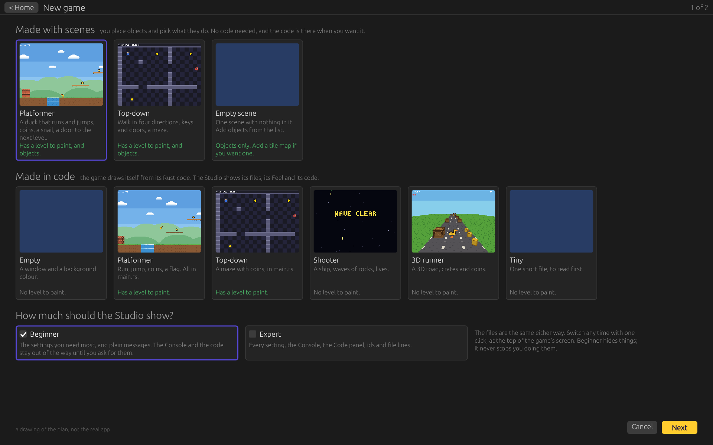

**The editor, in Beginner.** Scene and Files on the left, the frozen
game in the middle, the Inspector on the right. The snail is selected:
the arrows move it, and the dashed line is its patrol, drawn from its
own settings.

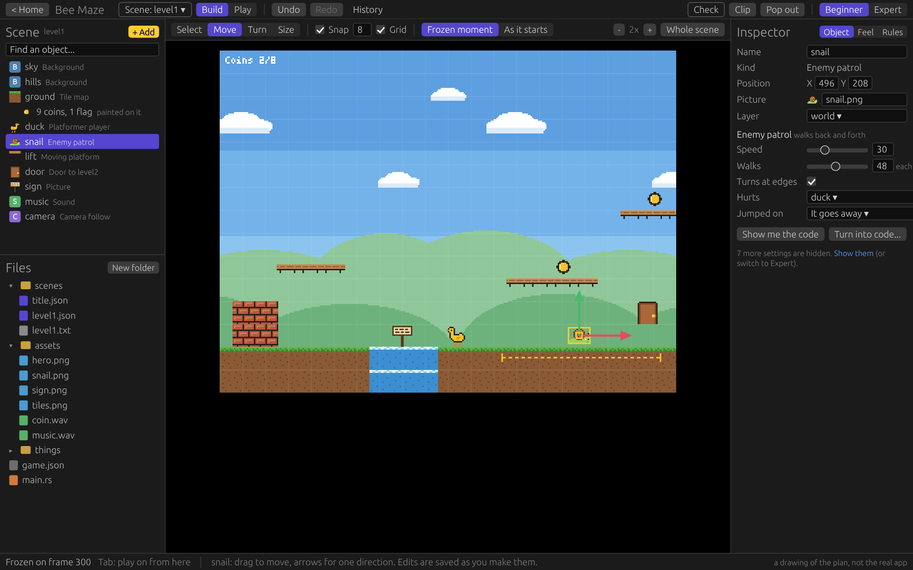

**The editor, in Expert.** The same files and the same screen, with
every setting, the object's id and line in the file, and the Code and
Console panels. The Code panel shows the last build's mistake on its
line.

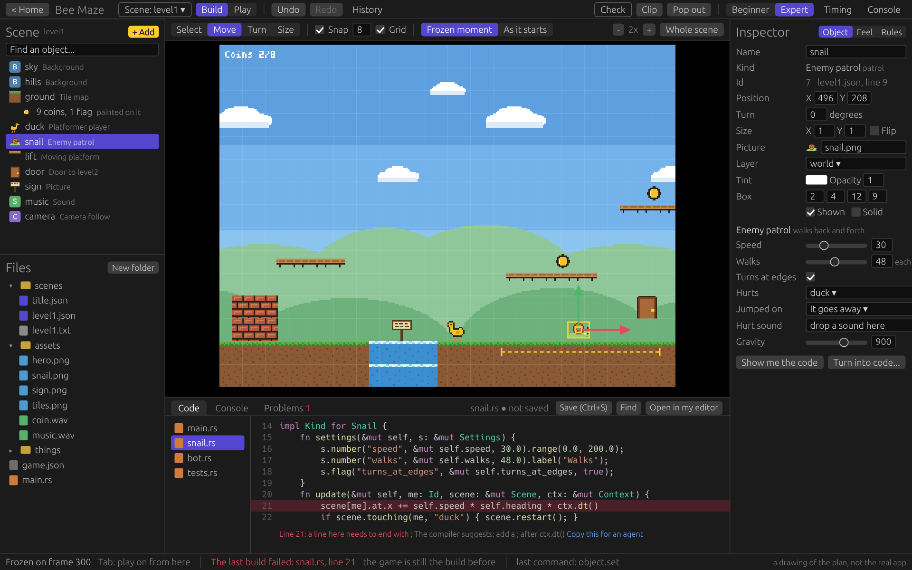

**Dragging a picture in.** From Files into the scene it becomes a new
object, snapped to the grid. Onto a Picture box in the Inspector it
becomes that object's picture. Sounds work the same way.

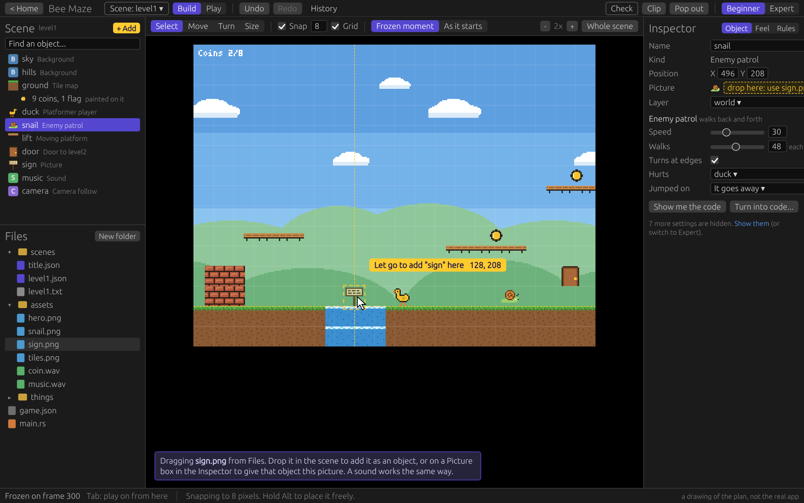

**Frozen in mid-play.** The lift has moved since the scene started, so
you see it twice: itself, and an outline where it starts. The Inspector
says "Starts at" and "Now". The coin the duck took is still in the list,
in italics.

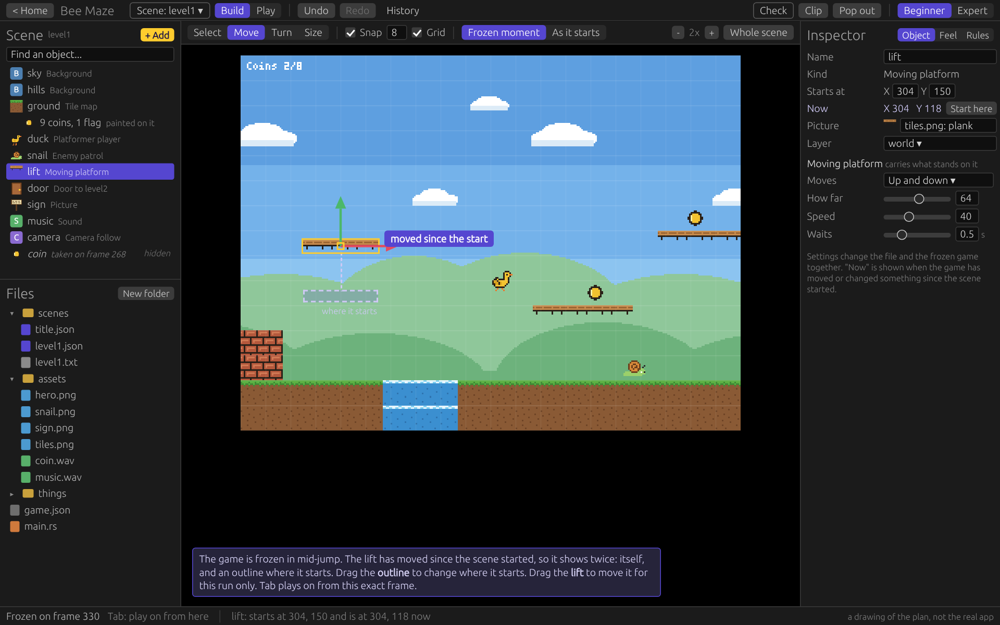

**Add an object.** Ready-made kinds, plain kinds, and the game's own
kinds and saved things.

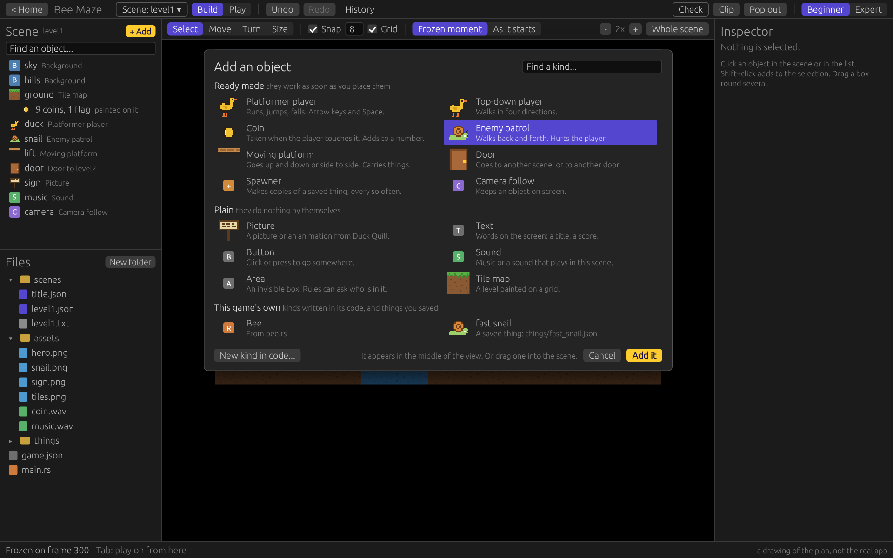

**A tile map is one object.** Select it and you get today's paint tools
and palette, on the same `level.txt`.

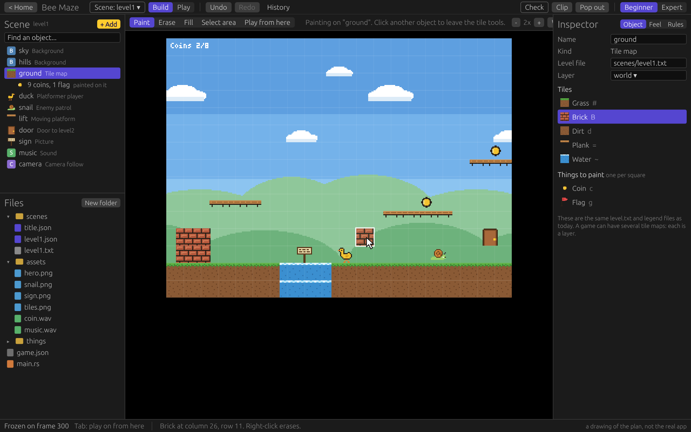

**The game's scenes.** Every scene, and how the game moves between them.
The arrows aren't drawn by hand: they're found in the scenes' doors,
buttons and rules.

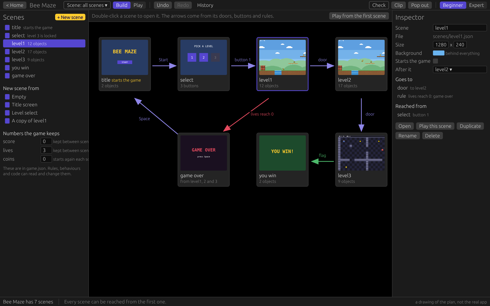

**Rules.** "When ... do ..." built from lists, stored as one readable
line each.

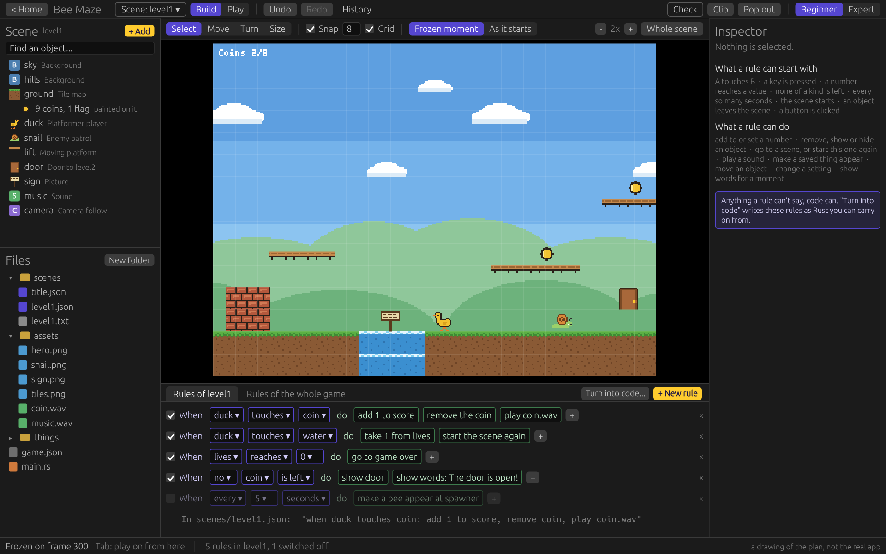

**Turn into code.** It says exactly what it will write, shows the code
first, and Undo puts everything back.

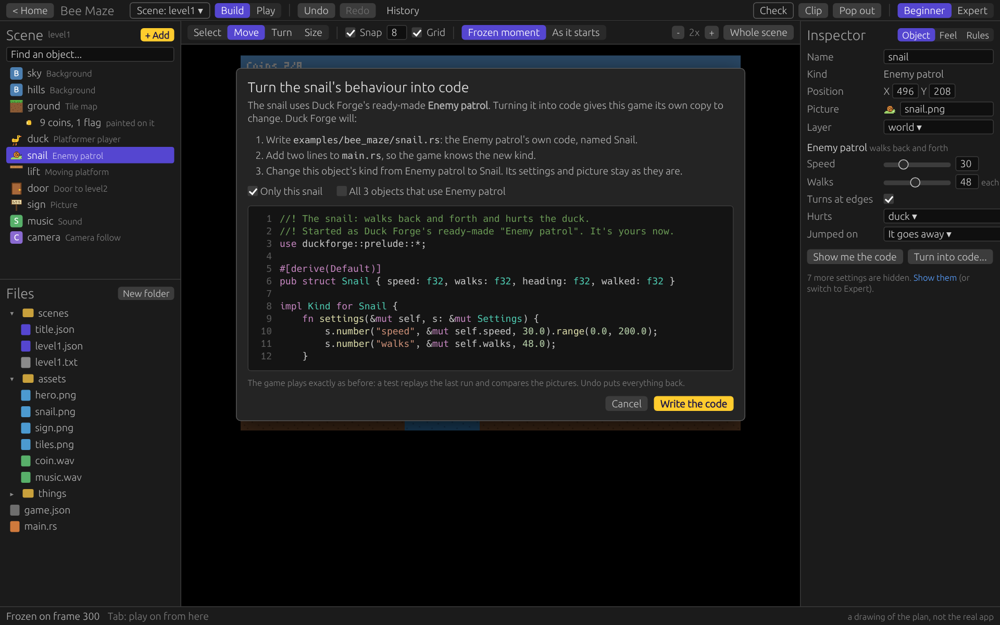

**Check understands scenes.** It names the scene and the object, shows
the spot, and "Show it in the scene" opens it selected.

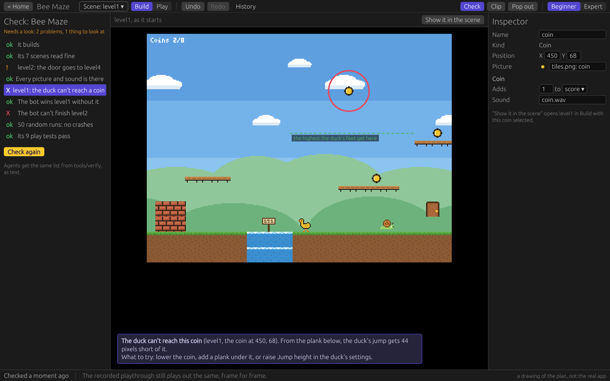

**The same panels in 3D.** The Studio flies its own camera through the
frozen moment. Positions have three numbers. The Model box is the slot
for Duck Mold's models.

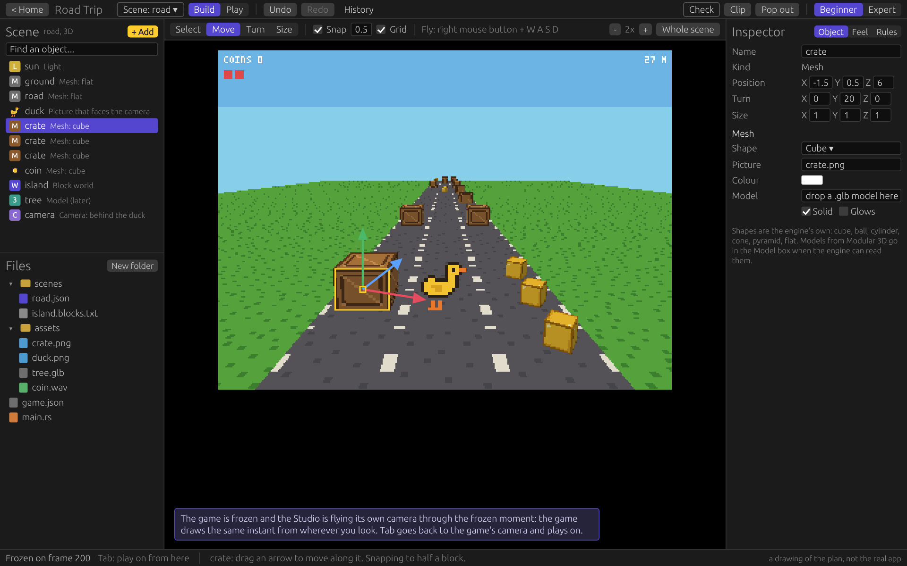

**A game made in code.** No scene, so nothing to drag, and the Studio
says so. It lists what the game drew, and Files, Feel and the Code
panel all work.

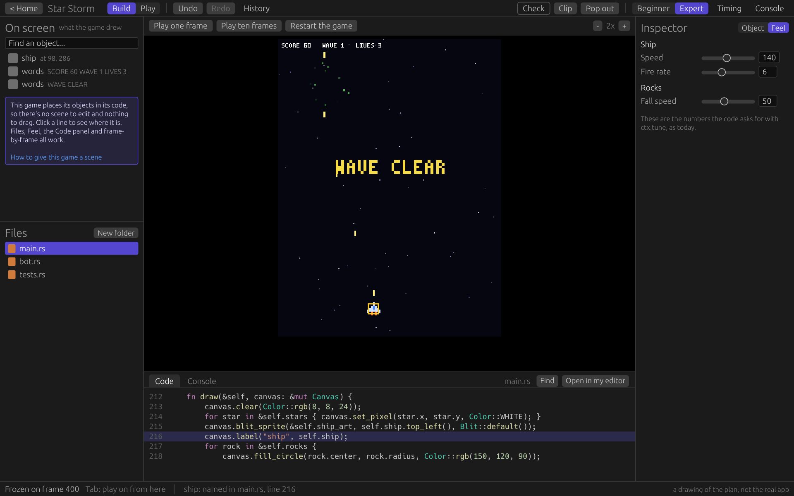

## 1. The scene file

**JSON, one object per line**, in the game's own folder:

```text
examples/bee_maze/
  game.json                 the game: title, size, first scene, numbers
  scenes/level1.json        a scene: its objects and rules
  scenes/level1.txt         a tile map's letters, exactly as today
  scenes/level1.legend.json what the letters mean, exactly as today
  things/fast_snail.json    an object saved to use again (optional)
  assets/                   pictures and sounds
  main.rs                   six lines, or the whole game, as you like
```

```json
{
  "duckforge_scene": 1,
  "size": [1280, 240],
  "background": "#6ab4f0",
  "layers": ["far", "back", "world", "front", {"name": "hud", "stays_on_screen": true}],
  "next": "level2",
  "objects": [
    {"id": 1, "name": "sky", "kind": "background", "layer": "far", "picture": "assets/sky.png", "parallax": 0.2},
    {"id": 3, "name": "ground", "kind": "tilemap", "level": "scenes/level1.txt"},
    {"id": 4, "name": "duck", "kind": "platformer_player", "at": [40, 208], "picture": "assets/hero.json", "jump_speed": 330},
    {"id": 7, "name": "snail", "kind": "patrol", "at": [496, 208], "picture": "assets/snail.png", "speed": 30, "walks": 48},
    {"id": 8, "name": "lift", "kind": "moving_platform", "at": [304, 150], "picture": "assets/tiles.json", "animation": "plank", "moves": "up_down", "how_far": 64},
    {"id": 9, "name": "door", "kind": "door", "at": [1200, 208], "picture": "assets/door.png", "goes_to": "level2"},
    {"id": 10, "name": "sign", "at": [374, 208], "picture": "assets/sign.png"},
    {"id": 11, "name": "music", "kind": "sound", "sound": "assets/music.wav", "loops": true},
    {"id": 12, "name": "camera", "kind": "camera_follow", "target": "duck"}
  ],
  "rules": [
    "when duck touches coin: add 1 to score, remove coin, play assets/coin.wav",
    "when lives reaches 0: go to game over"
  ]
}
```

Why JSON: every other Duck Forge file is JSON already (legends, Feel,
tune, input scripts), the engine already reads it with no new library,
and agents write it without mistakes. The Studio always writes it the
same way (one object per line, keys in a fixed order, only what differs
from the default), so a change to one object is a change to one line.
Any JSON layout a person or agent writes by hand reads fine.

**What every object has:**

| Key | Meaning | If left out |
|---|---|---|
| `id` | A number that never changes and is never used again in this scene. The Studio, replays and Check tell objects apart by it, even after a rename | The engine gives one (see "Ids", below) |
| `name` | What you and the code call it. Several objects can share one ("coin") | The kind's name |
| `kind` | What it does: a ready-made kind or one of the game's own | `picture`: it's drawn and does nothing |
| `at` | Where its anchor is, in the game's pixels: `[x, y]`, y downwards as everywhere in the engine | `[0, 0]` |
| `turn` | Degrees clockwise, round its anchor | 0 |
| `scale` | How many times bigger: `2`, or `[2, 1]` for each way. (A scene's own `size` is in pixels, so an object's word is a different one. The Studio's tool is still called Size) | 1 |
| `flip` | Mirrored left to right | false |
| `anchor` | The point of it that sits on `at`: `feet` (the bottom middle), `middle`, `top_left`, `top`, `top_right`, `left`, `right`, `bottom_left`, `bottom_right` | Its kind's usual one (below) |
| `picture` | A `.png`, or a Duck Quill sheet (`.json`) | none: nothing is drawn |
| `animation` | Which animation of the sheet | `idle` if it has one, or else its first |
| `layer` | One of the scene's layers. Layers are drawn in the list's order; inside one, objects are drawn in the file's order | `world` |
| `shown`, `tint`, `opacity` | As in `Blit` today | shown, white, 1 |
| `box` | Its collision box, `[left, top, width, height]` inside its picture | the whole picture |
| `solid` | Other objects can't pass through it | false |
| `like` | A saved thing to start from: `"like": "fast_snail"` | none |

**Anchors.** A picture, and everything that moves, stands on its
**feet**: the bottom middle of its picture, or the pivot a Duck Quill
sheet gives. That's where tile maps put things today, so an object
snapped to the grid stands on the tile under it. What's laid out like a
page is placed by its **top-left corner**: Text, Button, Area, Tile map,
Background. What has no shape (Sound, Camera, Spawner) sits on its
**middle**. Any object can say another with `"anchor"`.

**Order.** Objects are *drawn* in the file's order, inside their layer.
They *update* in the order of their ids: the file's objects, then
objects made while playing (in the order they were made), then things
painted on tile maps (map by map, row by row). So dragging an object up
or down the Scene list changes only what's drawn on top. It can never
change how the game plays, and the same inputs give the same game.

**Ids.** The Studio writes an id on every line. A scene written by hand
or by an agent can leave them out: the engine then gives each such
object an id the same way every time (the numbers after the highest id
in the file, going down the file), so a replay and a reload agree. Left
out, an id depends on the object's place among the others without one,
so a small tool puts them in the file for good:

```sh
cargo run --example write_ids -- examples/bee_maze/scenes/level1.json
```

It writes the file again the way Duck Forge writes it, changes nothing
else, and does nothing to a file whose objects all have ids. (It's
`tools/write_ids.rs`: a tool, not an option of every game, so games
that have no scenes carry none of this.) The Studio gets the same as a
command (`scene.write_ids`) with the Scene panel in step 2, and Check
says when a scene's objects have no ids. Two objects
with the same id is a mistake said in plain words; the second is given a
new one.

**Kept for later.** `"parent"` (objects inside objects) and `"kinds"`
(several behaviours on one object) are reserved now: no kind can use
them for a setting, a file that has them keeps them, and the engine says
they do nothing yet. So files made now won't change when those arrive.
The same goes for `"space": "3d"` and `"model"` (section 6).

**Its own settings** are every other key (`speed`, `walks`,
`goes_to`). A kind can't use one of the names above for a setting; the
engine says so plainly if it tries. Keys the engine doesn't know are
kept when the Studio saves, so a setting of a kind that isn't built yet,
or a note you added, survives.

**A saved thing** (`things/fast_snail.json`) is one object without an id
or a position. An object that says `"like": "fast_snail"` starts from it
and writes only what it changes. Change the thing and every object like
it changes. Spawners make copies of saved things.

**A tile map is one kind of object**: `{"kind": "tilemap", "level":
"scenes/level1.txt"}`. The engine reads it with `TileMap::load_level`,
the same code as today, and the legend file is found next to it as now.
The level can be anywhere in the game's folder: the demo game keeps
`level.txt` where today's games do, so today's paint tools work on it
already. Several tile maps in one scene are several layers of tiles;
the first is the one things walk on.

- The legend's "thing" letters still work. Each painted thing becomes an
  object when the scene loads: like the saved thing of that name if
  there is one, or else of the kind of that name, or else a plain named
  object. So painting thirty coins on the grid stays as quick as it is
  now, and placed objects sit beside them.
- **Today's `level.txt` games don't change at all.** They don't have a
  scene file and don't need one. Their code, their files and their
  playthroughs stay as they are. The Studio shows them with the same
  panels: the tile map and its painted things listed in the Scene panel,
  and the paint tools as now.

**Paths** inside a scene are from the game's folder. **Colours** are
`"#rrggbb"`. **A mistake in the file** is one sentence with the file and
the line: "scenes/level1.json, line 9: "snail": "at" should be two
numbers, like [40, 208]; it's 40". What can't be loaded has its
object's line too: "scenes/level1.json, line 12: "ghost" has the picture
"assets/gohst.png", which couldn't be loaded". The game still starts: a key with a
mistake is as if it weren't there, and a picture that can't be loaded is
drawn as a marked box, so one typo never loses the scene. A file that
isn't JSON at all, saved while the game runs, changes nothing: the scene
stays as it was until the file reads again. (A kind nothing knows, with
"did you mean", arrives with kinds in step 5 and Check in step 8. Until
then any kind is a name the game's code can ask for.)

## 2. Code and scenes together

Two rules decide everything here: **nothing possible in code becomes
impossible**, and **nothing made in the editor is locked away from
code**.

**A scene is a value your code holds.** The `Game` trait doesn't change.
A game that wants a scene loads one:

```rust
struct BeeMaze { scene: Scene, score: u32 }

impl Game for BeeMaze {
    fn update(&mut self, ctx: &mut Context) {
        self.scene.update(ctx);                       // every object does its thing
        let duck = self.scene.find("duck").unwrap();
        for coin in self.scene.touching(duck, "coin") {
            self.scene.remove(coin);
            self.score += 1;
            ctx.play(Sound::coin());
        }
    }
    fn draw(&self, canvas: &mut Canvas) {
        self.scene.draw(canvas);                      // layers, in order
        canvas.draw_text(&format!("Coins {}", self.score), vec2(4.0, 4.0), 1.0, Color::WHITE);
    }
    fn reload(&mut self, ctx: &mut Context, file: &Path) -> bool {
        self.scene.reload(ctx, file)                  // the Studio's edits arrive here
    }
}
```

`Scene::load("examples/bee_maze/scenes/level1.json")?` reads it. What
code can do with one:

| | |
|---|---|
| Find | `scene.find("duck")` (the first of that name), `scene.all("coin")`, `scene.of_kind("patrol")`, `scene.ids()` |
| Read and change | `scene[id].at`, `.turn`, `.scale`, `.picture`, `.layer`, `.shown`... every key in the file is a field. Its own settings: `scene[id].number("speed")`, `.text("goes_to")`, `.flag("open")`, `scene[id].set_number("speed", 60.0)`. How the file has it: `scene.starts_as(id)` |
| Add and remove | `scene.add(Object::new("coin").at(vec2(120.0, 96.0)))`, `scene.remove(id)`; from step 6, `scene.add_like("fast_snail", at)` |
| Touching | `scene.touching(id, "coin")` (by name or kind), `scene.overlaps(a, b)`, `scene.at_point(point)` |
| Moving | `scene.move_and_slide(id, movement)` gives today's `Contacts`: it stops at the tile map and at solid objects |
| The rest | `scene.tilemap()` (today's `TileMap`), `scene.camera` (today's `Camera2D`), `scene.draw_layer(canvas, "front")` to draw your own things between layers, `scene.problems()`; from step 7, `scene.go_to("level2")` and `scene.number("score")` |

Everything in the table without a step number is built (step 1), and
`examples/scene_demo` is a game written with it.

Objects made by code while playing (bullets, sparks) are ordinary
objects that just aren't in the file. Objects update in the order of
their ids (section 1, "Order"), so the same inputs give the same game
however the file's lines are arranged.

**A new kind, in Rust:**

```rust
#[derive(Default)]
pub struct Bee { speed: f32, bob: f32, home_y: f32, time: f32 }

impl Kind for Bee {
    fn settings(&mut self, s: &mut Settings) {
        s.number("speed", &mut self.speed, 40.0).range(0.0, 200.0);
        s.number("bob", &mut self.bob, 12.0).label("Bobs up and down by");
    }
    fn start(&mut self, me: Id, scene: &mut Scene, _ctx: &mut Context) {
        self.home_y = scene[me].at.y;
    }
    fn update(&mut self, me: Id, scene: &mut Scene, ctx: &mut Context) {
        self.time += ctx.dt();
        scene[me].at.x += self.speed * ctx.dt();
        scene[me].at.y = self.home_y + (self.time * 4.0).sin() * self.bob;
    }
}
```

and one line where the game starts: `game.kind::<Bee>("bee")`.

**Why its settings appear in the Inspector by themselves.** `settings`
is the one place a kind names its settings, and the engine calls it for
three jobs with the same code:

1. *To list them:* the engine runs it on an empty `Bee` and notes each
   name, its type, its default and its range. The Studio asks the
   running game for that list (`ask kinds`, over the link that exists)
   and draws the boxes. No list to keep in step, nothing to register
   twice.
2. *To load them:* the values from the scene file go into the fields.
3. *When you change one while the game is frozen:* the same call again,
   so `speed` changes and `time` (which isn't a setting) is kept.

It's the same idea as `ctx.tune`: the code asks for a value by name and
gives its default. It needs no new library and no "derive" magic, so the
first build stays as quick as it is.

The boxes a setting can be: a number (a slider when it has a range), a
whole number, a tick box, words, a choice from a list, a colour, a
picture, a sound, a point you can drag in the view, another object, a
scene, a saved thing, a key. Each can have `.label("...")`,
`.help("...")`, `.group("...")` and `.expert()` (hidden in Beginner).

The Studio keeps the last list it was given, so when the code doesn't
build the Inspector still works from the build before, and says so.

A kind can also draw itself (`fn draw(&self, me: &Object, canvas)`; the
default draws its picture) and code can reach a kind's own fields
(`scene.kind::<Bee>(id)`).

**The engine's old `Scene`.** The engine already has a type called
`Scene`: "what was on screen", made from `canvas.label` and saved as
`last.scene.json`. It becomes `OnScreen`. `sim.scene()` keeps working,
the saved files keep their names, and no example or test names the type
(*checked*). Objects in a scene label themselves, so `--describe` and
`sim.scene()` list them with no code.

## 3. Games without code

**A game made with scenes has this `main.rs`,** written by the starter:

```rust
use duckforge::prelude::*;

fn main() {
    let mut game = SceneGame::new("examples/bee_maze");   // reads game.json
    game.run();
}
```

`SceneGame` is an ordinary `Game` the engine brings: it holds the
current scene, the game's numbers, and moves between scenes. It still
has to be built by Rust like any game, which the Studio already does by
itself. You never have to open the file.

**Ready-made behaviours.** Each is a kind, with settings in the
Inspector:

| Kind | What it does | Main settings |
|---|---|---|
| Platformer player | Runs, jumps, falls, lands on one-way planks | Run speed, jump height, gravity, keys, which animations |
| Top-down player | Walks in four or eight directions | Speed, keys |
| Coin | Taken when the player touches it | Adds how much to which number, sound |
| Enemy patrol | Walks back and forth, turns at walls and edges | Speed, how far, hurts whom, what happens when jumped on |
| Moving platform | Up and down or side to side; carries what stands on it | Direction, how far, speed, wait |
| Door | Goes to another scene, or to another door | Goes to, needs which number (a key) |
| Spawner | Makes copies of a saved thing | Which thing, how often, at most how many |
| Camera follow | Keeps an object on screen | Target, smoothing, stays inside the scene |

Plain kinds that do nothing by themselves: Picture, Text, Button, Sound,
Area (an invisible box), Tile map, Background.

Each ready-made kind is one short file in the engine, written only with
what any game can use (the table in section 2). That's what makes "Turn
into code" honest.

**Rules**, for what the behaviours don't cover, are one sentence each:

```text
when duck touches coin: add 1 to score, remove coin, play assets/coin.wav
when duck touches water: take 1 from lives, restart
when lives reaches 0: go to game over
when no coin is left: show door, say The door is open!
when every 5 seconds: make fast_snail at spawner
```

- *When:* A touches B; a key is pressed; a number reaches a value; none
  of a name is left; every so many seconds; the scene starts; an object
  leaves the scene; a button is clicked.
- *Do:* add to, take from or set a number; remove, show or hide an
  object; go to a scene, or restart this one; play a sound; make a saved
  thing appear; move an object; change a setting; say words for a
  moment.

The Studio builds them from lists (the Rules picture above) and stores
the sentence. A sentence the engine can't read is one plain message with
the words it does know. Rules live in a scene, or in `game.json` for the
whole game.

**Both turn into Rust.**

- *A behaviour:* "Turn into code" copies the ready-made kind's own file
  into the game's folder under a new name, adds two lines to `main.rs`,
  and changes the object's kind. Same settings, same picture, and a test
  replays the last run to show the game plays the same. From then on
  it's the game's code.
- *Rules:* "Turn into code" writes each sentence as the few lines of
  Rust it stands for, in `rules.rs`, and takes the sentences out of the
  scene.
- It's one way. Going back is Undo or History, not a button.

**What's in Phase 5 and what waits:**

| In Phase 5 | Waits |
|---|---|
| The eight behaviours and the plain kinds | More behaviours (shooter ship, bullets, health bars, checkpoints, dialogue) |
| Turn a behaviour into code | Several behaviours on one object |
| Saved things | Rules with "and", "or", "else" or sums |
| Rules, as the **last** 2D step, and the first thing I'd move out if the phase runs long | Animation driven by rules; a timeline |

## 4. The editor's panels

One screen, as in the pictures. Everything is still the frozen game in
the middle.

| Panel | Where | What it does |
|---|---|---|
| **Scene** | Top left | The scene's objects in drawing order, with their kind. Click to select, drag to reorder, double-click to rename, a search box, **+ Add** |
| **Files** | Bottom left | The game's folder as a tree (built in the first-hour fixes). Click a picture to see it, a sound to hear it, a scene to open it, code to open it in the Code panel |
| **View** | Middle | The frozen game, with the Studio's own drawing on top: the selection, handles, the grid |
| **Inspector** | Right | The selected object's settings. Tabs for Feel (today's sliders) and Rules |
| **Code, Console, Problems** | Bottom, on request | See below |

**The view's tools** (the bar above the view, and one key each):

- **Select** (V): click an object; click again on a pile to get the one
  underneath; Shift+click adds; drag on empty space for a box.
- **Move** (G): drag the object, or an arrow to keep to one direction.
  Arrow keys nudge by one pixel, with Shift by one grid square.
- **Turn** (R): drag round the ring; snaps to 15 degrees.
- **Size** (S): drag a corner; Shift keeps the shape.
- **Snap** and **Grid**: on by default, to 8 pixels or to the tile map's
  squares. Positions are whole pixels unless you type otherwise. Alt
  places freely.
- **Frozen moment / As it starts**: see "Starts at and Now" below.
- Zoom, pan (middle mouse or Space+drag) and Whole scene, as Build mode
  has now.
- Selecting a tile map swaps the tools for today's Paint, Erase, Fill,
  Select area and Play from here.

Ctrl+C, Ctrl+V, Ctrl+D (duplicate), Delete, Ctrl+A, Ctrl+Z, Ctrl+Y all
work on the selection, one object or many. With several selected, the
Inspector shows the settings they share; changing one changes them all.

**How the view is drawn and clicked.** As now, the picture is the
game's own drawing of the frozen moment, so Build and Play can't look
different. Objects label themselves, so the Studio asks the game where
each one is on screen and does the clicking itself. While you drag, the
Studio draws the outline under the pointer at once and sends the change
to the frozen game a few times a second, as painting does now.

**Dragging from Files:**

| Drag | Onto | What happens |
|---|---|---|
| A picture, or a Duck Quill sheet | the scene | A new Picture object there, named after the file |
| A picture | a Picture box | That object gets the picture |
| A sound | the scene | A new Sound object (music for the scene) |
| A sound | a Sound box | That setting gets the sound |
| A level's `.txt` | the scene | A new Tile map |
| A saved thing | the scene | An object like it |
| A scene | a Door's or Button's "Goes to" | It goes there |
| Files from Windows | the scene | Copied into `assets/` first, then as above |

**Starts at and Now.** This is the one place the editor differs from
Godot's, because the picture is a game in mid-play. Every object has the
values the file gives it (how it starts) and the values it has right
now. For most objects they're the same, and there's nothing to think
about. When they differ:

- An object that's moved since the start (the duck, a snail, a lift)
  shows twice: itself, and an outline where it starts. Drag the
  **outline** to change the file. Drag the **object** to move it for
  this run only.
- A setting changed in the Inspector changes the file and the frozen
  game together, unless the game itself has changed that value since the
  start (lives went from 3 to 1). Then the Inspector shows both, and you
  choose which to change.
- An object the game has removed (a coin that was taken) stays in the
  Scene list in italics, so you can still select and edit it.
- **As it starts** shows the scene as the file says, with nothing moved:
  the plain "editor view". It's also how you look at a scene the game
  isn't in right now.

Either way you press Tab and play on from the same frame.

As built in Step 2:

- What a drag changes is decided when it begins. The dashed **outline**
  always changes the file. The **object** changes the file too while it
  is still where it starts (a sign, a crate), and moves for this run
  only once the game has moved it (the duck after a walk). The status
  bar says which: "Move sign" or "Move duck for this run".
- The Inspector has **Start here** (where it is now becomes its start)
  and **Back to its start**.
- Undo takes back a move "for this run" until the game plays on. After
  that there is no moment to put it back to, so it leaves the list.
- A game needs no new code for any of it: the change reaches the scene
  through the `reload` hook it already has, and the session's recording
  keeps it as an `"object"` event, so replays stay exact.
- **As it starts** is drawn by the game itself, from a copy of its scene
  put back to the file's values, through the camera of the frozen
  moment. The game's own scene isn't touched.

**The Code panel:**

- Opens the game's `.rs` files in tabs, with line numbers, Rust
  colouring, Find (Ctrl+F) and Go to line.
- Ctrl+S saves, and the save starts the build the Studio already does. A
  mistake shows on its line, in the same plain words as now, with "Copy
  this for an agent".
- "Show me the code" on an object, a kind or a setting opens the right
  file at the right line.
- "Open in my editor" stays, for anyone with VS Code.
- It is a plain editor. No suggestions as you type, no "go to
  definition", no debugger. I say why in section 10.

**Undo covers everything** done to scenes, levels, Feel and rules, as
one list, as now. Code has its own undo inside the Code panel, and
History's snapshots cover code too. Selecting something isn't an Undo
step.

**Every button is a named command**, in the table the Studio already
has, so agents and `--run` scripts can press all of them:

| Group | Commands |
|---|---|
| scene | `open`, `new`, `rename`, `duplicate`, `delete`, `set`, `play_from` |
| object | `add`, `set`, `move`, `turn`, `resize`, `rename`, `order`, `delete`, `duplicate`, `copy`, `paste`, `save_as_thing`, `turn_into_code`, `move_now` |
| select | `set`, `add`, `all`, `none` |
| view | `tool`, `snap`, `grid`, `show` (frozen moment or start), `zoom`, `pan`, `whole`, `fly` |
| rule | `add`, `set`, `delete`, `turn_into_code` |
| kind | `new` (writes a kind's skeleton in code) |
| code | `open`, `save`, `find`, `go_to` |
| files | the ones from the first-hour fixes, plus `use` (a file dropped on the scene or on a box) |
| studio | `mode` (Beginner or Expert) |

```json
{"do": "object.add", "kind": "patrol", "name": "snail", "at": [496, 208]}
{"do": "object.set", "ids": [7], "set": {"speed": 60}}
{"do": "files.use", "path": "assets/sign.png", "at": [128, 208]}
```

## 5. Several scenes in one game

```json
{ "duckforge_game": 1, "title": "Bee Maze", "width": 320, "height": 240,
  "first_scene": "title",
  "numbers": { "score": {"starts": 0, "kept": true},
               "lives": {"starts": 3, "kept": true},
               "coins": {"starts": 0} },
  "rules": ["when lives reaches 0: go to game over"] }
```

- **The scenes are the files in `scenes/`.** There's no second list to
  keep in step. `first_scene` says where the game starts, and a scene's
  `"next"` says what comes after it.
- **Moving between them:** a Door or a Button with "Goes to", a rule
  (`go to level2`, `go to next`, `restart`), or code
  (`scene.go_to("level2")`). The move happens between two updates, so a
  replay sees the same thing.
- **Numbers** (`score`, `lives`) belong to the game. "Kept" ones carry
  from scene to scene; the others start again in each scene. Behaviours,
  rules and code all read and change the same numbers
  (`scene.number("score")`).
- **A title screen** is a scene with Text and a Button. **A level
  select** is a scene with one Button per level; a Button can be locked
  until a level has been won, which the game keeps count of itself.
  "New scene" offers Empty, Title screen, Level select, and a copy of
  the scene you're in.
- **In the Studio:** a scene chooser in the top bar, and the Scenes page
  (the picture above) showing how they connect. "Play this scene" starts
  the game in that scene, as Play from here does for a tile.
- **Check** says when a scene can't be reached from the first one, and
  when something goes to a scene that isn't there.

Saving progress to disk (so level 3 is still unlocked tomorrow) waits:
it needs the save-file rules the engine already has for Duck Craft
(`ctx.is_headless()`), and a place to keep saves.

## 6. 2D first, then 3D

Everything above is built for 2D. **3D is Phase 5b**, right after this
phase: the steps at the end of section 9. (Reading `.glb` models is
already built: see below.) What Phase 5 does now is keep the file ready: a scene
that says `"space": "3d"` is read, kept and written back exactly as it
is (three numbers, the `"model"` key and all), and the engine says it
can't be drawn yet. So nothing written now will need changing.

The same file and the same panels will carry 3D with three differences:

```json
{ "duckforge_scene": 1, "space": "3d",
  "objects": [
    {"id": 1, "name": "sun", "kind": "light", "direction": [0.4, -1, 0.3], "ambient": 0.35},
    {"id": 2, "name": "crate", "kind": "mesh", "shape": "cube", "at": [-1.5, 0.5, 6], "turn": [0, 20, 0], "picture": "assets/crate.png", "solid": true},
    {"id": 3, "name": "island", "kind": "blocks", "world": "scenes/island.blocks.txt"},
    {"id": 4, "name": "duck", "kind": "picture", "at": [0, 0, 4], "picture": "assets/duck.json", "faces_camera": true},
    {"id": 5, "name": "tree", "kind": "mesh", "model": "assets/tree.glb", "at": [3, 0, 9]},
    {"id": 6, "name": "camera", "kind": "camera", "follows": "duck"} ] }
```

1. **Three numbers** for `at`, `turn` and `size` (y is up, as in the
   engine's 3D).
2. **3D kinds:** Mesh (the engine's own shapes: cube, ball, cylinder,
   cone, pyramid, flat), Blocks (a block world, see below), Picture that
   faces the camera (today's billboard), Light, Camera.
3. **A fly camera in the frozen game.** Hold the right mouse button and
   use W A S D, as in Godot and Unity. The link's `view` message already
   asks the frozen game to draw the same moment through the Studio's
   camera; in 3D it carries a 3D camera. The Studio works out what you
   clicked with the engine's own camera maths, and draws three arrows to
   move along.

**A block world as a file** follows tile maps: `island.blocks.txt` is
layers of letters, bottom layer first, with a legend that says which
block each letter is. That's plain text an agent can write and git can
compare. Painting blocks by clicking in the editor is its own job and
isn't in this phase.

**3D models are glTF 2.0, as one `.glb` file, made with Duck Mold**
(the tool this plan first called Modular 3D). The engine already reads
them: `Mesh::load_glb(path)`, built on the `claude/duck-mold-models`
branch and merged into Phase 5 at step 2, with the sockets that were
added to it since (both are in `main` now). So Phase 5b doesn't build a
reader; it uses this one.

What the plan asked a reader for, beside what the one that's built
does:

| | The plan | `Mesh::load_glb` today | Not yet |
|---|---|---|---|
| Which files | Any `.glb` that keeps to a stated part of glTF | Only `.glb` files written by Duck Mold (`duck-mold export`): they say so inside (`extras.duck_mold`, version 0). Any other file is refused with one sentence saying why, and so is a damaged one: no crash | Models from other tools (Blender). Only worth doing if you want them |
| Shapes | Triangles with positions, normals, texture points, vertex colours | One mesh, one list of triangles: the corner points and one colour for each triangle. Corners in the same place are shared, so a box has 8. The engine lights flat faces itself, so it needs no normals | Texture points; lines and points |
| Looks | A base colour and one picture, glow, see-through | The model's palette colours, exactly as the recipe has them (they're stored as linear light and turned back to the same 0 to 255) | Pictures on models, glow, see-through |
| Parts | A tree of named parts, each with a position, a turn and a size | Parts, and parts made of parts ("assemblies": `left_arm`, with `left_arm/hand` inside it), each as a named run of the model's triangles: enough to recolour one. `GlbModel::load` gives them, with the model's name and its palette by name. It also gives the model's **sockets**: named points, each facing a way, where its recipe joined its parts (`model.socket("head.top")`), so a game can put a hat on the robot's head and keep it there as the robot moves and turns | Parts that keep a position and a turn of their own. Today a model is one solid mesh, so a part can't be moved by itself |
| Animation | Named clips that move parts; limbs as rigid parts first | None | All of it. It needs the row above first, in Duck Mold and then here |
| Duck Forge's own | `extras.duckforge`: a collision box and where the feet are | Not needed: a Duck Mold model stands on y = 0 and faces forward (+z), so its feet are at its own zero point, and its box is `mesh.bounds()`. What Duck Mold adds is under `extras.duck_mold` | |
| Directions | Turned from glTF's to the engine's by the loader | Done: x is mirrored and each triangle's corners reordered, so left stays left and faces stay facing out. 1 unit is 1 block, about a metre | |

Three things to know about it:

- The reader's code is Duck Mold's own, copied byte for byte between two
  marker lines in `src/glb.rs`, so both projects read a file the same
  way. A change is made in Duck Mold first, then copied here.
- Its tests load Duck Mold's six example models and check them against
  what `duck-mold inspect` said: the triangle counts, the size, the
  colours, that every part is a closed solid, which way each faces, and
  where every socket is. `examples/turntable` shows the robot, with a
  hat put on its `head.top` socket while it turns.
- Sockets came after you asked for the models branch: you merged both
  into `main` while Step 2 was being built, so Step 2's branch has
  `main` merged in and carries both. A socket is a point, not a part
  that moves: the "Parts" and "Animation" rows are as they were.

**The slot in scenes:** an object's `"model"` key, kept as it is by the
engine and the Studio (step 1), and Files calling `.glb` files "Model".
In Phase 5b the Mesh kind draws its `"model"` with `Mesh::load_glb`, the
Inspector gets a Model box that takes a dropped `.glb`, and a model
saved again in Duck Mold shows in the frozen game, as a picture does. So
scene files written now won't need changing.

Sprites and 2D animation keep coming from Duck Quill's JSON and PNG,
which the engine reads today.

**Phase 5b, in order:** 3D scenes drawn (Mesh, Light, Camera, facing
pictures, models with the reader above, reload); the fly camera in the
frozen game, clicking and moving in 3D. Still later: parts that move and
their animation (once Duck Mold writes them), pictures on models,
painting block worlds, ready-made 3D behaviours, skinned meshes.

## 7. Beginner and Expert

You pick one on the New game screen. One click on **Beginner | Expert**
in the top bar switches, any time. It's remembered for each game, in the
Studio's own settings, because it's about the person and not the game:
the game's files are byte for byte the same in both.

| | Beginner | Expert |
|---|---|---|
| Inspector | The settings you need most. "7 more settings are hidden. Show them" | Everything: turn, size, tint, box, the id, the line in the file, the kind's name in code |
| Bottom panels | Hidden until you ask ("Show me the code" opens the Code panel) | Code, Console and Problems, a click away |
| Messages | One plain sentence and what to try | The same sentence, with the details open and the command's name |
| Scene list | Objects and their kinds | Also ids, and what the game drew that isn't an object |
| Files | Pictures, sounds, scenes, things; code under one "Code" folder | The folder as it is on disk |
| Top bar | Build, Play, Undo, History, Check, Clip, Pop out | Also Timing and Console |

**Beginner hides things; it never blocks them.** Every hidden setting is
one "Show them" away, every panel one click away, and a file edited in
Expert, by hand or by an agent, works in Beginner. A kind says which of
its settings are for Expert (`.expert()`); if it says nothing, they all
show.

## 8. What Duck Forge keeps that Godot doesn't have

- **Editing in the frozen moment, and playing on from that exact
  frame.** Scenes are files the game loaded, so an edit reaches the
  frozen game through the same `file` message and `reload` hook as a
  painted tile does today. `Scene::reload` works out what changed,
  object by object, and applies only that, so the duck stays in
  mid-jump.
- **Replays stay exact.** A session already stores the text files as
  they were on frame 1 and every change with its frame. Scene files join
  that list with no new idea. Moving an object "for this run only" is
  one new kind of event with a frame number. The test that exists
  (freeze, edit, resume, replay, compare the last picture pixel for
  pixel) gets a scene edit in the middle.
- **Check and its bots understand scenes.**
  - Before running anything: every scene reads; every picture, sound,
    scene and object a setting names is there; every scene can be
    reached.
  - "The duck can't reach this coin": today's `map.reach`, with solid
    objects counted as ground and the player's own jump settings. Moving
    platforms make it less sure, and it says so ("looks out of reach
    unless the lift helps").
  - A ready-made bot plays games made of ready-made behaviours, with
    today's `map.route`. It's the starter's `bot.rs`, moved into the
    engine. Games with their own code keep their own bot.
  - Every problem names its scene and object, and one click selects it.
- **Every editor action is a named command** (the table in section 4)
  that a button, a key, a script and an agent all call the same way.
- **Plain files everywhere.** Scenes, things, rules, numbers: all text
  an agent can write without the Studio open, and git can compare.
  History snapshots them with the rest.
- **Agents lose nothing.** `cargo run`, `tools/verify`, `new_game`,
  `--fuzz`, `--video`, `--describe` and the Studio's commands work on a
  scene game as on any example. `new_game` gets the scene starters.

## 9. The build steps

Each step ends in a STOP, with the tests passing on Linux and Windows,
the measurements below, and a hand checklist for your PC with no
terminal. "Stronger" means the model that wrote this design. "Cheaper"
means a smaller model can build it from this document and the step
before, because the hard choices are already made and there's a pattern
to copy.

| | Step | When it's done you can | Who |
|---|---|---|---|
| 1 | **Scenes in the engine.** The file, `Scene`, drawing in layers, turned and resized pictures, a tile map as an object, `reload` that merges, mistakes in plain words. A small demo game. **Built** | Open the demo in the Studio, play it, edit its scene file in Notepad while it's frozen, and see the change | Stronger |
| 2 | **Scene list, Inspector, select and move.** The link's new questions, the `object` and `select` commands, snap and grid, Undo, "Starts at and Now". **Built** | Click an object, drag it, change its name, position, picture and layer, undo, and play on from the frozen frame | Stronger |
| 3 | **The other tools.** Turn, Size, several at once, box select, copy, paste, duplicate, delete, nudge, reorder, Add (plain kinds). **Built** | Build a small picture of a level by hand | Cheaper |
| 4 | **Dragging from Files.** Onto the scene and onto Inspector boxes, and from Windows | Drag a picture in, drag a sound onto a box | Cheaper |
| 5 | **Kinds.** `Kind`, `Settings`, `SceneGame`, the Inspector's boxes drawn from the game's own list, "New kind in code", "Show me the code" | Add a kind's skeleton from the Studio, give it a setting in code, and see the box appear | Stronger |
| 6 | **Ready-made behaviours and saved things.** The eight, one small file and one test each; "Turn into code"; two scene starters | Make a platformer with coins, a snail, a lift and a door, with no code. Turn the snail into code | Cheaper, one behaviour at a time. The first one (platformer player) by the stronger model, as the pattern |
| 7 | **Several scenes.** `game.json`, numbers, going between scenes, Text and Button, the scene chooser, New scene, the Scenes page, Play this scene | Make a title, a level select and two levels, and play through them | Stronger for the engine half, cheaper for the Scenes page |
| 8 | **Check and bots.** Scene checks, reach with objects, the ready-made bot, problems that select their object, `tools/verify` | Put a coin out of reach and be told which; break a door and be told which | Stronger |
| 9 | **Beginner and Expert, and the Code panel** | Switch with one click; open, change and save code inside the Studio and see a mistake on its line | Cheaper |
| 10 | **Rules.** The sentences, the builder, turning them into code | Make "duck touches water: restart" without code | Stronger for reading the sentences, cheaper for the builder |
| | **The proof**, as at the end of Phase 4: from New game to a three-scene game with no code, then one behaviour turned into code, walked on GitHub's Windows machine and by you | | Cheaper |

Then, as phases of their own:

| | Step | When it's done you can | Who |
|---|---|---|---|
| 5b.1 | **3D scenes.** Three numbers, Mesh, Light, Camera, facing pictures, drawing and reload | Open a 3D demo scene, edit its file, see the change | Stronger |
| 5b.2 | **3D in the editor.** The fly camera in the frozen game, clicking and moving in 3D, the Model box | Fly round a frozen 3D game, move a crate, play on | Stronger |
| 5b.3 | **Models in scenes.** The Mesh kind's `"model"`, the Model box, a changed `.glb` reloaded. The reader is built already (`Mesh::load_glb`) | Drop a model from Duck Mold into a scene | Cheaper |
| Export | **One folder ready to send to a friend**: the game's program and everything it reads, with no Rust needed to play it | Press Export, zip the folder, send it | Cheaper, from a short design |

After each step: a new section in the hand checklist (it carries on from
item 49), the numbers in `docs/decisions.md`, and screenshots of every
new screen.

Steps 3, 4, 9 and the proof are the ones to hand to a cheaper model
whole, with most of step 6 and the Studio halves of steps 7 and 10.
Step 10 (Rules) is the first to cut if the phase runs long; nothing
before it depends on it. The final shape of a rule's sentence is decided
at step 10, not now.

## 10. What I'd cut or postpone

Bluntly, so nothing surprises you later.

**This won't be Godot.** Godot's editor is many people's work over many
years. Phase 5 gives Duck Forge its own version of the five panels,
working on 2D scenes, with eight behaviours. That's a real editor for
small games. It isn't a rival.

**Games made in code don't become editable.** The shooter, the 3D
runner and Duck Craft draw themselves from Rust, and no editor can drag
what only exists as code. They get Files, Feel, the Code panel and a
read-only list of what they drew. To edit one's objects in the Studio,
its objects have to move into a scene, which is a rewrite of that game,
by hand or by an agent, and not a button. I'd move one starter as part
of step 6, to show how, and leave the rest alone.

**Cut from Phase 5:**

- **No tree of objects inside objects.** Godot's scene is a tree; this
  one is a flat list with layers. A tree makes every tool, the file and
  the code harder, and the games Duck Forge makes rarely need it. A lift
  carries what stands on it because the lift does that, not because of a
  tree. The key `"parent"` is kept for it (section 1).
- **One behaviour per object.** No stacking "patrol" and "shoots" on one
  snail. For that you turn it into code. The key `"kinds"` is kept for
  it.
- **The Code panel is a plain editor.** Suggestions as you type and "go
  to definition" mean running rust-analyzer, a large separate program,
  inside the Studio and keeping it alive on Windows. That's a phase of
  its own. Files over a few thousand lines will feel slow in the panel;
  "Open in my editor" is there for them.
- **Turning doesn't turn collision boxes.** The engine's boxes don't
  rotate (as in its physics today). Turn is for looks; a turned
  platform still collides as its upright box. The Inspector says so.
- **No screen-layout system.** Text and Button, placed by hand, by any
  of their nine anchor points. No containers that resize.
- **No animation editor, no particle editor, no sound editor.** Duck
  Quill and Duck Echo do those.
- **No saving progress to disk**, and **no Export button**. "Exported
  game" in this document means what `cargo build --release --example`
  gives. A game with scenes reads its files when it starts, as games
  read their pictures and levels today, so sharing a game means sharing
  its folder with it. A proper Export (one folder ready to send to a
  friend) is the small phase right after this one and 5b.
- **3D** is Phase 5b (section 6). Phase 5 keeps 3D scene files as they
  are and draws nothing of them.
- **No gamepads, no macOS**, as before.

**First to go if the phase runs long:** Rules (step 10). The phase is
still whole without them.

**The risks I see:**

- *Starts at and Now* (step 2) is the hardest idea in the phase. If it
  confuses in your hands, the fallback is simple and still good: Build
  always shows "As it starts", and "Frozen moment" becomes a second
  view for looking and for tiles.
- *The Inspector from the game's own list* (step 5) depends on the game
  being built. A game whose code doesn't build shows the last list it
  had, which can be stale.
- *Dragging smoothness.* The frozen game redraws a few times a second
  while you drag. The outline under the pointer hides that, but a very
  big scene may still feel a beat behind.
- *Size.* Ten steps is longer than Phase 4's five. Each is small on
  purpose.

## The rules, and how they're measured

| Rule | How it's kept |
|---|---|
| Agents lose nothing | Every step runs `tools/verify` on every example, `--fuzz` and a `--run` script of the new commands |
| Existing games and playthroughs pass, frame for frame | The playthrough tests that exist today, unchanged. No existing game's files are touched before step 6, and then only the one starter that's moved, as a new starter beside the old one |
| Exported games don't contain the editor | Everything the Studio needs inside a game (answering questions, the "As it starts" view) is behind the `studio` feature, which exported games don't turn on. A test builds without it and checks the names aren't in the program |
| No slower, no bigger | The table below, measured again at every step on Linux and on GitHub's Windows machine. An existing game more than 1% bigger or slower stops the step |
| The Duck Forge look | No existing drawing code changes. An object that isn't turned, and is the same size both ways, is drawn by today's `blit_sprite`, to the pixel. Turned and stretched pictures use the same sharp-pixel rule (`Canvas::draw_placed`, new in step 1) |
| Linux and Windows | The release workflow runs every test on Windows, as now |
| A hand checklist | After every step, numbered on from 49 |

*Measured* today, on this Linux machine, release builds with the usual
features:

| Game | Size of the program | 600,000 updates with nobody playing (three runs) |
|---|---|---|
| Platformer starter (`template`) | 6,386,216 bytes | 0.33, 0.34, 0.38 s |
| Shooter starter | 6,252,280 bytes | 0.50, 0.51, 0.59 s |
| 3D runner starter | 11,594,608 bytes | 2.30, 2.36, 2.64 s |

From step 6 the new Platformer starter made with scenes is measured
beside today's. It does more work per object than hand-written code, so
I expect it a little bigger and a little slower; the target is within
10%, and the real numbers will be reported whatever they are.

**After Step 1** (*measured*, same machine; "before" is the code before
Step 1 with only the new timing option added, so both are timed the same
way: `--headless --time`):

| Game | Size before | Size after | 600,000 updates, before | after | Drawing one frame, before | after |
|---|---|---|---|---|---|---|
| Platformer starter | 6,391,536 | 6,393,376 | 0.32 to 0.36 s | 0.31 to 0.37 s | 80 to 83 µs | 75 to 76 µs |
| Shooter starter | 6,257,544 | 6,259,768 | 0.46 to 0.57 s | 0.47 to 0.58 s | 18.2 to 19.5 µs | 17.6 to 19.9 µs |
| 3D runner starter | 11,600,200 | 11,602,168 | 2.17 to 2.28 s | 2.17 to 2.27 s | 1,471 to 1,499 µs | 1,464 to 1,488 µs |
| Scene demo (new) | | 6,612,816 | | 0.87 to 0.91 s | | 76 to 82 µs |

- Existing games are about 2,000 bytes bigger (0.03%), and no slower:
  every time is inside the spread of running the same program again.
- The scene demo is 3.4% bigger than the Platformer starter, and draws a
  frame in the same time. Its updates take 1.5 millionths of a second
  each against the starter's 0.55: three times as long, and still under
  a ten-thousandth of the 16,667 a frame has.
- The first version of `write_ids` was an option every game had, and
  made every existing game 100,000 bytes (1.5%) bigger. That's over the
  rule, so it became a tool of its own (`tools/write_ids.rs`), and
  existing games link none of the scene code.
- On GitHub's Windows machine, after Step 1: the Platformer starter is
  3,888,640 bytes and draws a frame in 104 to 106 µs; the scene demo is
  4,103,168 bytes (5.5% bigger) and draws one in 105 µs. The release
  workflow prints these on every run from now on, and
  `docs/decisions.md` has the whole table.

## Decided

The questions, as answered in the review:

1. **JSON for scenes.** Yes.
2. **Rules as sentences.** Yes; their final shape is decided at step 10.
3. **Rules stay in this phase**, as step 10, and are the first thing cut
   if it runs long.
4. **3D is Phase 5b:** the two 3D steps move there. The Model slot and
   the `"space": "3d"` key are in the file now.
5. **Models are glTF `.glb`, made with Duck Mold.** The reader is built
   (`Mesh::load_glb`, merged in at step 2), so Phase 5b uses it and
   builds none. Section 6 says what it covers. Parts that move, and
   their animation, come when Duck Mold writes them.
6. **A flat list and one behaviour per object**, for now. `"parent"` and
   `"kinds"` are kept for later, so files made now never change.
7. **The plain Code panel**, with "Open in my editor".
8. **The names** stay as they are.
9. **The Platformer moves to scenes in step 6**, as a new starter beside
   today's.

Four changes to the scene file, made before Step 1 was built (all in
section 1):

- **a.** An object's "how many times bigger" is `"scale"`. `"size"` is
  only ever a scene's size in pixels. The Studio's tool is still Size.
  (An object that says `"size"` is told its new name.)
- **b.** Update order doesn't depend on drawing order: objects are drawn
  in the file's order and update in the order of their ids.
- **c.** Ids for scenes written without the Studio: the engine gives
  them the same way every time, and `cargo run --example write_ids --
  FILE` writes them into the file.
- **d.** `"at"` is the object's anchor. Pictures and movers stand on
  their feet; Text, Button, Area, Tile map and Background are placed by
  their top-left corner; any object can say another with `"anchor"`.

And three more:

- **Starts at and Now** is built as designed in step 2 and tested by
  hand before step 3. If it confuses, the fallback in section 10 is
  taken.
- **Export** (one folder ready to send to a friend) is the small phase
  right after this one and 5b.
- **The first-hour fixes** come first: Step 1's branch is main with
  those fixes and this design.

## What Step 2 built, and what it left for Step 3

Built: the Scene list, the bar above the view (Select, Move, Snap with
the grid's size, Grid, Frozen moment / As it starts), clicking and
dragging in the view, the Move tool's two arrows, the Inspector (name,
position, picture, animation, layer; under More: turn, size, flipped,
shown, solid, opacity and the object's own settings), Undo for all of
it, and "Starts at and Now". Pictures 23 to 30 in `docs/studio-screens/`
are the real screens.

Three things work differently from the mockups, on purpose:

- **The tile map is selected in the Scene list, not by clicking the
  ground.** Otherwise every click that misses an object would start
  painting. While it's selected the left side has the paint tools and
  the view paints; Esc, or picking another object, gives the view back.
  Coins and flags painted on the tile map belong to it: they aren't
  picked by a click, and the list says "4 coins, 1 flag painted on it".
- **The scene is edited while the game is frozen**, as painting is. A
  game that isn't running has no picture to click on yet; "As it starts"
  with no game running comes with several scenes, in step 7.
- **Kind is shown, not changed.** It becomes a list in step 5, when
  games can say which kinds they have.

Left for Step 3, as the table says: Turn and Size tools in the view (the
numbers are in the Inspector already), a box to select several, nudging
with the arrow keys, copy, paste, duplicate, delete, reorder, Add, and
an Inspector for several objects at once (now it shows their names and
one Layer box).

## What you test on Windows after Step 1

GitHub's Windows machine runs every test, including one that builds the
demo game, plays it through the Studio's link, freezes it, saves its
scene file from outside, plays on, undoes the change and replays the
session to the same picture. These need your PC, with no terminal:

50. Home, "Examples that came with Duck Forge": **Scene demo** has a
    picture. Open it. It builds and plays: the arrow keys run, Space
    jumps, coins count up next to the coin at the top left, the crates
    stop the duck and can be stood on, the bush is drawn in front of the
    duck, and the flag says "You made it!".
51. Check it, before changing anything: every line is fine.
52. Play again and press Tab to freeze. In the Files tab, open `scenes`
    and click `pond.json`. If Windows asks what to open it with, pick
    Notepad. (Or "Show in File Explorer", right-click the file, Open
    with, Notepad.) Each object is one line.
53. On the line of the sign, change `"turn": -8` to `"turn": 40` and
    save (Ctrl+S). Within a second the frozen picture shows the sign
    leaning the other way. The frame number at the bottom hasn't moved.
54. On the line of the big crate, change `"scale": [2, 1.5]` to
    `"scale": [4, 3]` and save: it's twice as big, and still stands on
    the ground.
55. Add a coin: copy the whole line of the coin with `"id": 8`, paste it
    under itself, and in the copy change `"id": 8` to `"id": 12` and
    `"at": [330, 150]` to `"at": [100, 190]`. (Every object's line ends
    with a comma except the last.) Save: a coin appears near the start.
56. In the duck's line, change `"at": [40, 208]` to `"at": [500, 208]`
    and save: the duck doesn't move (it has walked on since the start).
    Tab: it plays on from where it was, the big crate stops it at its
    new size, and it can take the new coin. "Restart the game": now the
    duck starts further on.
57. Make a mistake on purpose: freeze, delete one `"` in the file and
    save. The picture doesn't change and the game still plays. The
    Console says which line is wrong and "(the scene is kept as it
    was)". Put the `"` back and save: changes show again.
58. Close Notepad, then press Ctrl+Z in the Studio a few times: each
    change you saved goes back, one by one, and the picture with it.
59. Painting still works on the demo's ground: with the game frozen,
    paint a few bricks and a Coin. They appear, and the duck can stand
    on the bricks and take the coin.
60. Check again. If it says the recorded playthrough is from an older
    level, "Record it again" has the bot play the scene as it is now.
61. Nothing else has changed: your own platformer and Duck Peaks play
    and check as before.

(After Step 2, item 59 needs one more click: select "ground" in the
Scene list first. Item 84 below is the same test.)

## What you test on Windows after Step 2

GitHub's Windows machine runs a test that does most of this with a
pretend mouse on the real Scene demo (click, drag, Undo, the duck moved
for this run, its outline dragged, As it starts, the arrows, two objects
at once, the tile map, Tab). What it can't judge is whether it feels
right and reads clearly. That's these, with no terminal:

62. Open **Scene demo**. Walk the duck a little to the right (not as far
    as the sign) and press Tab. On the left, under "Build", is the
    **Scene** list: sky, hills, ground, sign, crate, big crate, coin,
    coin, duck, bush, coin icon. "ground" says what's painted on it and
    "duck" says "moved". Above the game is a bar: Select, Move, Snap,
    Grid, Frozen moment, As it starts. A faint grid lies over the game.
63. Click the sign in the game. It gets a yellow outline, its row in the
    list lights up, and the right side shows the **Inspector**: its
    name, position 120 and 208, picture and layer, and at the bottom
    "id 4 · line 9 of pond.json".
64. Drag the sign to the right. It follows in steps of 8 pixels, with
    its position written beside the pointer. Let go. The Inspector's
    position has changed, the status bar says "Move sign", and the frame
    number hasn't moved. In Files, open `scenes/pond.json` in Notepad:
    the sign's line has the new `"at"`.
65. Ctrl+Z: the sign goes back. Ctrl+Y: it's in the new place again.
66. Drag it holding **Alt**: it moves pixel by pixel. Untick **Snap**:
    the same without Alt. Tick it again and change "8 px" to 16: the
    grid's squares are bigger and a drag goes in steps of 16. Put it
    back to 8.
67. Untick **Grid**: the lines go. Tick it again.
68. In the Inspector, click in **Name**, type `old sign`, press Enter:
    the list shows the new name. Press on the position's **x** number
    and drag left and right: the sign slides. Click x once, type 200,
    Enter: it jumps there. Each of these is one Ctrl+Z.
69. **Picture**: choose `assets/crate.png`. The sign becomes a crate.
    Ctrl+Z.
70. Drag the sign onto the duck. The duck is in front (it's lower in
    the list). **Layer**: choose `front`. Now the sign is in front.
    Ctrl+Z twice.
71. Open **More**. Turn 45: it leans. Size x 2 and y 2: twice as big.
    Flipped: mirrored. Shown off: it vanishes from the game but stays in
    the list (click it there), on again. Opacity half: see-through.
72. Double-click "crate" in the Scene list, type `box`, press Enter. The
    list says box, and so does its line in pond.json.
73. Click the duck. Besides its yellow outline there's a **dashed
    outline where it starts**, with "starts here" and a line between
    the two. The Inspector says **Starts at** 40, 208 and **Now** with
    where it walked to.
74. Drag the duck itself somewhere to the right. The status bar says
    "Move duck for this run". In Notepad the duck's line still says 40.
    Tab: the duck plays on from the new place. Freeze again and press
    "Restart the game": it starts at 40, as before.
75. Play a little, freeze, click the duck, and this time drag the
    **dashed outline**. The outline moves and the duck stays. "Restart
    the game": the duck starts where you put the outline.
76. Play a little, freeze, click the duck, press **Start here**. The
    dashed outline is gone: it now starts where it stands. Ctrl+Z brings
    the outline back, and the duck stays where it is.
77. Drag the duck somewhere, then press **Back to its start**: it jumps
    onto the outline.
78. Play until the duck has taken one of the two coins that float above
    the crates. Freeze. That coin is in *italics* in the list. Click it
    there: a dashed outline shows where it starts, and the Inspector
    says the game has removed it. Change its position's x: the outline
    moves. "Restart the game": the coin is in its new place.
79. Play a little, freeze, press **As it starts**. The picture shows the
    scene as the file has it: the duck at its start, every coin back.
    Drag the crate: it moves, and that's saved. Press **Frozen moment**:
    the game is exactly as you froze it (with the crate moved). Tab: it
    plays on from the same frame, with the same number of coins.
80. Press **Move** (or the G key) with the sign selected. It gets a red
    arrow pointing right and a green one pointing up. Drag the red
    arrow: the sign only moves sideways, however the mouse wanders. The
    green one: only up and down. V goes back to Select.
81. Drag the small crate on top of the big crate. Click where both are:
    the one on top is selected. Click again in the same spot: the one
    under it.
82. Click the sign, then Shift+click the crate: both have outlines and
    the Inspector says "2 objects". Drag one: both move. One Ctrl+Z puts
    both back.
83. Click the empty sky: nothing is selected. Esc does the same.
84. Click **ground** in the Scene list. The paint tools appear under the
    list. Paint a brick and a coin: as it always worked. Press Esc: the
    tools go, and clicks in the game select objects again.
85. A mistake in the file: in Notepad, on the sign's line, change
    `"at": [120, 208]` (or whatever it is now) to `"at": "left"` and
    save. The Scene list says what's wrong and on which line, and that
    the Studio won't change the file until it's fixed. (The sign itself
    jumps to the top left corner: its place can't be read.) Try to drag
    the crate: a message says the same, and nothing is written. Put the
    numbers back and save: dragging works again.
86. Tab to play: the grid, the outlines and the bar are gone, and the
    game plays as always.
87. A game with no scene (your own platformer, or Duck Peaks): Build
    mode is exactly as before, with the paint tools at once, no Scene
    list and no Inspector tab.
88. Tell me how "Starts at and Now" felt in 73 to 79. If it confused
    you, we take the fallback: the editor always shows the scene as it
    starts, and Tab plays from the start.

## What Step 3 built

The bar above the view has **Turn** (R) and **Size** (S) beside Select
and Move. Turn draws a ring round the selected object and turns it round
its feet, in steps of 15 degrees; Size gives it four corners and grows
it round its feet, in quarters. Shift keeps the shape; Alt is free for
both. A drag that starts on empty space draws a box and selects what it
touches. Ctrl+A, Ctrl+C, Ctrl+X, Ctrl+V, Ctrl+D, Delete and the arrow
keys work on the selection, and copies go on Windows' clipboard as lines
of a scene file. The Scene list has **+ Add**, a search box, rows that
can be dragged up and down, and a right-click menu. The Inspector shows
what several objects share, and an area's box. Pictures 31 to 38 in
`docs/studio-screens/` are the real screens. `docs/decisions.md` ("Step
3: the other tools") says why each works as it does.

Different from the plan, on purpose:

- **Turn and Size work round the object's feet** (its `at`), not round a
  corner or the middle: that's where the engine turns it, and a crate
  made bigger still stands on the ground. A bottom corner of something
  standing on its feet changes only its width.
- **Add offers Picture, Area, Background and Tile map now.** Text, Button
  and Sound are in the window, greyed, saying which step brings them (7,
  7 and 4): until then they would show nothing and do nothing. The
  ready-made kinds come in step 6 and the game's own in step 5.
- **The Inspector for several** has no position: drag or nudge them, and
  they move together.

## What you test on Windows after Step 3

GitHub's Windows machine runs a test that does most of this with a
pretend mouse and keyboard on the real Scene demo (the ring, a corner, a
box, the arrow keys, Ctrl+C, Ctrl+V, Ctrl+D, Delete, Add, dragging a
row, the right-click menu, and Ctrl+Z after each), and one that adds,
turns, sizes, duplicates, reorders, pastes and deletes, undoes it all,
plays on and replays the session to the same picture. What it can't
judge is whether it feels right. These need your PC, with no terminal:

89. Open **Scene demo**, walk the duck a little, and press Tab. The bar
    above the game has Select, Move, **Turn** and **Size**. The Scene list
    has a yellow **+ Add** and a "Find an object..." box.
90. Click the sign and press **R**. A yellow ring goes round it, centred
    on its foot. Press on the ring and drag round it clockwise: the sign
    turns round its foot in steps, with the angle beside the pointer.
    Let go. Hold **Alt** and turn it again: now it turns a degree at a
    time. Ctrl+Z twice puts it back.
91. Press **S**: four white squares at the sign's corners. Drag the
    top-right one up and to the right: the sign grows in steps, its foot
    stays on the ground, and the size shows beside the pointer ("2 x 2").
    Try a bottom corner: only the width changes. Hold **Shift**: it keeps
    its shape. Ctrl+Z.
92. Turn the big crate with the ring, then click a corner of it where
    it's drawn now: it's selected, and its yellow outline is turned too.
    Ctrl+Z.
93. Press **V**. Press on empty sky to the left of the small crate and
    drag a box round the crate and the coin above it. Let go: both are
    selected, and the Inspector says "2 objects", with "Solid" half-ticked
    (one is solid, the other isn't). Hold Shift and drag another box round
    the sign: now three.
94. With the three selected, in the Inspector: **Layer** front, then
    **Size** x 2. All three change. Ctrl+Z twice.
95. **Ctrl+D**: a copy of each appears one grid square to the right,
    and the copies are selected. **Delete**: they go. Ctrl+Z brings them
    back; Ctrl+Z again takes the copies away.
96. Click the sign. Press the **right arrow** three times: it moves a
    pixel each time. **Shift+right arrow**: a whole grid square. One
    Ctrl+Z puts all four back.
97. Click the duck (it has walked since the start) and press the left
    arrow: the status bar says "Move duck for this run", and in Notepad
    `pond.json` still says where it starts. Ctrl+Z.
98. Click the sign, **Ctrl+C**, point at the sky, **Ctrl+V**: a copy of
    the sign where the pointer is. Open `scenes/pond.json` in Notepad: its
    line is there.
99. Still in Notepad, select the whole line of the bush and copy it
    (Ctrl+C). Back in the Studio, point at the sky and Ctrl+V: a bush
    appears there. The other way: click the crate in the Studio, Ctrl+C,
    then paste in a new Notepad window: you get the crate's line.
100. Click the coin above the crate and press **Ctrl+X**: it's gone. Point
     somewhere else and Ctrl+V: it's back, there.
101. Press **+ Add**. Text, Button and Sound are greyed: hold the pointer
     on them to see which step brings them. Click **Picture**, choose
     `assets/crate.png` under "Which picture", and **Add it**: a crate in
     the middle of the view, selected.
102. **+ Add**, **Area**, Add it: a dashed light-blue box. The Inspector
     has **Box** w and h; make w 64. Drag it somewhere. Press Tab: the game
     doesn't draw it. Freeze again: it's dashed again.
103. **+ Add**, **Background**, choose `assets/hills.png`, Add it: hills
     appear behind the duck. Walk a little: they move slower than the
     ground. Ctrl+Z.
104. **+ Add**, **Tile map**: "Which level" lists `level.txt`. Cancel.
105. Type `coin` in "Find an object...": only the coins and the coin icon
     are listed. Clear it.
106. Drag the **bush** row up the list, above **duck**: a yellow line
     shows where it'll go. Let go: the bush is now drawn behind the duck.
     Ctrl+Z: in front again.
107. Right-click **big crate** in the list: Rename, Duplicate, Copy,
     Delete and four ways to reorder. Choose "Send to the back (drawn
     first)": it moves to the top of the list. Ctrl+Z.
108. **Ctrl+A** selects every object but the ground, the sky and the
     hills. **Esc** selects nothing.
109. After all that, Tab: it plays on from the same frame. "Restart the
     game": it starts as the file says now. Check: if it says the
     recorded playthrough is from an older level, "Record it again".
110. Your own platformer, or Duck Peaks: Build mode is as it was; R, S,
     Delete and the arrow keys do nothing to it.
111. Tell me anything that felt wrong or surprising, especially sizing
     round the feet (item 91) and pasting from Notepad (item 99).
