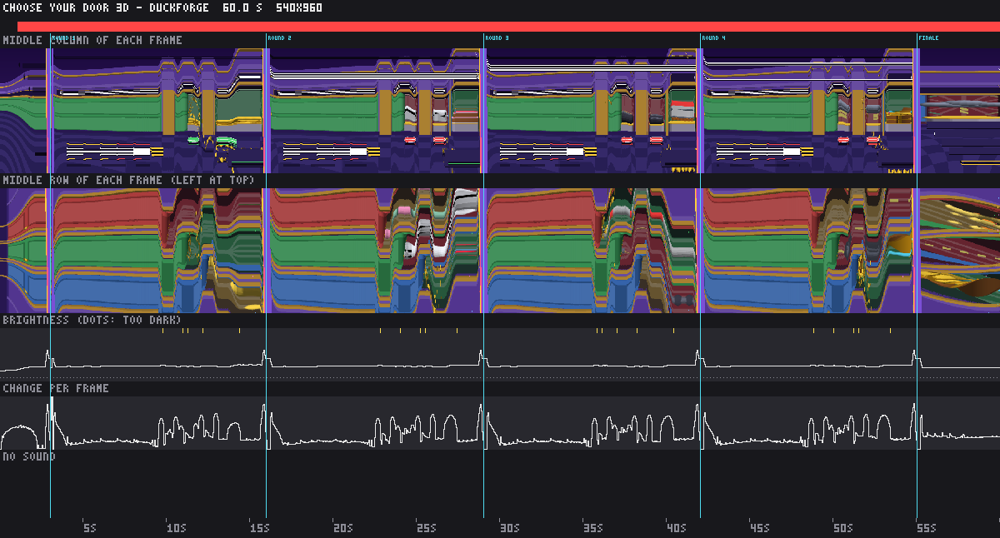
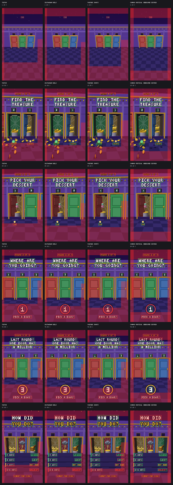
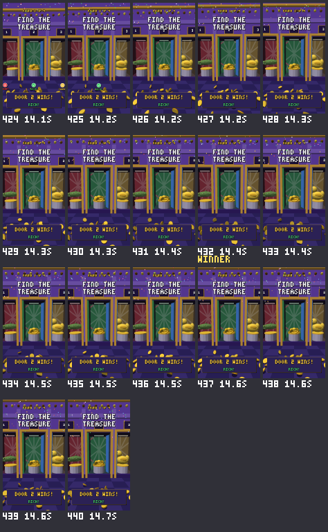

# Review mode: checking a render the way a viewer sees it

You can't watch a video or hear it. `--review` turns a run into what you
can read (numbers, words and still pictures) and checks it the way a
viewer would see it, on the phone, TV or monitor they'd see it on. The
reference is [AI_GUIDE.md, section 16](AI_GUIDE.md#16-review-a-render);
this page is a worked example.

## The door show, reviewed

`examples/door_show_3d.rs` is a one-minute vertical game show (540 x 960,
30 frames a second), made for YouTube Shorts and TikTok. It tells the
review what it means:

- `ctx.place("round 2")` at each round, so the camera's jump there is a cut;
- `ctx.event("door 1 opens")`, `ctx.event("coins")` and `ctx.event("winner")`;
- `ctx.intend("jolt for a bad door", 0.5)` and `ctx.intend("whip pan to
  the next round", ...)`, so that shaking and that fast turn are meant;
- `canvas.label_model("door 1", ...)` and `canvas.label_model("winning prize", ...)`;
- three expectations in `init`: the winning prize fills at least 6% of the
  height and is lit when "winner" happens, and the captions at 7.5 s and
  57 s are readable on every vertical app.

```text
cargo run --release --example door_show_3d -- --headless --review --frames 1800 --out show
```

The render and the review together took 26 seconds; the review itself
1.2 seconds. The start of `show/review/review.txt` (all of it is in
[review/door_show_3d-review.txt](review/door_show_3d-review.txt)):

```text
Review of Choose Your Door 3D - duckforge: 60.0 s, 540x960, 30 frames a second
Judged as seen on: TikTok, Instagram Reels, YouTube Shorts, common vertical (900x1400 centred)
50 flagged, 0 warnings, 1 notes. Reviewed in 1.2 s.

Expectations: 1 of 3 passed
  FAIL  at 7.50 s, the text on screen is readable on every matching profile: at 7.50 s: "ROUND 1 OF 4" is under
        TikTok's, Instagram Reels', YouTube Shorts' and common vertical (900x1400 centred)'s top edge; ...
  pass  when "winner", "winning prize" on screen, at least 6% of the height, lit above 0.15

Worst first:
  FLAG    3.07-15.97 s  text covered: "ROUND 1 OF 4" is under Instagram Reels', TikTok's, YouTube Shorts' and common
                        vertical (900x1400 centred)'s top edge  [film-04-text-covered-3.1s.png]
  FLAG     4.03-5.43 s  text covered: "PICK A DOOR!" is under Instagram Reels', TikTok's, YouTube Shorts' and common
                        vertical (900x1400 centred)'s bottom edge (again at 6.1, 8.2, 17.0, 18.7, 20.7, 30.0, 31.2,
                        33.3 s and 4 more times)  [film-05-text-covered-4.0s.png]
  ...
```

**What it found.** The show was laid out on the whole 540 x 960 frame,
before anyone checked what the apps draw over it: the round title sits
under every app's top bar, and "PICK A DOOR!", the countdown and the
reactions ("CHOMP!", "RICH!") sit where TikTok, Reels and Shorts put the
caption, the account name and the buttons. Every text is readable (no
contrast flags: the dark copies drawn round each word are recognised as
an outline), big enough, and the winning prize is big and lit when it
wins. The camera is clean: the jump into each round is marked as a place,
and the jolts and whip pans are marked as meant. To fix the layout, move
the captions into the common 900 x 1400 middle (the red boxes in
`viewer.png` would turn green).

**What it doesn't know.** The film has no sound of its own (its sounds
are added afterwards from `cues.json`), so the sound checks have nothing
to say.



`overview.png`: each round is the same shape (the blue lines are the
places), the change per frame jumps at each door, and the red bar along
the top is where text is covered.



`viewer.png`: each caption moment as each app shows it. Red is what the
app covers; each text is boxed green (fine) or red (not).



`event-05-winner-14.4s.png`: every frame round the "winner" event, the
event's frame captioned.

## A video made anywhere else

```text
cargo run --release --bin duckforge -- review any.mp4
```

reads the frames and sound with ffmpeg and checks what pixels and sound
alone can show: frozen stretches, flicker, cuts, very dark or blown-out
stretches, silences and loudness, with the same pictures. Text, camera,
events and expectations need the engine's truth, so they're left out.

## Profiles

What each app covers is in `review_profiles/*.toml`. The numbers are
approximate and sources disagree (TikTok's bottom margin is given as 480
to 660 px, YouTube Shorts' as 270 to 672 px), so each file says where its
numbers came from and when they were checked. Edit them, or add your own
and pass `--profiles DIR`.
